# 지금까지 구현된 흐름 (2026-10-18, main `f10fdd7` 기준)

기획서(`docs/planning/production-flow.md`)의 생산 흐름이 **지금 main 코드로 어떻게 돌아가는지**를 처음부터 끝까지, 코드 수준까지 정리한 문서다.

- **구현됨 (처음부터 끝까지):** 주문 → 차량별 생산 건 → 부품 예약 → (부족하면 구매 담당이 부족 부품을 보고 발주 → 입고 → 재예약) → 작업지시 발행 → 공정 진행 (로봇 공정은 가상 설비가 자동, 사람 공정은 작업자 입력) → 검사 양품 → VIN 발행·생산 완료 → 부품 사용·완성차 재고·부품 LOT 기록 → 출고
- **언제든 일어나는 것도 구현됨:** 고객 취소(프레스 배정 전까지), 설비 고장·정지(다른 설비로 재배정), 설비 재시작·보고 유실(시간 초과로 되돌려 재배정), 흐름이 멈출 만한 데이터 문제(차를 취소로 끝냄)
- **화면용:** 주문·제품·부품 재고·완성차·LOT 목록과 조회, 역할별 권한 (ADMIN 은 계정 발급만)
- **아직 없음:** 14장 (열린 이슈는 없다. 구매·출고 보완, 목록 검색은 필요할 때 다시 연다. DLQ 재처리 도구)

반영된 PR: #81(문서 정리·차량 단위 생산), #85(MES 작업지시·공정·실적·설비·배정), #87(고객 번호를 요청 본문으로), #89(배정 실패 차가 뒤를 막지 않게), #91(프레스 대기 제거), #92(VIN·생산 완료), #94(설비 고장 = 재배정, FAILED 제거), #96(구매·입고), #97(simulator + 배정 스케줄러 켜기), #98(주문 취소·주문 상세), #99(출고), #100(부품 LOT ↔ VIN), #102(목록·조회 API), #109(멈추던 흐름을 취소로 끝내기), #110(simulator 재시작·배정 회차), #112(완료 보고 시간 초과), #113(역할별 권한), #115(자동 구매 제거 → 구매 담당이 직접 구매), #119·#122(주문 상태에서 부품 대기 제거 → 접수), #120(ADMIN 은 계정 발급만, WORKER 를 PRODUCTION 으로 합침), #121(모든 재고에 LOT, 초기 재고 LOT)

> 그림은 원본 문서의 다이어그램을 보고 mermaid 로 옮긴 것이다.

## 목차

1. [한눈에 보기](#1-한눈에-보기)
2. [업무 흐름 (비즈니스 관점)](#2-업무-흐름-비즈니스-관점): 누가 무엇을 하는가, 고객이 보는 상태, 역할과 권한
3. [서비스 사이의 공통 장치](#3-서비스-사이의-공통-장치): HTTP, 이벤트, Outbox, 중복 방지, 재시도·DLQ, 동시 변경, traceId, 권한
4. [이벤트 목록과 큐](#4-이벤트-목록과-큐)
5. [테이블 (서비스별, 컬럼·제약까지)](#5-테이블-서비스별)
6. [상태값과 전이](#6-상태값과-전이)
7. [전체 흐름: 예시 주문 하나를 끝까지 따라가기](#7-전체-흐름-예시-주문-하나를-끝까지-따라가기) (단계별 테이블 모습)
8. [로봇 공정 배정 알고리즘 자세히](#8-로봇-공정-배정-알고리즘-자세히) (시간 초과, 배정 회차 포함)
9. [API 목록](#9-api-목록) (요청·응답 예시, 오류, 권한)
10. [오류 코드 전체](#10-오류-코드-전체)
11. [설정값](#11-설정값)
12. [로그로 보는 흐름](#12-로그로-보는-흐름)
13. [상황별 시나리오 (S1~S87)](#13-상황별-시나리오)
14. [아직 없는 것과 알려진 빈틈](#14-아직-없는-것과-알려진-빈틈)
15. [코드 읽는 순서, 관련 명세](#15-코드-읽는-순서-관련-명세)

---

## 1. 한눈에 보기

### 1.1 서비스와 역할

| 서비스 | 역할 | 지금 하는 일 | DB |
|---|---|---|---|
| gateway | 바깥 요청을 각 서비스로 보냄, 로그인(JWT)·권한 확인 | `/api/orders/**` → order, `/api/production/**` → production, `/api/inventory/**` → inventory, `/api/purchases/**` → purchase, `/api/auth/**` → auth. `/api` 를 떼고(StripPrefix=1) 넘긴다. 클라이언트가 보낸 `X-User-*` 헤더는 모두 지우고, 검증한 JWT 의 sub(직원 public_id)로 `X-User-Id` 만 다시 채운다. **쓰기 요청은 JWT 의 role 로 막는다** (2.4, 3.10). 요청마다 traceId 를 새로 만든다 | 없음 |
| auth | 직원 계정, 로그인, JWT 발급 | 관리자가 계정을 발급(메일로 활성화 링크) → 직원이 비밀번호를 정해 활성화 → 로그인하면 Access(JWT, RS256) + Refresh(httpOnly 쿠키). 공개키(`/internal/jwks`)를 gateway 에 준다 | auth_db + Redis |
| order | 주문 | 주문 생성·목록·상세·취소 요청, 차량·품목·주문 상태 보관, 생산 완료·출고 반영 | order_db |
| production | ERP 생산 계획 + MES | 제품·BOM·제품 목록, 생산 건(차량 1대), 작업지시·공정·실적, 설비·설비 상태 이력, 로봇 공정 배정 스케줄러, VIN 발행, 취소 판단 | production_db |
| inventory | 부품·완성차 재고 | 차량 1대분 부품 예약·대기 줄, 부족 부품 조회, 입고 반영·재예약, 예약 해제, 부품 사용 처리, 완성차 재고·출고, 부품 LOT 부여·LOT ↔ VIN 기록, 재고 조회 | inventory_db |
| purchase | 구매·입고 | 구매 담당이 부족 부품을 보고 부품·수량·공급업체를 넣어 발주(구매 건 = 발주), 입고, 입고 알림. 부품은 inventory 에 동기로 확인 | purchase_db |
| simulator | 가상 설비 (DB 없음, 메모리) | 설비 10대를 흉내 낸다. 로봇 공정 배정을 받아 시작·완료(가끔 불량)를 보고하고, 설비 상태(가동·정지·고장)를 보낸다. 시작할 때 모든 설비 상태를 알린다 | 없음 |

### 1.2 흐름 한 장 요약

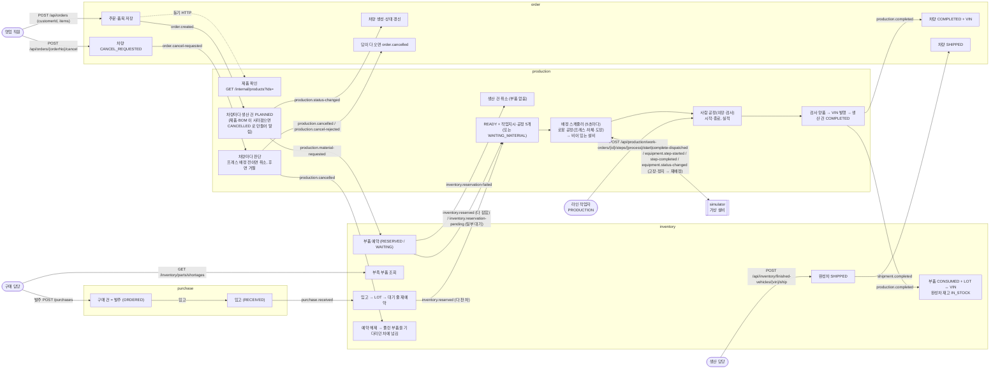

### 1.3 단위

- 주문(customer_order) 하나에 품목(order_item) 여러 개 (제품마다 한 줄, 수량 포함. 같은 제품을 두 줄로 넣을 수 없다)
- 품목의 수량만큼 차량이 생긴다. **차량 1대 = production 의 생산 건(production) 1건 = order 의 order_vehicle 1건**
- 생산 건 1건마다: 부품 예약 요청 1번(material-requested), 작업지시(work_order) 1건, 공정(work_order_step) 5개, 완성되면 VIN 1개와 완성차 재고(finished_vehicle) 1줄
- 공정 하나를 끝낼 때마다 실적(production_result) 1줄 (불량 재작업이면 같은 공정에 여러 줄)
- 부품: 생산 건 × 부품 = 예약 줄(part_reservation) 1줄. 입고 한 번 = LOT(part_lot) 1줄. 차가 완성되면 쓴 부품마다 LOT 사용 기록(part_lot_usage) 1줄 이상
- 구매: 구매 담당이 넣는 구매 건(purchase) 하나 = 부품 하나의 발주 한 번. 수량은 담당자가 정한다 (부족분보다 많이 살 수 있음)

예: "아반떼 2대 + 싼타페 1대" 주문 → 품목 2줄 → 차량(생산 건) 3대 → 부품 예약 요청 3번 → 작업지시 3건 → 공정 15개 → VIN 3개, 완성차 재고 3줄

### 1.4 개발용 기본 데이터

| 서비스 | 데이터 |
|---|---|
| production `db/seed-dev/R__dev_seed.sql` (dev 만) | 현대자동차 30종 (아반떼 id 1, 아반떼 하이브리드, 아반떼 N, 쏘나타, 그랜저, 캐스퍼, 코나, 투싼, 싼타페 id 16, 팰리세이드, 아이오닉 5/6/9, 넥쏘, 스타리아, 포터 II …). ST1, 엑시언트 수소전기트럭은 BOM 이 없다 (주문하면 404 BOM_NOT_FOUND, 제품 목록에도 안 나옴) |
| inventory `db/seed-dev/R__dev_seed.sql` (dev 만) | 부품 18종, id 1001~1018 고정 (엔진·하이브리드·EV·수소 파워트레인, 변속기, 타이어 16/18/20, 시트, 차체 3종, ECU). 재고 50~2000. LOT 이 없는 재고다 (6.8) |
| production V4 마이그레이션 (모든 환경) | 설비 10대: 공정마다 2대, 모두 RUNNING |
| purchase V3 마이그레이션 (모든 환경) | 공급업체 3곳: 현대모비스, 한국타이어, 현대트랜시스 |
| auth | 첫 관리자(ADMIN) 1명은 DB 에 직접 넣는다 (발급할 사람이 없으므로). 그 뒤 계정은 관리자가 발급 |

예: 아반떼 BOM = 가솔린 엔진 1.6(1001)×1, 8단 자동변속기(1009)×1, 타이어 16인치(1011)×4, 세단 차체(1015)×1, 시트 세트(1014)×1, ECU(1018)×1

---

## 2. 업무 흐름 (비즈니스 관점)

시스템 이야기를 빼고, 자동차 공장에서 사람과 부서가 무엇을 하는지로 먼저 본다. 각 단계 끝의 "시스템에서는" 은 그 일을 하는 코드다.

### 2.1 등장하는 사람과 부서

| 누구 | 역할(role) | 하는 일 | 시스템 |
|---|---|---|---|
| 고객 | 없음 (로그인하지 않음) | 차를 주문한다 | 고객 번호(customerId)로 식별된다 |
| 영업·주문 담당 | SALES | 고객 주문을 대신 입력하고, 진행 상황을 알려 주고, 취소를 요청한다 | order 서비스 |
| 생산관리 (ERP) | PRODUCTION | 주문을 차량 단위 생산 계획으로 바꾸고 부품을 계산한다 (BOM 전개, 시스템이 자동). 공정 수동 개입, 완성차 출고 | production 의 생산 건 |
| 자재·창고 | (출고는 PRODUCTION) | 부품 재고를 관리하고 생산에 쓸 부품을 확보(예약)한다. 모자라면 구매를 요청한다 (시스템이 자동) | inventory 서비스 |
| 구매 | PURCHASE | 부족 부품을 보고 공급업체에 발주(부품·수량·공급업체)하고, 들어오면 입고 처리한다 | purchase 서비스 |
| 현장관리 (MES) | PRODUCTION | 부품이 다 확보된 차에 작업지시를 내리고, 로봇 공정을 설비에 배정하고(시스템이 자동), 공정 진행과 실적을 관리한다 | production 의 작업지시·공정·실적·배정 스케줄러 |
| 라인 작업자 | PRODUCTION (#118 에서 WORKER 를 합침) | 사람 공정(의장·검사)을 하고 시작·종료와 양품·불량을 입력한다. 설비 연동이 안 될 때는 로봇 공정도 대신 진행한다 | 작업자 API (`/api/production/work-orders`) |
| 설비 (로봇) | 없음 | 프레스기, 용접·도장 로봇. MES 의 배정을 받아 작업하고 시작·완료·양품/불량을 보고한다. 가동·정지·고장 상태도 보낸다 | simulator |
| 관리자 | ADMIN | 직원 계정을 발급한다. 계정 발급만 한다 (업무 조회·쓰기 불가, #118) | auth, gateway |

### 2.2 업무 단계

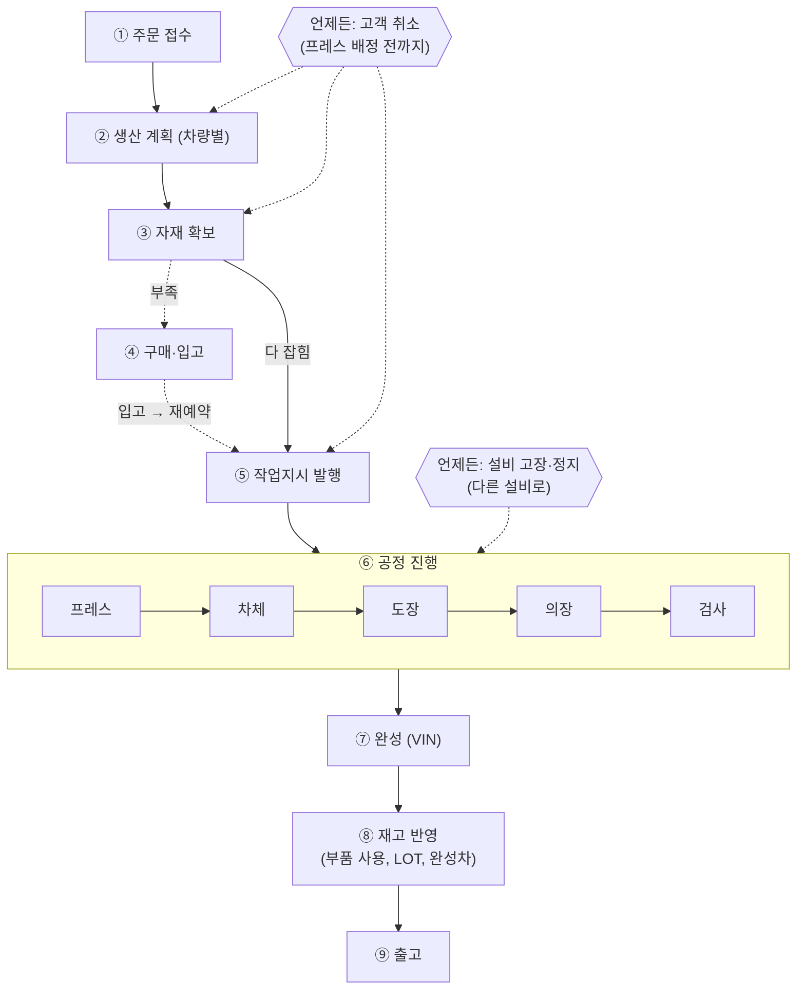

✅ 모두 구현됨

#### ① 주문 접수

- 고객이 전화·매장에서 "아반떼 2대, 싼타페 1대" 를 주문하면, 로그인한 **영업 직원(SALES)**이 고객 번호와 함께 입력한다
- 직원은 제품 목록(`GET /api/production/products`)에서 고를 수 있는 차를 본다. 삭제되지 않았고 부품 구성(BOM)이 있는 차만 나온다
- 고객 번호는 요청 본문(customerId)으로 받는다. 로그인한 사람은 직원이고 고객이 아니므로, 로그인 정보(`X-User-Id`)를 고객 번호로 쓰지 않는다 (#86, #87)
- 접수할 때 팔 수 있는 차인지 바로 확인한다: 카탈로그에 있는 제품인가, BOM 이 등록돼 있는가. 하나라도 안 되면 그 자리에서 주문 전체를 거절한다 (주문 자체가 안 생김)
- 주문에는 그 시점의 제품 코드·이름을 복사해서 남긴다 (스냅샷). 나중에 제품 이름이 바뀌어도 고객의 주문 내역은 그대로다
- 고객에게 주문 번호(UUID)를 준다. 내부 번호(id)는 밖으로 내보내지 않는다 (목록의 다음 페이지도 주문 번호로 이어 받는다)
- 고객이 보는 상태: **접수(RECEIVED)**
- 시스템에서는: `OrderController.create` → `OrderService.create`(트랜잭션 밖에서 production 에 제품 확인) → `OrderWriter.save`(한 트랜잭션에 저장 + order.created)

#### ② 생산 계획: 주문을 차량 단위로

- 생산은 차 한 대 단위로 관리한다. 차마다 차대번호(VIN)가 붙고, 취소도 차마다 판단하기 때문이다
- "아반떼 2대" 는 생산 건 2건(seq 1, 2), "싼타페 1대" 는 1건이 된다
- 차 한 대마다 BOM 으로 필요한 부품을 계산해서 자재 쪽에 "이 차에 쓸 부품을 잡아 달라" 고 요청한다
- 주문 쪽에도 "차 3대가 생겼다" 고 알려서, 주문 쪽이 차량별 진행 상황을 갖게 한다
- 주문 뒤에 그 제품이나 BOM 이 지워졌으면 (주문 접수와 계획 사이에 관리자가 삭제) 그 수량만큼 차를 처음부터 취소된 상태로 만들어 주문 쪽에 알린다. 부품은 요청하지 않는다. 고객에게 그 품목은 "취소" 로 보이고, 다른 품목은 그대로 진행한다 (#103)
- 시스템에서는: `OrderEventListener.onOrderCreated` → `ProductionService.planAll` → `planVehicles` (PLANNED, material-requested, status-changed(PLANNED)) 또는 `rejectVehicles` (CANCELLED, status-changed(CANCELLED))

#### ③ 자재 확보 (부품 예약)

- 자재 쪽은 차 한 대분 부품을 부품마다 확인한다
  - 재고가 있고 앞에 기다리는 차가 없으면 그 부품을 이 차 몫으로 잡아 둔다 (**RESERVED**). 다른 차가 못 쓴다
  - 재고가 모자라거나 먼저 기다리는 차가 있으면 줄을 세운다 (**WAITING**). 재고가 있어도 새치기하지 않는다 (먼저 주문한 차가 먼저)
- 부족은 따로 알리지 않는다. 구매 담당이 **부족 부품 조회**(기다리는 수량 − 재고)로 그때그때 본다 (#114)
- 차 한 대의 결과를 생산 쪽에 알린다: 부품 다 잡힘 또는 일부 기다림
- BOM 에 있는 부품이 재고 목록에 아예 없으면 (삭제됐거나 잘못 등록) 아무것도 잡지 않고 "예약할 수 없음" 을 알린다. 생산 쪽은 그 차를 취소한다 (#103)
- 주의: 일부 부품만 잡혀도 잡힌 부품은 그 차 몫으로 남는다 (다른 차가 못 씀)
- 시스템에서는: `ProductionEventListener.onMaterialRequested` → `PartReservationService.reserve` → inventory.reserved / inventory.reservation-pending / inventory.reservation-failed

#### ④ 구매·입고

- **구매 담당(PURCHASE)**이 부족 부품 조회(`GET /api/inventory/parts/shortages`)를 본다: 기다리는 수량이 재고보다 많은 부품과 부족 수량, 기다리는 차 수. 이미 발주한 수량은 빼지 않으므로 발주 중 구매 목록(ORDERED)과 함께 본다
- 담당자가 부품·수량·공급업체를 넣어 구매 건을 만들면 그대로 **발주(ORDERED)** 다. 수량은 부족분보다 많이 살 수 있다. 부품은 inventory 에 확인해 코드·이름을 남기고, 발주한 직원도 남긴다
- 시스템이 구매 건을 자동으로 만들지 않는다 (#114 에서 자동 구매와 inventory.shortage 를 없앴다. 사람이 수량·공급업체·시점을 판단)
- 부품이 들어오면 **입고** 처리한다 (RECEIVED). 구매 건 전체를 한 번에 입고한다 (부분 입고 없음)
- 입고되면 창고 재고가 늘고, 그 입고에 **LOT 번호**가 붙는다 (`LOT-{입고일}-{구매 건 번호}`)
- 그 부품을 기다리던 차들에게 **먼저 기다린 순서대로** 부품을 넘긴다. 앞 차의 수량이 안 차면 거기서 멈춘다 (뒤의 작은 줄이 들어갈 수 있어도 새치기하지 않음). 어떤 차의 부품이 모두 잡히면 ③의 "다 잡힘" 과 같은 알림이 나간다
- 그때까지 그 차(생산 건)는 **부품 대기(WAITING_MATERIAL)** 에 머문다. 고객에게는 **접수**로 보인다 (#117). 며칠 걸릴 수 있어서 자동으로 취소하지 않는다
- 시스템에서는: inventory `PartController.findShortages` → `PartService.findShortages` / purchase `PurchaseController.create` → `PurchaseService.create`(트랜잭션 밖에서 PartClient 로 부품 확인) → `PurchaseWriter.save` / 입고 `PurchaseService.receive` → purchase.received → inventory `PurchaseEventListener.onReceived` → `PartReservationService.receive`

#### ⑤ 작업지시 발행

- 부품이 다 잡힌 차만 생산에 들어간다. **"부품 확보 완료" 가 생산 착수의 신호**다 (기획서: 생산의 트리거)
- 현장관리는 그 차에 작업지시서 1장을 내린다. 작업지시서에는 공정 5개가 순서대로 적혀 있다: **프레스 → 차체(용접) → 도장 → 의장(조립) → 검사**
- 차의 상태는 생산 준비(READY), 고객에게는 **생산 중**으로 보인다
- 아직은 취소할 수 있다 (프레스 배정 전). 다만 다음 배정 주기(5초)에 프레스가 배정되므로 이 틈은 몇 초뿐이다
- 시스템에서는: `InventoryEventListener.onReserved` → `ProductionService.markReserved` → `releaseWorkOrder` (작업지시 RELEASED, 공정 5개 PENDING)

#### ⑥ 공정 진행 (혼합 자동화)

공정 5개 중 앞의 3개는 로봇이, 뒤의 2개는 사람이 한다. 실제 자동차 공장과 같다.

**로봇 공정 (프레스 → 차체 → 도장): 시스템이 자동으로**

- 현장관리 시스템(MES)이 **5초마다** 라인을 둘러보고, "앞 공정이 끝난 차" 를 "비어 있고 돌아가는 설비" 에 **먼저 나온 작업지시부터** 배정한다
  - 프레스도 작업지시가 나오자마자 배정한다 (기다리지 않는다, #90). 그래서 부품이 다 잡힌 차는 몇 초 안에 취소할 수 없게 된다
- 설비는 배정을 받아 작업을 시작했다고 보고하고, 끝나면 양품·불량을 보고한다 (가상 설비 simulator 가 프레스 3초, 차체 4초, 도장 5초, 불량 5%로 흉내 낸다)
- 불량이면 실적만 남기고 같은 공정을 다시 배정한다 (재작업)
- 설비가 **정지·고장**이면 그 설비에는 배정하지 않는다. 그 설비에 배정됐거나 작업 중이던 차는 **다른 설비로 다시 배정**된다 (생산 실패는 없다, #93)
- 설비가 배정을 잊거나(재시작) 보고가 사라지면 **시간이 지난 뒤 되돌려 다시 배정**한다: 시작 보고가 1분 안에 없을 때, 시작 뒤 완료 보고가 5분 안에 없을 때 (#74, #111)
- 다시 배정할 때마다 **배정 회차**가 올라, 지난 배정에서 늦게 온 보고는 무시된다 (#104)
- 어떤 차가 배정에 계속 실패해도 뒤의 차는 막히지 않는다. 그 차는 다음 바퀴에 다시 본다 (#88, #89)

**사람 공정 (의장 → 검사): 작업자가 입력**

- 작업자(역할 PRODUCTION)가 단말에서 할 일 목록을 보고, "이 차의 의장을 의장 라인 1호에서 시작" 을 입력한다
  - 순서를 건너뛸 수 없다 (앞 공정이 끝나야 다음 공정)
  - 그 공정용 설비여야 하고, 돌아가는 중이고, 다른 차를 작업 중이 아니어야 한다
- 끝나면 결과를 입력한다: 양품이면 다음 공정, 불량이면 사유를 적고 같은 공정을 다시 한다
- 작업자가 하는 공정은 오래 걸려도 시스템이 되돌리지 않는다

**공통**

- 누가(사람이면 작업자, 로봇이면 설비), 언제, 어느 설비에서, 결과가 무엇이었는지 모두 실적으로 남는다 (추적성)
- **프레스가 설비에 배정되는 순간이 "되돌릴 수 없는 시점"** 이다. 배정이 곧 생산 순서 확정이고, 이후에는 고객이 취소할 수 없다
- 설비 하나는 한 번에 차 한 대만 맡는다
- 설비 연동이 안 될 때는 작업자가 로봇 공정도 같은 작업자 API 로 대신 진행할 수 있다 (수동 개입)
- 설비 상태가 바뀔 때마다 이력이 남는다 (가동률 계산용)
- 시스템에서는: 로봇 공정 `LineDispatchScheduler` → `LineDispatcher` → `WorkOrderService.dispatch` / 설비 보고 `SimulatorEventListener` → `WorkOrderService.reportStepStarted`·`reportStepCompleted` / 설비 상태 `EquipmentService.changeStatus` / 사람 공정 `WorkOrderController` → `WorkOrderService.startStep`·`completeStep` / 첫 시작 때 `ProductionService.startProduction`

#### ⑦ 완성 (VIN)

- 검사를 양품으로 끝내면(작업자든 설비 보고든) 그 차는 완성이다
- **차대번호(VIN, 17자)**를 발행한다: KMH + 제품 번호 5자리 + 체크 자리 + 연식 + 공장 U + 작업지시 번호 6자리 (예: `KMH000013TU000012`)
- 작업지시·차가 **완료(COMPLETED)** 가 되고, 자재 쪽과 주문 쪽에 "이 차가 완성됐다(VIN)" 고 알린다
- 제품 번호가 5자리, 작업지시 번호가 6자리를 넘으면 VIN 을 만들 수 없어 완료를 거절한다 (VIN_RANGE_EXCEEDED, #103)
- 시스템에서는: `WorkOrderService.finishStep` → `completeWorkOrder` → `Vin.issue` → `ProductionService.completeProduction` → production.completed

#### ⑧ 재고 반영 (부품 사용, LOT, 완성차)

- 자재 쪽은 그 차에 잡아 둔 부품을 **사용(CONSUMED)** 으로 처리한다 (잡아 둔 수량이 줄고, 바로 쓸 수 있는 수량은 그대로)
- 쓴 부품이 **어느 LOT 에서 나왔는지** 기록한다: LOT 이 없는 옛 재고부터, 그다음 먼저 들어온 LOT 부터 (FIFO). 한 부품이 LOT 두 개에 걸칠 수 있다 (#76)
- 완성차 재고에 한 대를 넣는다 (창고에 있음 IN_STOCK)
- 주문 쪽은 차를 **생산 완료**로 바꾸고 VIN 을 기록한다. 모든 차가 완료면 주문도 "생산 완료"
- 나중에 불량 부품이 나오면: VIN 으로 쓰인 LOT 을, LOT 으로 그 LOT 이 들어간 차를 찾는다 (리콜 대상)
- 시스템에서는: inventory `ProductionEventListener.onProductionCompleted` → `FinishedVehicleService.stock` / order `ProductionEventListener.onProductionCompleted` → `OrderVehicleService.complete`

#### ⑨ 출고

- **생산 담당(PRODUCTION)**이 완성차 목록에서 창고에 있는 차를 골라 VIN 으로 한 대씩 출고한다
- 완성차 재고는 출고됨(SHIPPED) 이 되고, 주문 쪽에 알린다. 주문의 그 차는 "출고", 모두 출고되면 주문도 "출고"
- 주문의 차를 나눠서 출고할 수 있다 (일부만 출고된 주문은 "생산 완료")
- 시스템에서는: `FinishedVehicleController.ship` → `FinishedVehicleService.ship` → shipment.completed → order `InventoryEventListener.onShipmentCompleted` → `OrderVehicleService.ship`

#### 언제든 일어날 수 있는 것

- **고객 취소** (#75): 영업 직원이 주문 취소를 요청하면 차마다 판단한다. 프레스 배정 전이면 취소(잡아 둔 부품을 돌려놓고, 그 부품을 기다리던 다른 차에 넘김), 이미 배정됐으면 거절(원래 상태로 돌아감). 일부 차만 취소될 수 있다. 답이 다 오면 "이번 요청으로 취소된 차가 있다" 고 한 번 알린다
- **설비 고장·정지** (#93): 그 설비에 배정됐거나 작업 중이던 공정만 "시작 전" 으로 되돌려 다른 설비로 다시 진행한다. 차·주문 상태는 그대로 (늦어질 뿐)
- **설비 재시작·보고 유실** (#104, #111): 설비 상태를 설비 기준으로 다시 맞추고, 멈춘 공정은 시간 초과로 되돌려 다시 배정한다
- **데이터 문제로 차가 멈출 상황** (#103): 주문 뒤 제품 삭제, BOM 의 부품이 없음 → 차를 취소로 끝낸다

### 2.3 고객이 보는 상태

주문 화면의 상태는 차량들 → 품목 → 주문 순서로 요약된 값이다 (6.11 의 요약 규칙).

| 표시 (order 상태) | 업무상 뜻 | 차량이 이 상태가 되는 때 |
|---|---|---|
| 접수 (RECEIVED) | 주문은 받았고 아직 생산 시작 전 (부품을 기다리는 중도 포함) | 주문 직후, 생산 건이 막 생겼을 때 (PLANNED), 부품이 모자라 입고를 기다릴 때 (production WAITING_MATERIAL) |
| 생산 중 (IN_PRODUCTION) | 부품 확보, 작업지시가 나왔거나 공정 진행 중 | 예약 결과 "다 잡힘" 이후 (READY, IN_PROGRESS) |
| 생산 완료 (COMPLETED) | VIN 발행 | production.completed |
| 출고 (SHIPPED) | 출고됨 | shipment.completed |
| 취소 요청 (CANCEL_REQUESTED) | 고객이 취소를 요청, 차마다 답을 기다림 | 취소 요청 API |
| 취소 (CANCELLED) | 취소됨 | production.cancelled, 또는 처음부터 취소된 생산 건(status-changed(CANCELLED)) |

한 주문에 차가 여러 대면 가장 앞선 진행 상황이 보인다. 예: 아반떼 1대 생산 중 + 싼타페 1대 부품 기다림(접수) → 주문은 "생산 중". 취소된 차는 빼고 본다. 부품 대기는 공장 안 사정이라 고객에게 따로 보이지 않는다 (#117). production 의 생산 건은 WAITING_MATERIAL 을 그대로 가진다. 생산 실패(FAILED)는 없다. 설비 고장은 다른 설비로 돌려 이어서 만든다 (#93).

### 2.4 역할과 권한 (#107, #118)

- 역할: **SALES, PURCHASE, PRODUCTION, ADMIN** (WORKER 는 #118 에서 PRODUCTION 으로 합침. 차이가 출고 하나뿐이었다)
- **조회(GET)는 업무 역할(SALES, PURCHASE, PRODUCTION)**. 사내 ERP 라 현황을 함께 본다
- **쓰기는 아래 표의 역할만**. 표에 없는 요청은 아무도 못 한다 (새 API 는 표에 넣어야 열린다)
- **ADMIN 은 계정 발급만** (`/api/auth/admin/**`). 업무 조회·쓰기는 403
- 확인은 gateway 한 곳에서 JWT 의 role 로 한다. 뒤 서비스는 다시 확인하지 않는다
- 테스트용으로 권한을 푸는 설정은 없다. local 이든 배포 환경이든 같은 규칙이다 (2026-10-17 결정)

| 요청 | 하는 일 | 허용 역할 |
|---|---|---|
| `POST /api/orders` | 주문 생성 | SALES |
| `POST /api/orders/{orderNo}/cancel` | 주문 취소 요청 | SALES |
| `POST /api/production/work-orders/{id}/steps/{process}/start` | 공정 시작 | PRODUCTION |
| `POST /api/production/work-orders/{id}/steps/{process}/complete` | 공정 종료·실적 | PRODUCTION |
| `POST /api/purchases` | 구매 건 만들기 = 발주 | PURCHASE |
| `POST /api/purchases/{id}/receive` | 입고 | PURCHASE |
| `POST /api/inventory/finished-vehicles/{vin}/ship` | 완성차 출고 | PRODUCTION |
| `/api/auth/admin/**` | 계정 발급 | ADMIN |
| 그 밖의 GET | 조회 | SALES, PURCHASE, PRODUCTION |
| 그 밖의 요청 | 표에 없는 요청 | 아무도 못 함 (403, denyAll) |
| 로그인·활성화·재발급·로그아웃, health | 공개 | 누구나 (토큰을 읽지 않음) |

---

## 3. 서비스 사이의 공통 장치

### 3.1 동기 호출과 비동기 이벤트

| 방식 | 언제 | 지금 쓰는 곳 |
|---|---|---|
| 동기 HTTP (`client/`, HTTP Interface + RestClient) | 바로 답이 필요한 확인 | order → production `GET /internal/products?ids=1,16` (주문 생성 때 제품·BOM 확인), purchase → inventory `GET /internal/parts?ids=1012` (구매 건 만들 때 부품 확인·스냅샷). 연결·읽기 시간 제한 3초 |
| 비동기 이벤트 (RabbitMQ) | 서비스 사이 업무 흐름 (SAGA) | 그 밖의 모든 것 |

- 내부 API(`/internal/**`)는 gateway 에 노출하지 않고(라우트 없음), Swagger 어노테이션도 없고, `springdoc.paths-to-exclude` 로 api-docs 에서도 뺀다. 지금 내부 API: production `GET /internal/products`, inventory `GET /internal/parts`, auth `GET /internal/jwks`, simulator `/internal/simulator/equipments/**`
- 다른 서비스를 부르는 동안 DB 커넥션을 잡지 않도록, 호출은 `{도메인}Service` 에서 트랜잭션 밖에 끝내고 저장은 `{도메인}Writer` 의 `@Transactional` 메서드로 뺀다 (예: OrderService → OrderWriter, PurchaseService → PurchaseWriter)
- client 호출 실패·시간 초과·비정상 응답은 client 의 default 메서드에서 `{상대 서비스}_UNAVAILABLE(503)` 으로 바꾼다 (`ProductClient.findProducts` → PRODUCTION_UNAVAILABLE, `PartClient.findParts` → INVENTORY_UNAVAILABLE)

### 3.2 HTTP 응답 모양 (common-web)

성공

```json
{ "data": { ... }, "status": 201, "message": "..." }
```

실패 (공통 핸들러 `GlobalExceptionHandler`, gateway 가 직접 만드는 401·403·404·5xx 도 같은 모양)

```json
{ "code": "PRODUCT_NOT_FOUND", "message": "주문한 제품을 찾을 수 없습니다." }
```

- 서비스가 던지는 예외는 모두 `CustomException(에러코드)` 다. 에러코드가 HTTP 상태를 정한다 (10장)
- 요청 형식 오류(Bean Validation)는 공통 핸들러가 400 으로, 첫 위반 메시지를 message 에 넣는다
- 목록 응답은 두 가지다
  - `CursorPage { items, count, last, nextCursor }` (id 커서, 오래된 것 먼저): 작업지시 목록, 구매 목록
  - `{ items, count, last, nextOrderNo }` / `{ items, count, last, nextVin }` (식별자 커서, 최신 먼저): 주문 목록, 완성차 목록. 화면은 마지막으로 받은 orderNo·VIN 만 넘기고, 서버가 그 값을 내부 id 로 바꿔 `id < 그 id` 로 읽는다 (내부 id 를 밖에 내보내지 않으려고, #101)
  - 둘 다 size+1 개를 읽어 하나가 남으면 다음 페이지가 있다고 본다
- 모든 응답에 `X-Trace-Id` 헤더가 하나 붙는다 (gateway 가 만든 값)

### 3.3 RabbitMQ 구조

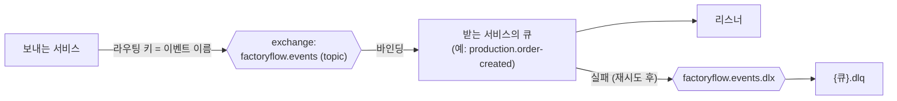

- 보내는 쪽은 큐를 모른다. 이벤트 이름(예: `order.created`)을 라우팅 키로 exchange 에 던진다
- 받는 쪽이 자기 큐를 만들어 그 라우팅 키로 exchange 에 묶는다 (각 서비스 `config/EventQueueConfig`)
- 큐 이름 규칙: `{받는 서비스}.{이벤트를 줄인 이름}` (예: `production.order-created`)
- 큐마다 이벤트 하나를 받는 데 필요한 네 가지를 한 묶음으로 만든다: 큐(실패하면 dead letter exchange 로), 이벤트 → 큐 연결, `{큐}.dlq`, dead letter 연결
- 받는 쪽이 없는 이벤트는 exchange 에 던져지지만 묶인 큐가 없어 버려진다. 지금은 `order.cancelled` 하나뿐이다 (이후 알림 기능의 자리)

### 3.4 이벤트 메시지 모양 (EventEnvelope)

```jsonc
{
  "eventId": "5b1e2c9a-…",           // 이벤트 하나의 고유 id (중복 처리 방지에 씀)
  "eventName": "order.created",       // 라우팅 키와 같다
  "traceId": "a9f3d0e1-…",            // 한 흐름을 로그에서 묶는 id
  "version": 1,
  "occurredAt": "2026-10-17T09:00:00Z",
  "payload": { "orderId": 10, "products": [ { "productId": 1, "qty": 2 } ] }
}
```

- payload 의 Java 타입은 `event/publisher/payload/`(보내는 쪽)와 `event/listener/payload/`(받는 쪽)에 서비스마다 따로 둔다. 서비스끼리 클래스를 공유하지 않는다 (JSON 계약만 공유)
- payload 이름은 과거형 (예: OrderCreated, ReservationFailed, ShipmentCompleted)
- 계약의 원본은 `docs/specs/events.md` (사람만 수정). 바꿀 때는 필드 추가만 (version 그대로). 예: production.cancel-rejected 에 status, purchase.received 에 purchaseId, shipment.completed 에 productId, 배정·설비 보고 세 이벤트에 dispatchSeq 를 더했다. 이벤트를 없앤 적도 있다: production.failed(#93), inventory.shortage(#114)
- simulator 는 common-event 를 쓰지 않고 이 JSON 모양만 맞춘다 (3.5)

### 3.5 보내기: Outbox (common-event `EventPublisher`, `OutboxRelay`)

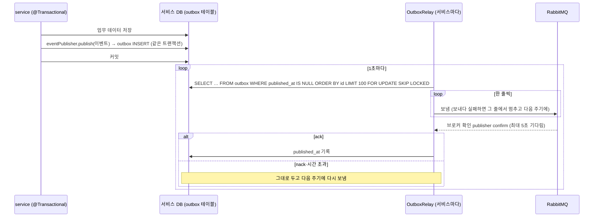

- 왜: "DB 는 저장됐는데 이벤트는 안 나감" / "이벤트는 나갔는데 DB 는 롤백" 이 생기지 않게 하려고
- 결과적으로 **적어도 한 번(at-least-once)** 보낸다. 같은 이벤트가 두 번 갈 수 있으므로 받는 쪽이 중복을 거른다 (3.6)
- `FOR UPDATE SKIP LOCKED`: 같은 서비스가 여러 대 떠 있어도 한 줄을 두 인스턴스가 동시에 보내지 않는다
- 발행은 service 계층에서만 한다 (ArchUnit)
- 이벤트 발행(outbox INSERT)은 JPA 의 자동 flush 를 일으킨다. 그래서 낙관적 락 충돌을 409 로 바꾸려면 발행 전에 직접 flush 한다 (3.8, `flushOrConflict`)
- traceId 는 MDC 의 traceId 를 쓴다. 없으면 새로 만든다 (3.9)

**simulator 는 예외 (DB 가 없다, 2026-10-16 결정)**

- 진짜 설비처럼 MES 의 DB 를 갖지 않는다. 함께 저장할 업무 데이터가 없어 Outbox 가 필요 없다
- `EquipmentEventPublisher` 가 RabbitMQ 로 바로 보내고, 브로커 확인을 받을 때까지 메모리(`PendingMessages`)에 두었다가 resend-interval(1초)마다 같은 eventId 로 다시 보낸다
- 재시작하면 확인 못 받은 메시지는 사라진다. production 의 시간 초과가 그 공정을 되돌린다 (8.7)
- ArchUnit 의 "발행은 Outbox 로만", "리스너는 ProcessedEventGuard" 규칙에서 simulator 를 뺐다

### 3.6 받기: ProcessedEventGuard

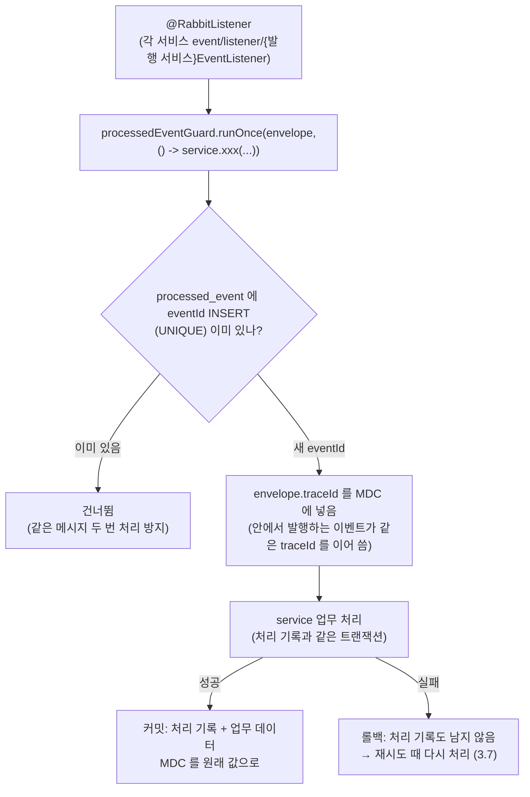

- 리스너는 반드시 `ProcessedEventGuard.runOnce(envelope)` 를 부른다 (ArchUnit). 리스너 클래스 이름은 보낸 서비스 이름 (예: order 의 `InventoryEventListener` 는 inventory 가 보낸 shipment.completed 를 받음)
- eventId 가 다른 "같은 내용" 의 재발행은 Guard 가 못 거른다. 그래서 각 service 가 **업무 키로 한 번 더** 거른다
  - 이미 생산 건이 있는 주문·제품, 이미 예약 줄이 있는 생산 건, 이미 있는 작업지시, 이미 있는 완성차(생산 건 UNIQUE), 이미 입고 이력이 있는 구매 건, 상태가 이미 바뀐 차량·생산 건·설비
- simulator 는 받은 eventId 를 메모리(`SeenEvents`, 최근 10000개)로 거른다

### 3.7 실패: 재시도와 DLQ

- 처리 중 예외 → 트랜잭션 전체 롤백 (처리 기록 포함) → **1s, 2s, 4s 간격으로 최대 3번** 다시 처리 (`spring.rabbitmq.listener.simple.retry`, 최대 간격 10s)
- 그래도 실패하면 `EVENT_DEAD_LETTERED queue=… eventId=… reason=…` ERROR 로그 후 `{큐}.dlq` 에 원본 그대로 보관
- JSON 이 깨진 메시지도 같다 (재시도 후 DLQ)
- DLQ 의 메시지를 다시 넣는 도구는 아직 없다. 사람이 원인을 고친 뒤 RabbitMQ 관리 화면에서 옮긴다
- DLQ 로 가는 경우는 "정상 흐름에서는 생기지 않는" 데이터 꼬임만 남겼다 (없는 생산 건·품목, 품목 수량 초과, 예약 줄 없는 완료 등). 업무상 일어날 수 있는 문제(제품 삭제, 부품 없음)는 #103 에서 차를 취소로 끝내도록 바꿨다

### 3.8 동시 변경: 낙관적 락 (@Version)

| 엔티티 | 무엇을 막나 | 방법 |
|---|---|---|
| inventory `part` | 같은 부품을 두 차가 동시에 예약해 새치기·이중 예약, 입고·사용과 예약이 겹침 | 예약·입고 조회에 `OPTIMISTIC_FORCE_INCREMENT`. 값을 안 바꿔도(WAITING) 커밋 때 version 을 올려, 동시에 처리한 쪽이 충돌하고 재시도하게 한다. LOT 남은 수량은 부품과 함께 바뀌므로 부품 version 이 함께 막는다 |
| inventory `finished_vehicle` | 같은 차를 동시에 출고 | `@Version`. 늦은 쪽 409 FINISHED_VEHICLE_CONFLICT |
| production `production` | 같은 차량을 동시에 바꿈 (프레스 배정 vs 취소 수신 등) | `@Version` |
| production `work_order` | 같은 작업지시의 공정을 동시에 바꿈 (두 작업자가 같은 공정 시작, 배정과 작업자 시작이 겹침, 고장 되돌림과 작업자 종료) | `@Version`. 공정이 바뀔 때마다 `step_changed_at` 을 바꿔 작업지시 version 도 오르게 한다 (공정 행에는 version 이 없다) |
| production `equipment` | 같은 설비를 두 차가 동시에 잡음 | `@Version` + `occupied_step_id`. 늦게 커밋한 쪽이 충돌 |
| order `customer_order`, `order_item` | 같은 주문의 차량들이 여러 큐에서 동시에 바뀌어 요약이 꼬임, 취소 요청과 상태 반영이 겹침 | `@Version`. 리스너는 재시도로 최신 상태를 보고 다시 요약, 취소 API 는 409 ORDER_CONFLICT |
| purchase `purchase` | 같은 구매 건을 동시에 입고 | `@Version`. 늦은 쪽 409 PURCHASE_CONFLICT |

- 리스너에서 충돌 → 예외 → 재시도로 최신 상태를 보고 다시 판단
- API 에서 충돌 → `flushOrConflict` 가 409 로 바꿈 (응답 만들기·이벤트 발행 전에 flush)
- 배정 스케줄러에서 충돌 → 그 차를 이번 바퀴에서 빼고 다음 바퀴에 다시 본다 (8장)

### 3.9 traceId (한 흐름을 로그로 따라가기)

- gateway: 요청마다 traceId 를 새로 만든다 (클라이언트가 보낸 `X-Trace-Id` 는 버림). 뒤 서비스로 `X-Trace-Id` 로 넘기고, 모든 응답(gateway 가 만든 오류 포함)에 하나만 붙인다
- 서비스 HTTP 요청: `TraceIdFilter` 가 `X-Trace-Id` 를 MDC 에 넣는다. 없으면 새로 만든다
- 이벤트 발행: MDC 의 traceId 를 envelope 에 넣는다
- 이벤트 수신: envelope 의 traceId 를 MDC 에 넣는다 → 그 안에서 발행하는 이벤트도 같은 traceId
- simulator: 받은 배정의 traceId 를 시작·완료 보고에 이어 쓴다. 상태 이벤트는 새 traceId
- 결과: 주문 생성 요청의 traceId 가 order.created → material-requested → reserved → status-changed … 까지 이어진다
- 끊기는 곳: 배정 스케줄러(요청·메시지가 없음, 바퀴마다 새 traceId), 작업자 API·출고·발주·입고·취소 요청(각 요청의 traceId). 이어 보려면 orderId·productionId·workOrderId·VIN 으로 찾는다

### 3.10 권한 (gateway SecurityConfig)

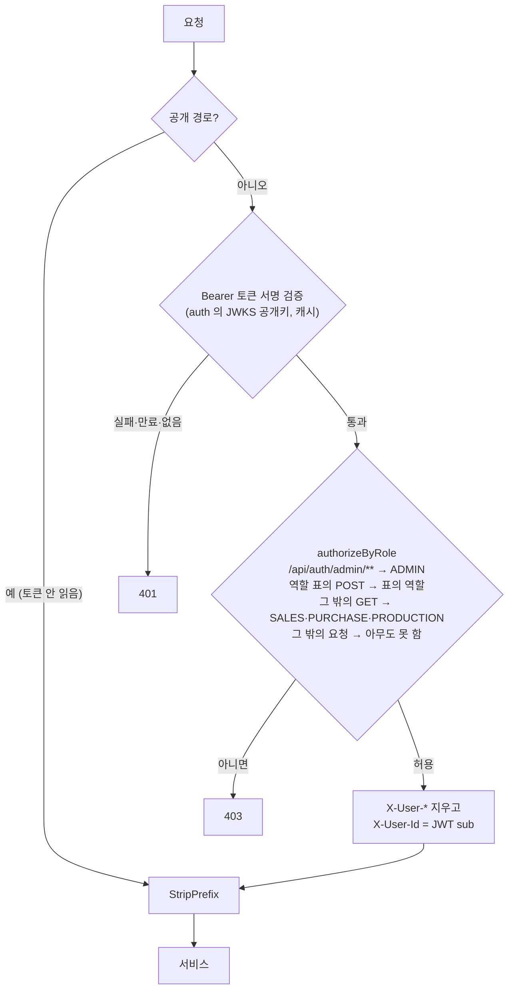

- 경로는 밖 주소(`/api/...`) 기준이다 (StripPrefix 보다 먼저 돈다)
- JWT 의 role 클레임(`"SALES"`)을 권한(`"ROLE_SALES"`)으로 바꿔 본다
- role 은 뒤 서비스로 넘기지 않는다. 서비스는 권한을 다시 확인하지 않는다 (헤더 role 과 JWT role 을 따로 맞출 필요가 없게)

---

## 4. 이벤트 목록과 큐

### 4.1 오가는 이벤트 (`docs/specs/events.md` 와 같음)

| 이벤트 | 보내는 서비스 → 받는 서비스 (큐) | payload | 언제 보내나 |
|---|---|---|---|
| `order.created` | order → production (`production.order-created`) | orderId, products[{productId, qty}] | 주문 저장 (같은 트랜잭션) |
| `order.cancel-requested` | order → production (`production.order-cancel-requested`) | orderId | 취소 요청 API |
| `order.cancelled` | order → 받는 쪽 없음 | orderId | 취소 회차의 답이 다 왔고 이번 회차에 취소된 차가 있을 때 한 번 |
| `production.material-requested` | production → inventory (`inventory.production-material-requested`) | productionId, parts[{partId, qty}] | 생산 건(차량) 생성. 차량 1대분 부품 (qty = BOM 의 qty_per_unit) |
| `production.status-changed` | production → order (`order.production-status-changed`) | orderId, productionId, productId, status | 생산 건 생성(PLANNED, 또는 처음부터 CANCELLED), WAITING_MATERIAL, READY, IN_PROGRESS 로 바뀔 때 |
| `production.step-dispatched` | production → simulator (`simulator.production-step-dispatched`) | workOrderId, process, equipmentCode, dispatchSeq | 로봇 공정을 설비에 배정 |
| `production.cancelled` | production → inventory (`inventory.production-cancelled`), order (`order.production-cancelled`) | orderId, productionId | 취소 승인, 부품 없음으로 취소, 이미 취소된 차에 다시(취소 요청·늦은 예약 완료) |
| `production.cancel-rejected` | production → order (`order.production-cancel-rejected`) | orderId, productionId, reason(ALREADY_STARTED), status | 프레스 배정 뒤라 취소 거절 |
| `production.completed` | production → inventory (`inventory.production-completed`), order (`order.production-completed`) | orderId, productionId, productId, vin | 검사 양품 → VIN 발행 |
| `inventory.reserved` | inventory → production (`production.inventory-reserved`) | productionId | 차량의 부품이 모두 RESERVED (예약 때, 입고 뒤 재예약 때, 취소로 풀린 부품을 넘겨받을 때) |
| `inventory.reservation-pending` | inventory → production (`production.inventory-reservation-pending`) | productionId, shortages[{partId, shortQty}] (WAITING 줄의 부품과 수량) | 차량 부품 중 하나라도 WAITING |
| `inventory.reservation-failed` | inventory → production (`production.inventory-reservation-failed`) | productionId, reason(PART_NOT_FOUND), partIds[] (없는 부품, id 순) | 요청한 부품 중 없거나 삭제된 부품이 있음 |
| `purchase.received` | purchase → inventory (`inventory.purchase-received`) | purchaseId, partId, qty | 입고 API |
| `equipment.step-started` | simulator → production (`production.equipment-step-started`) | equipmentCode, workOrderId, process, dispatchSeq | 설비가 배정받은 공정을 시작 (시작 지연 1초 뒤) |
| `equipment.step-completed` | simulator → production (`production.equipment-step-completed`) | equipmentCode, workOrderId, process, result(GOOD/DEFECT), defectReason, dispatchSeq | 설비가 공정을 끝냄 (작업 시간 뒤) |
| `equipment.status-changed` | simulator → production (`production.equipment-status-changed`) | equipmentCode, process, status(RUNNING/STOPPED/FAULT) | 설비 상태가 바뀜, simulator 가 시작할 때 모든 설비 |
| `shipment.completed` | inventory → order (`order.shipment-completed`) | orderId, productionId, productId, vin | 출고 API |

### 4.2 서비스별 발행·수신 정리

| 서비스 | 보냄 | 받음 |
|---|---|---|
| order | order.created, order.cancel-requested, order.cancelled | production.status-changed, production.cancelled, production.cancel-rejected, production.completed, shipment.completed |
| production | production.material-requested, production.status-changed, production.step-dispatched, production.cancelled, production.cancel-rejected, production.completed | order.created, order.cancel-requested, inventory.reserved, inventory.reservation-pending, inventory.reservation-failed, equipment.step-started, equipment.step-completed, equipment.status-changed |
| inventory | inventory.reserved, inventory.reservation-pending, inventory.reservation-failed, shipment.completed | production.material-requested, production.cancelled, production.completed, purchase.received |
| purchase | purchase.received | 없음 (부족은 조회로 봄, #114) |
| simulator | equipment.step-started, equipment.step-completed, equipment.status-changed (Outbox 없이 바로) | production.step-dispatched (메모리로 중복 거름) |
| auth, gateway | 없음 | 없음 |

### 4.3 한 이벤트를 여러 서비스가 받는 경우

- `production.cancelled` → inventory(예약 해제), order(차량 취소) — 큐가 따로라 처리 순서는 정해지지 않는다
- `production.completed` → inventory(부품 사용·완성차·LOT), order(차량 완료) — 출고(shipment.completed)가 order 의 production.completed 보다 먼저 처리될 수도 있어 order 는 둘 다 받아들인다 (13 S82)

---

## 5. 테이블 (서비스별)

서비스마다 DB 가 따로다. 서비스를 넘는 참조는 FK 가 아니라 id 값만 들고 있다 (논리 참조). 같은 서비스 안에서도 FK 제약은 걸지 않고 주석으로 "논리 FK" 라고 적는다. 대부분의 업무 테이블은 `created_at`, `updated_at`, `is_deleted`(소프트 삭제) 를 갖는다 (BaseEntity). 추가만 하는 이력 테이블은 `created_at` 만. DB 가 있는 서비스는 모두 `outbox`(보낼 이벤트, `published_at` 이 비면 미발행), `processed_event`(받은 이벤트 id, `event_id` UNIQUE) 를 갖는다. 데이터 접근은 Spring Data 메서드 이름 또는 QueryDSL 만 쓴다 (`@Query`, EntityManager 쿼리, JDBC 금지. 예외는 common-event 의 Outbox). 이미 적용된 마이그레이션의 주석(상태 값 목록)은 체크섬 때문에 고치지 않는다. 그래서 옛 주석에 FAILED 가 남아 있지만 코드에는 없다.

### 5.1 order_db

| 테이블 | 한 행의 뜻 | 컬럼 | 제약 |
|---|---|---|---|
| `customer_order` | 주문 1건 | id, order_no(CHAR 36, UUID, 밖으로 내보내는 번호), customer_id, status(품목들의 요약), cancel_requested_at(진행 중인 취소 요청 회차의 시각, 답이 다 오면 NULL, V6), version(V5) | UNIQUE(order_no), INDEX(customer_id), INDEX(status) |
| `order_item` | 주문의 제품 한 줄 | id, order_id, product_id, product_code·product_name(주문 당시 스냅샷), qty, status(차량들의 요약), fail_reason(안 씀), version(V5) | UNIQUE(order_id, product_id), CHECK(qty > 0) |
| `order_vehicle` | 품목 속 차량 1대 = 생산 건 1건 | id, order_id, order_item_id, production_id, vin(생산 완료 때, V5), status, cancelled_at(V6) | UNIQUE(production_id), INDEX(order_item_id) |

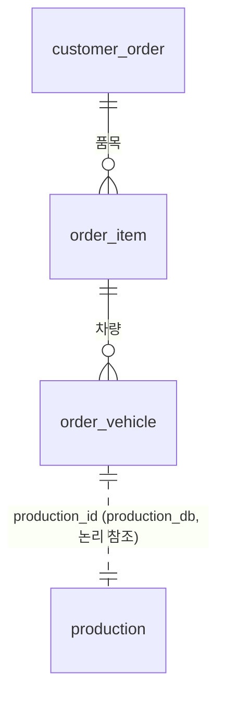

- `order_vehicle` 은 주문 때가 아니라 production.status-changed(PLANNED) 를 받을 때 생긴다 (그래야 production_id 를 안다). 큐가 달라 production.completed·shipment.completed 가 먼저 오면 그때 만든다

### 5.2 production_db

| 테이블 | 한 행의 뜻 | 컬럼 | 제약 |
|---|---|---|---|
| `product` | 완성차 제품 | id, code, name | UNIQUE(code) |
| `bom` | 제품 1대에 드는 부품 | id, product_id, part_id(inventory 의 부품), qty_per_unit | UNIQUE(product_id, part_id), CHECK(qty_per_unit > 0) |
| `production` | 생산 건 = 차량 1대 (SAGA 상태) | id, order_id, product_id, seq(그 주문·제품 안의 차량 번호 1, 2, …), status, started_at(프레스 시작), completed_at, version | UNIQUE(order_id, product_id, seq), CHECK(seq > 0), INDEX(status) |
| `work_order` | 작업지시 (생산 건당 1건) | id, production_id, order_id, product_id, status, vin, released_at, started_at, completed_at, step_changed_at, version | UNIQUE(production_id), UNIQUE(vin)(V5), INDEX(status) |
| `work_order_step` | 작업지시의 공정 (5개) | id, work_order_id, process, seq(1~5), status, equipment_code(배정되었거나 진행 중인 설비), dispatched_at(로봇 배정 시각, 작업자 시작이면 NULL, V7), dispatch_seq(배정 회차, V8), started_at, ended_at | UNIQUE(work_order_id, process), CHECK(seq BETWEEN 1 AND 5), INDEX(process, status) 배정 조회용, INDEX(equipment_code, status), INDEX(status, dispatched_at) 시간 초과용 |
| `production_result` | 공정 실적 (공정을 끝낼 때마다 1줄) | id, work_order_step_id, result(GOOD/DEFECT), defect_reason(DEFECT 일 때만), worker_id(작업자 public_id, 설비 보고면 NULL), equipment_code, started_at, ended_at | INDEX(work_order_step_id). 고치지 않는다 (모든 컬럼 updatable=false) |
| `equipment` | 설비 | id, code(PRESS-01 …, simulator 와 같은 값), name, process, status(RUNNING/STOPPED/FAULT), occupied_step_id(지금 맡은 공정, 비었으면 NULL), version | UNIQUE(code), INDEX(process) |
| `equipment_status_history` | 설비 상태가 바뀐 기록 (추가만, V6) | id, equipment_code, from_status, to_status, changed_at(이벤트가 생긴 시각), created_at | INDEX(equipment_code, changed_at) |

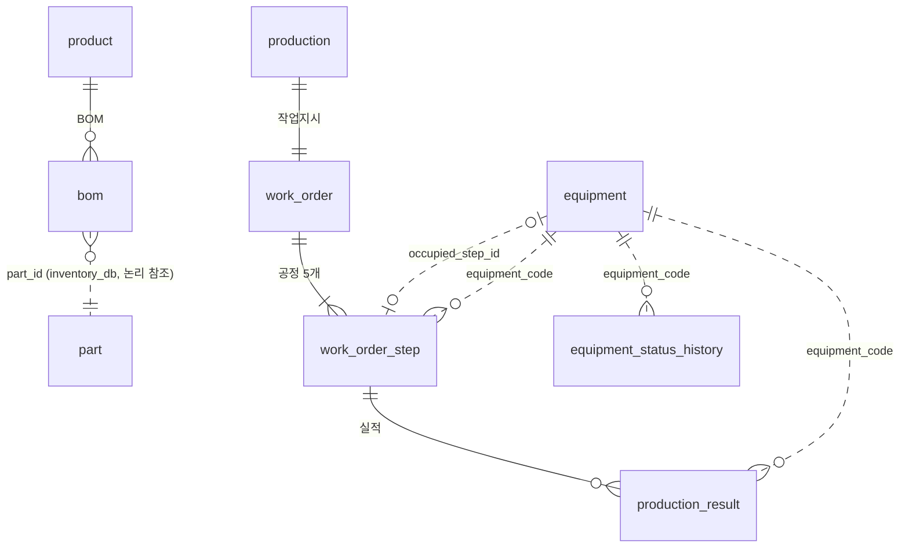

**기본 설비 10대 (V4 마이그레이션, 모두 RUNNING)**

| 공정 | 설비 |
|---|---|
| PRESS | PRESS-01 프레스기 1호, PRESS-02 프레스기 2호 |
| BODY | BODY-01 용접 로봇 1호, BODY-02 용접 로봇 2호 |
| PAINT | PAINT-01 도장 로봇 1호, PAINT-02 도장 로봇 2호 |
| ASSEMBLY | ASSEMBLY-01 의장 라인 1호, ASSEMBLY-02 의장 라인 2호 |
| INSPECTION | INSPECTION-01 검사 라인 1호, INSPECTION-02 검사 라인 2호 |

설비 상태는 simulator 의 equipment.status-changed 로만 바뀐다 (production 에는 상태를 바꾸는 API 가 없다).

### 5.3 inventory_db

| 테이블 | 한 행의 뜻 | 컬럼 | 제약 |
|---|---|---|---|
| `part` | 부품 재고 | id, code, name, unit(EA/SET/KG), available(바로 쓸 수 있는 수량), reserved(생산용으로 잡은 수량), version | UNIQUE(code), CHECK(available ≥ 0), CHECK(reserved ≥ 0) |
| `part_reservation` | 예약 줄: 생산 건 × 부품 | id, production_id, part_id, qty, status(WAITING/RESERVED/RELEASED/CONSUMED) | UNIQUE(production_id, part_id), CHECK(qty > 0), INDEX(status, id) 대기 순서용, INDEX(part_id) |
| `stock_history` | 재고 변동 이력 (추가만) | id, part_id, qty(>0), type(RESERVE/RELEASE/RECEIVE/CONSUME), ref_type(PRODUCTION/PURCHASE), ref_id, created_at | INDEX(part_id, created_at), INDEX(ref_type, ref_id) |
| `finished_vehicle` | 완성차 재고 1대 (V3) | id, vin, production_id, order_id, product_id, status(IN_STOCK/SHIPPED), shipped_at(V4), version(V4) | UNIQUE(vin), UNIQUE(production_id), INDEX(status) |
| `part_lot` | 부품 LOT = 입고 1번, 또는 초기 재고 (V5, V6) | id, part_id, lot_no(VARCHAR 32), purchase_id(초기 재고 LOT 은 NULL, V6), received_qty, remaining_qty(아직 안 쓴 수량), received_at(쓰는 순서) | UNIQUE(lot_no), UNIQUE(purchase_id), INDEX(part_id, id), INDEX(part_id, received_at, id)(V6), CHECK(received_qty > 0), CHECK(0 ≤ remaining_qty ≤ received_qty) |
| `part_lot_usage` | 완성차에 쓰인 부품 LOT (추가만, V5) | id, vin, production_id, part_id, lot_id(V6 부터 NOT NULL), qty, created_at | INDEX(vin), INDEX(lot_id), CHECK(qty > 0) |

**규칙**

- 창고 실물 = available + reserved
- `part.reserved` = 그 부품의 RESERVED 예약 줄 qty 합 (같은 트랜잭션에서 맞춘다)
- 대기 순서 = WAITING 예약 줄의 id 순서
- **모든 재고에 LOT 이 있다** (#116): LOT 남은 수량 합 = 창고 실물. 처음부터 있던 재고는 초기 재고 LOT `LOT-INIT-{부품 id}`
- 이력 type: RESERVE(예약), RELEASE(취소로 해제), RECEIVE(입고, ref PURCHASE), CONSUME(완료로 사용)

### 5.4 purchase_db

| 테이블 | 한 행의 뜻 | 컬럼 | 제약 |
|---|---|---|---|
| `supplier` | 공급업체 | id, name, contact | — (기본 3곳, V3) |
| `purchase` | 구매 건 = 부품 하나의 발주 | id, part_id, part_code·part_name(발주 당시 스냅샷), qty, supplier_id, requested_by(안 씀), ordered_by(발주한 직원 public_id, V4), status(ORDERED/RECEIVED, CANCELLED 는 V4 가 옛 자동 요청을 끝낸 것), source(MANUAL, AUTO 는 옛 자동 요청), ordered_at, received_at, version(V3) | INDEX(part_id, status), INDEX(supplier_id), CHECK(qty > 0) |

### 5.5 auth_db, Redis

| 저장소 | 내용 |
|---|---|
| `user_account` | id, public_id(밖으로 쓰는 직원 번호, JWT sub), email(UNIQUE), password(해시), name, role(SALES/PURCHASE/PRODUCTION/ADMIN, V3 에서 WORKER → PRODUCTION), status(ACTIVE …) |
| `customer` | 고객 (로그인하지 않음) |
| Redis | `auth:activation:{token}`(발급 대기, 24시간), `auth:pending:{email}`, `auth:refresh:{publicId}`(Refresh, 14일, 사용자당 1개), `auth:login-fail:{email}`(실패 횟수, 15분) |

### 5.6 simulator (메모리)

| 무엇 | 내용 |
|---|---|
| 설비 10대 (`VirtualEquipment`) | production 과 같은 코드·공정. 상태(RUNNING/STOPPED/FAULT), 지금 하는 작업(Job: workOrderId, process, traceId, dispatchSeq) 하나, 상태 회차(자동 수리용) |
| 받은 eventId (`SeenEvents`) | 최근 10000개. 같은 배정을 두 번 처리하지 않게 |
| 확인 못 받은 메시지 (`PendingMessages`) | 브로커 확인을 받을 때까지 다시 보냄 |
| 재시작하면 | 모두 사라진다. 설비는 RUNNING, 작업 없음으로 시작하고 모든 설비 상태를 알린다 |

---

## 6. 상태값과 전이

### 6.1 생산 건 (`production.status`) — SAGA 상태

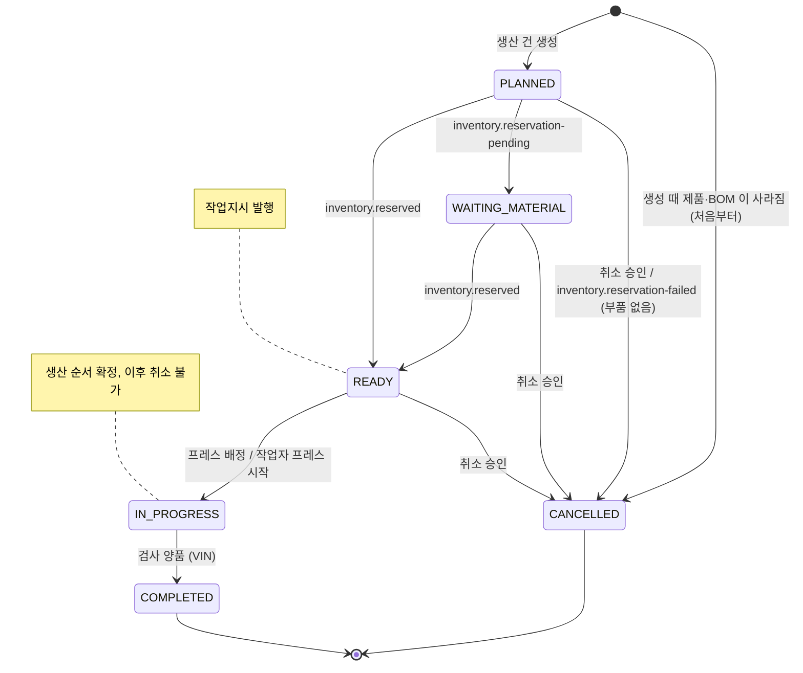

| 상태 | 들어오는 때 | 바꾸는 메서드 | 알림 |
|---|---|---|---|
| PLANNED | 생산 건 생성 | `Production.plan` | status-changed(PLANNED) |
| WAITING_MATERIAL | inventory.reservation-pending (PLANNED 에서만) | `waitForMaterial` | status-changed |
| READY | inventory.reserved (PLANNED 또는 WAITING_MATERIAL 에서) | `markReady` | status-changed |
| IN_PROGRESS | 작업지시의 첫 시작 (READY 에서만) | `start` | status-changed |
| COMPLETED | 검사 양품 (IN_PROGRESS 에서만) | `complete` | production.completed (status-changed 는 따로 안 보냄) |
| CANCELLED | 취소 승인 (프레스 배정 전), 부품 없음 (PLANNED 에서만) | `cancel` | production.cancelled |
| CANCELLED (처음부터) | 주문 뒤 제품·BOM 삭제 | `Production.reject` | status-changed(CANCELLED) |

- 허용되지 않은 상태에서 온 예약 결과는 무시한다 (INFO 로그). 단 CANCELLED 에 예약 완료가 오면 production.cancelled 를 다시 보낸다 (풀게 하려고)
- READY 가 아닌데 첫 시작을 하려 하면 WORK_ORDER_CLOSED(409) 로 거절한다 (예: 취소된 생산 건의 작업지시가 남아 있을 때)
- 검사 양품인데 생산 건이 IN_PROGRESS 가 아니면 409 WORK_ORDER_CLOSED (작업자 API) / 처리 오류 → DLQ (설비 보고)
- FAILED 는 없다 (#93 에서 없앰)

### 6.2 작업지시 (`work_order.status`)

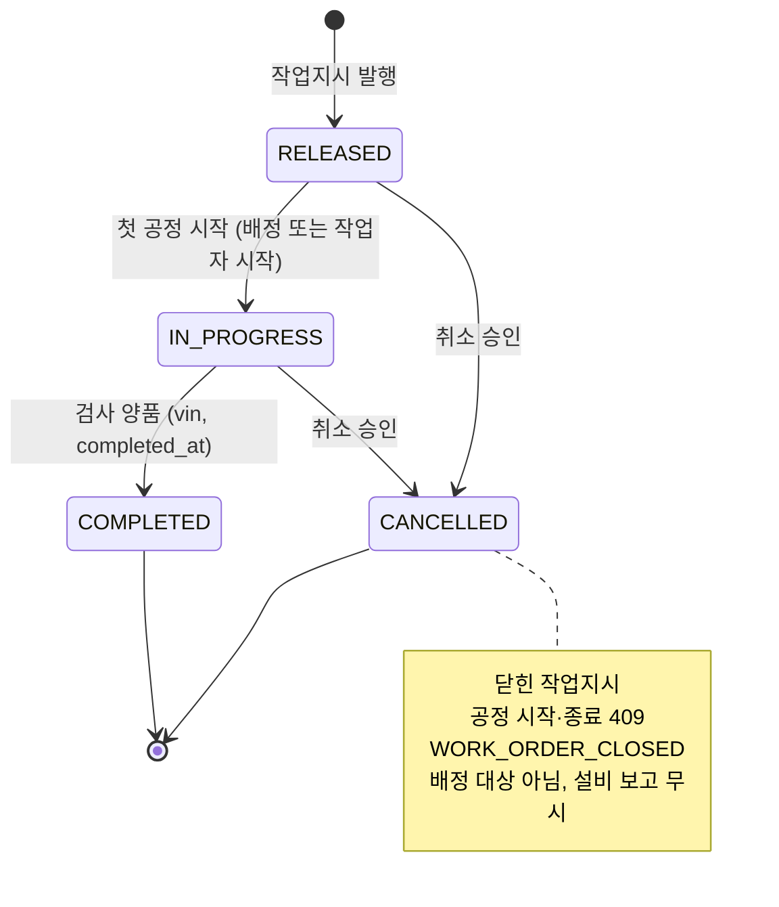

- `WorkOrder.start` 는 RELEASED 에서만 바뀐다. 불량 재작업으로 프레스를 다시 시작해도 다시 바뀌지 않으므로 "생산 시작" 은 한 번만 일어난다
- 취소는 프레스 배정 전에만 승인되므로 실제로 취소되는 작업지시는 RELEASED 다

### 6.3 공정 (`work_order_step.status`)

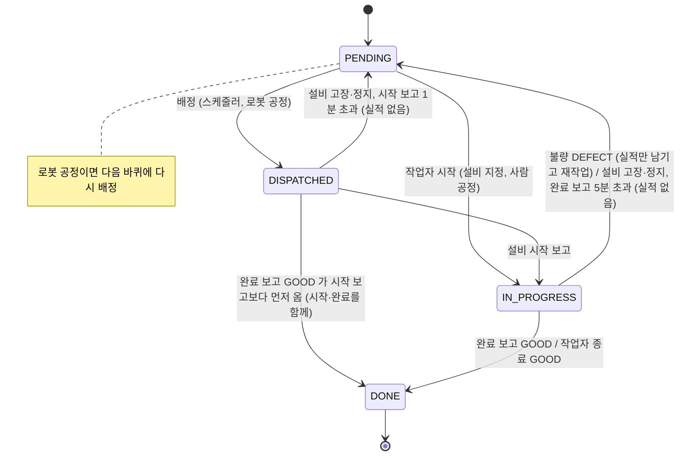

| 전이 | 메서드 | 바뀌는 값 |
|---|---|---|
| PENDING → IN_PROGRESS (작업자) | `WorkOrderStep.start` | equipment_code, started_at, ended_at=NULL, dispatched_at=NULL, dispatch_seq +1 |
| PENDING → DISPATCHED (배정) | `dispatch` | equipment_code, dispatched_at, dispatch_seq +1, started_at=NULL, ended_at=NULL |
| DISPATCHED → IN_PROGRESS (설비 시작 보고) | `startByEquipment` | started_at |
| IN_PROGRESS → DONE (GOOD) | `finish` | ended_at |
| IN_PROGRESS → PENDING (DEFECT) | `finish` | equipment_code=NULL, started_at=NULL |
| DISPATCHED·IN_PROGRESS → PENDING (고장·정지, 시간 초과) | `interrupt` | equipment_code=NULL, started_at=NULL |

- 라우팅 순서 PRESS(1) → BODY(2) → PAINT(3) → ASSEMBLY(4) → INSPECTION(5) (`ProductionProcess` 선언 순서)
- 앞 공정이 모두 DONE 이어야 시작 → 한 작업지시에서 진행 중인 공정은 하나뿐
- 로봇 공정 = PRESS, BODY, PAINT (`ProductionProcess.isAutomated()`), 사람 공정 = ASSEMBLY, INSPECTION
- 작업자는 DISPATCHED 공정을 시작할 수 없다 (설비 보고를 기다림)
- 설비가 진행 중인 공정 = IN_PROGRESS 이고 dispatched_at 이 있음. 작업자가 시작한 공정은 dispatched_at 이 없어 완료 보고 시간 초과 대상이 아니다
- **배정 회차(dispatch_seq)**: 공정을 맡길 때마다 +1. 설비 보고의 dispatchSeq 가 지금 값과 다르면 지난 배정의 보고라 무시 (`isCurrentDispatch`). 보고에 dispatchSeq 가 없으면(이 기능 전 메시지) 설비 코드·상태로만 판단

### 6.4 설비 (`equipment`)

| 값 | 뜻 |
|---|---|
| status RUNNING / STOPPED / FAULT | 가동 / 정지 / 고장. RUNNING 일 때만 배정·시작 가능 |
| occupied_step_id | 맡은 공정. NULL 이면 비어 있음. 배정·작업자 시작 때 채우고(`occupy`), 공정이 끝나거나(양품·불량) 되돌려지면(고장·시간 초과) 비운다(`release`) |

- 설비 하나는 한 번에 공정 하나만 맡는다. "비어 있는 설비" = RUNNING 이고 occupied_step_id 가 NULL
- 상태가 바뀔 때마다 `equipment_status_history` 1줄 (같은 상태로 바뀌면 이력 없음)
- FAULT·STOPPED 가 되면 맡은 공정을 되돌리고 설비를 비운다 (6.3). RUNNING 으로 돌아와도 되돌린 공정을 다시 가져오지 않는다 (배정 스케줄러가 알아서)

### 6.5 부품 예약 줄 (`part_reservation.status`)

| 상태 | 뜻 | 재고 |
|---|---|---|
| RESERVED | 재고를 이 차 몫으로 잡음 | available −qty, reserved +qty, 이력 RESERVE |
| WAITING | 재고 부족 또는 앞에 기다리는 줄이 있음 | 그대로 |
| RELEASED | 취소로 풀림 | RESERVED 였으면 available +qty, reserved −qty, 이력 RELEASE / WAITING 이었으면 그대로 |
| CONSUMED | 생산 완료로 사용됨 | reserved −qty (available 그대로), 이력 CONSUME |

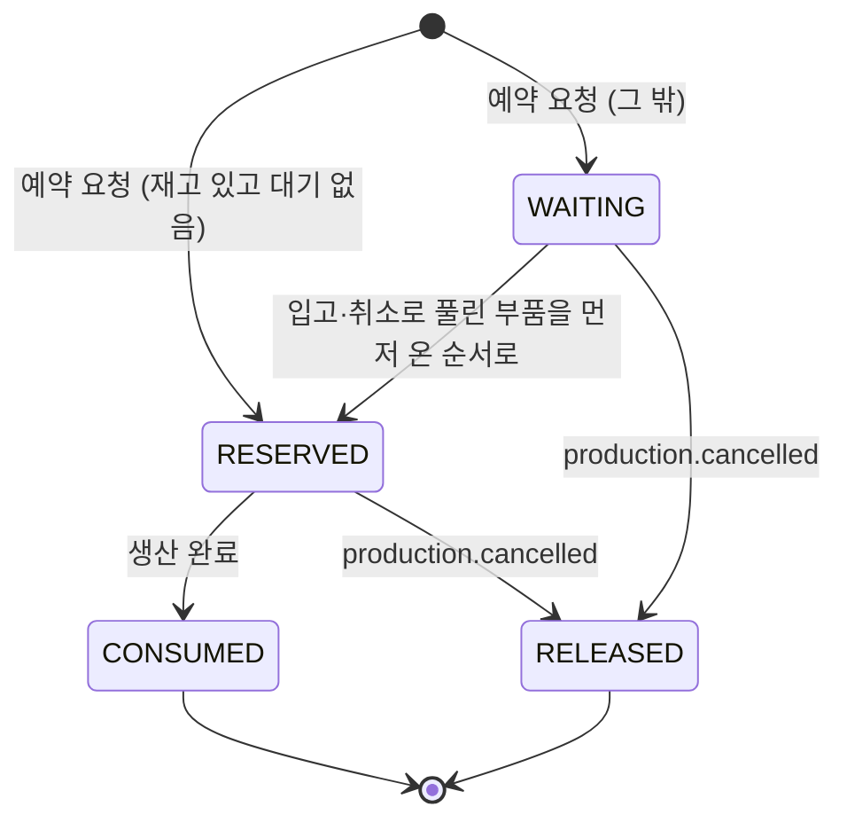

### 6.6 완성차 (`finished_vehicle.status`)

| 상태 | 들어오는 때 |
|---|---|
| IN_STOCK | production.completed 수신 (완성차 재고 1대) |
| SHIPPED | 출고 API (shipped_at 기록, shipment.completed) |

- 출고는 IN_STOCK 에서만. 이미 SHIPPED 면 409 FINISHED_VEHICLE_ALREADY_SHIPPED. 출고 취소(되돌리기)는 없다 (#106)

### 6.7 구매 건 (`purchase.status`)

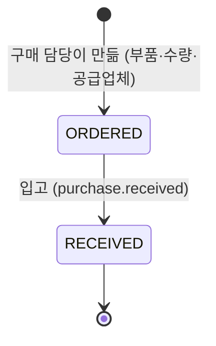

- 만들 때 바로 ORDERED (요청 단계 없음, #114). 입고는 ORDERED 에서만 (아니면 409 INVALID_PURCHASE_STATUS)
- source 는 MANUAL. 자동 구매 시절의 건은 AUTO 로 남아 있고, 발주되지 않았던 자동 요청(REQUESTED)은 V4 에서 CANCELLED 가 됐다
- 구매 취소·부분 입고는 없다 (필요하면 다시 연다)

### 6.8 부품 LOT (`part_lot`)

- 입고 한 번에 LOT 1줄: `lot_no = LOT-{입고일 yyMMdd}-{purchaseId, 6자리가 안 되면 앞을 0 으로}` (예: `LOT-261017-000031`). received_qty = remaining_qty = 입고 수량
- **초기 재고 LOT** (#116, V6): LOT 을 붙이기 전부터 있던 재고는 부품마다 `LOT-INIT-{부품 id}` 하나 (구매 건 없음). 남은 수량 = 실물 − 다른 LOT 남은 수량, 받은 수량 = 남은 수량 + LOT 없이 이미 쓴 수량. LOT 없이 남은 옛 사용 기록도 이 LOT 으로 옮겼다. 입고 시각은 그 부품의 가장 이른 LOT 보다 1초 앞 (LOT 이 없던 부품은 마이그레이션 시각). dev 시드도 시드 부품마다 지금 재고만큼 만든다
- 차가 완성될 때 부품을 쓰는 순서: remaining_qty > 0 인 LOT 을 **입고 순서(received_at, 같으면 id)**로 빼 나간다. 초기 재고 LOT 은 id 가 커도 입고 시각이 가장 앞이라 먼저 쓴다. 뺄 때마다 `part_lot_usage` 1줄
- LOT 이 예약 수량보다 모자라면 실물과 LOT 이 어긋난 데이터라 PART_LOT_SHORTAGE → 롤백, 재시도 후 DLQ (정상 흐름에서는 생기지 않는다)
- 예약 해제(취소)는 실물이 그대로라 LOT 을 바꾸지 않는다
- 어느 LOT 을 썼는지는 **완성 때** 정한다 (예약 때 정하면 취소·재배정마다 LOT 수량도 되돌려야 해서, #76 결정). 그래서 실제 창고에서 꺼낸 LOT 과 다를 수 있다

### 6.9 order 쪽 상태 (`OrderStatus`, 차량·품목·주문이 같은 값을 씀)

RECEIVED, IN_PRODUCTION, COMPLETED, SHIPPED, CANCEL_REQUESTED, CANCELLED (FAILED 없음, WAITING_MATERIAL 은 #117 에서 없앰. 남아 있던 행은 order V7 이 RECEIVED 로 바꿈)

**생산 건 → 차량 매핑** (`OrderVehicleService.vehicleStatusOf`, status-changed·cancel-rejected 에 씀)

| production | order_vehicle |
|---|---|
| PLANNED, WAITING_MATERIAL | RECEIVED (부품 대기는 고객에게 접수로 보임, #117) |
| READY, IN_PROGRESS | IN_PRODUCTION |
| COMPLETED | COMPLETED |
| CANCELLED | CANCELLED |
| 그 밖의 값 (FAILED 포함) | 처리 오류 UNKNOWN_PRODUCTION_STATUS → 재시도 → DLQ |

### 6.10 차량에 반영하는 규칙 (`OrderVehicle`)

| 받은 것 | 메서드 | 규칙 |
|---|---|---|
| status-changed | `applyProductionStatus` | 끝난 차량(COMPLETED, SHIPPED, CANCELLED)은 그대로. 취소 요청 중(CANCEL_REQUESTED)이면 CANCELLED 만 받음. 같은 상태면 그대로 |
| production.completed | `complete(vin)` | 위와 같은 규칙으로 COMPLETED + VIN |
| shipment.completed | `ship(vin)` | SHIPPED·CANCELLED 가 아니면 모두 SHIPPED (생산 완료를 아직 못 받은 차, 취소 요청 중인 차도). VIN 이 비어 있으면 기록 |
| 취소 요청 API | `requestCancel` | CANCELLED 가 아니면 CANCEL_REQUESTED |
| production.cancelled | `cancel(now)` | 위 status-changed 규칙으로 CANCELLED + cancelled_at |
| production.cancel-rejected | `restoreAfterRejection(status)` | CANCEL_REQUESTED 일 때만 거절 때의 상태(매핑 표)로 되돌림 |

- 바뀌었을 때만 품목·주문을 다시 계산한다 (같은 트랜잭션)
- 처음 보는 생산 건이면 그 품목에 차량을 만든다 (status-changed, completed, shipment 모두). 품목 수량을 넘으면 ORDER_VEHICLE_OVERFLOW → DLQ

### 6.11 요약 규칙 (차량들 → 품목, 품목들 → 주문, `OrderStatus.summarize`)

CANCELLED 는 빼고 남은 것으로, 위에서부터 먼저 맞는 것:

1. 남은 것이 없음 → CANCELLED
2. 하나라도 CANCEL_REQUESTED → CANCEL_REQUESTED
3. 모두 SHIPPED → SHIPPED
4. 모두 COMPLETED 또는 SHIPPED → COMPLETED
5. 하나라도 IN_PRODUCTION / COMPLETED / SHIPPED → IN_PRODUCTION
6. 그 외 → RECEIVED

품목 수량보다 아직 알려지지 않은 차량은 RECEIVED 로 보고 계산한다 (`OrderItem.refreshStatus`). 예: 수량 2, 알려진 차 1대 IN_PRODUCTION → [IN_PRODUCTION, RECEIVED] → IN_PRODUCTION.

### 6.12 취소 회차 (`customer_order.cancel_requested_at`)

- 취소 요청 API 가 지금 시각을 넣는다 (회차 시작)
- cancelled / cancel-rejected 를 받을 때마다: CANCEL_REQUESTED 차량이 더 없으면 회차를 끝내고(NULL), 이번 회차에 취소된 차량(cancelled_at ≥ cancel_requested_at)이 하나라도 있으면 order.cancelled 한 번
- 일부 취소 뒤 다시 요청하면 새 회차 (남은 차량만 CANCEL_REQUESTED)

---

## 7. 전체 흐름: 예시 주문 하나를 끝까지 따라가기

**예시 데이터** (숫자를 보기 쉽게 줄였다)

- 제품: 아반떼 A(id 1, BOM: 엔진 1001 × 1, 타이어 1011 × 4), 싼타페 B(id 16, BOM: 엔진 1001 × 1, 타이어 1012 × 6)
- 재고: 엔진 1001 available 10, 타이어 1011 available 8, 타이어 1012 available 3 (B 는 부족). 모두 초기 재고 LOT(`LOT-INIT-{부품 id}`)에 있다
- 주문: 영업 직원이 고객 7 의 A 2대 + B 1대 를 입력
- 날짜: 2026-10-17

### 7.1 주문 생성 (order, 동기)

```http
POST /api/orders
Authorization: Bearer <SALES 직원 JWT>

{ "customerId": 7, "items": [ { "productId": 1, "qty": 2 }, { "productId": 16, "qty": 1 } ] }
```

| 순서 | 클래스 | 하는 일 |
|---|---|---|
| 0 | gateway | JWT 확인, role SALES 확인(아니면 403), `/api` 떼고 order 로. `X-User-*` 지우고 `X-User-Id`(직원) 다시 채움. order 는 이 헤더를 쓰지 않는다 |
| 1 | `OrderController.create` | Bean Validation: customerId 없음·1 미만, 품목 비었음, productId 없음, qty 없음·1 미만, 같은 제품 중복(`@UniqueProductIds`) → 400. production 을 부르기 전에 거절 |
| 2 | `OrderService.create` (트랜잭션 밖) | `ProductClient.findProducts([1, 16])` → production `GET /internal/products?ids=1,16` |
| 3 | production `InternalProductController` → `ProductService` | 삭제되지 않은 제품만, 각 제품에 orderable(삭제되지 않은 BOM 이 있는가) 을 붙여 응답 |
| 4 | `OrderService.create` | 요청한 제품마다: 응답에 없음 → 404 PRODUCT_NOT_FOUND, orderable=false → 404 BOM_NOT_FOUND. production 실패·3초 초과·본문/data 없음 → 503 PRODUCTION_UNAVAILABLE |
| 5 | `OrderWriter.save` (트랜잭션) | customer_order(RECEIVED, order_no=UUID) + order_item 2줄(스냅샷, RECEIVED) 저장 + order.created outbox |
| 6 | 응답 | 201 `{ data: { orderNo: "…" } }` (내부 id 는 응답에 없음) |

결과

```text
customer_order #10  order_no 3f2a…  customer 7  RECEIVED  version 0
order_item #1 (A, AVANTE/아반떼, qty 2, RECEIVED)   order_item #2 (B, SANTAFE/싼타페, qty 1, RECEIVED)
outbox: order.created { orderId: 10, products: [ {1, 2}, {16, 1} ] }   (traceId T)
```

### 7.2 차량별 생산 건 (production ← order.created)

`OrderEventListener.onOrderCreated` → `ProcessedEventGuard.runOnce` → `ProductionService.planAll`

| 순서 | 하는 일 |
|---|---|
| 1 | 같은 제품 줄은 수량 합치기 (`mergeByProductId`), 수량 < 1 이면 처리 오류 INVALID_ORDER_QTY |
| 2 | 한 번씩 조회 (제품 수와 상관없이 쿼리 3번): 이미 만든 생산 건(`plannedProductIds`), 있는 제품(`existingProductIds`), BOM(`bomsByProductId`) |
| 3 | 제품마다: 이미 있음 → 건너뜀(INFO) / 제품이나 BOM 이 사라짐(`rejectReason`) → `rejectVehicles`: 수량만큼 CANCELLED 생산 건 + status-changed(CANCELLED), ERROR SAGA_REJECTED (13 S8) / 그 밖 → `planVehicles` |
| 4 | `planVehicles`: 수량만큼 반복 — 생산 건 저장(PLANNED, seq) → material-requested(차량 1대분 부품) → status-changed(PLANNED) |

결과

```text
production #101 (order 10, A, seq 1, PLANNED, version 0)
production #102 (order 10, A, seq 2, PLANNED)
production #103 (order 10, B, seq 1, PLANNED)
outbox: material-requested ×3  {101: [1001×1, 1011×4]}, {102: [1001×1, 1011×4]}, {103: [1001×1, 1012×6]}
        status-changed ×3      {10, 101, 1, PLANNED}, {10, 102, 1, PLANNED}, {10, 103, 16, PLANNED}
processed_event: order.created 의 eventId
```

### 7.3 order 가 차량을 알게 됨 (order ← production.status-changed PLANNED)

`ProductionEventListener.onStatusChanged` → `OrderVehicleService.applyProductionStatus`

1. PLANNED → 차량 상태 RECEIVED 로 매핑
2. (orderId, productId) 로 품목을 찾는다 (없으면 ORDER_ITEM_NOT_FOUND → DLQ)
3. productionId 로 차량을 찾는다. 처음 보는 생산 건이면 그 품목에 차량을 만든다 (품목 수량을 넘으면 ORDER_VEHICLE_OVERFLOW → DLQ)
4. 차량 상태가 바뀌었으면 품목 요약 → 주문 요약

결과

```text
order_vehicle (item 1, production 101, RECEIVED), (item 1, production 102, RECEIVED), (item 2, production 103, RECEIVED)
품목·주문 모두 RECEIVED
```

### 7.4 부품 예약 (inventory ← production.material-requested)

`ProductionEventListener.onMaterialRequested` → `PartReservationService.reserve`

차량 하나씩 (메시지 하나씩, 각각 따로 트랜잭션) 처리한다.

| 순서 | 하는 일 |
|---|---|
| 1 | 이 생산 건의 예약 줄이 이미 있으면 건너뜀 (eventId 만 다른 재발행 방지) |
| 2 | 같은 부품 줄 합치기, partId 순서로 정렬 (TreeMap) |
| 3 | 부품을 한 번에 읽음 (OPTIMISTIC_FORCE_INCREMENT). 없거나 삭제된 부품이 있으면 아무것도 잡지 않고 inventory.reservation-failed {productionId, PART_NOT_FOUND, 없는 partIds} 후 끝 (13 S18) |
| 4 | 부품별 WAITING qty 합을 한 번에 읽음 |
| 5 | 부품마다: 대기 줄 없고 available ≥ qty → RESERVED(available −, reserved +, 이력 RESERVE) / 아니면 WAITING (재고 그대로) |
| 6 | 차량 결과 1건: 모두 RESERVED → inventory.reserved, 아니면 inventory.reservation-pending (WAITING 줄 목록) |

부족은 이벤트로 보내지 않는다. 부족 부품 조회가 그때그때 계산한다 (`PartService.findShortages`, QueryDSL 로 부품별 WAITING 합계)

```text
shortQty = 그 부품의 WAITING qty 합 − available   (0 보다 크면 부족 부품)
```

예시 결과 (메시지가 101 → 102 → 103 순서로 처리됐다고 가정)

```text
#101 (A): 엔진 RESERVED (10→9),  타이어1011 RESERVED (8→4)   → inventory.reserved {101}
#102 (A): 엔진 RESERVED (9→8),   타이어1011 RESERVED (4→0)   → inventory.reserved {102}
#103 (B): 엔진 RESERVED (8→7),   타이어1012 WAITING (3 < 6)
                                                              → inventory.reservation-pending {103, [{1012, 6}]}
부족 부품 조회: 타이어 1012 waitingQty 6, available 3, shortQty 3, waitingProductions 1
```

테이블 모습

```text
part 1001  available 7  reserved 3  version +3
part 1011  available 0  reserved 8
part 1012  available 3  reserved 0          (WAITING 은 재고를 건드리지 않음)
part_reservation  (101,1001,1,RESERVED) (101,1011,4,RESERVED) (102,1001,1,RESERVED) (102,1011,4,RESERVED)
                  (103,1001,1,RESERVED) (103,1012,6,WAITING)
stock_history     RESERVE ×5 (ref PRODUCTION 101/102/103)
```

### 7.5 예약 결과 반영 + 작업지시 발행 (production ← inventory.*)

```text
InventoryEventListener.onReserved           → ProductionService.markReserved
InventoryEventListener.onReservationPending → ProductionService.markWaitingForMaterial
```

**markReserved (#101, #102)**

1. 생산 건이 없으면 PRODUCTION_NOT_FOUND → DLQ
2. 취소된 생산 건(CANCELLED)이면 production.cancelled 다시 보내고 끝 (늦은 예약을 풀게)
3. PLANNED/WAITING_MATERIAL 이 아니면 무시 (INFO)
4. READY 로 바꿈
5. `releaseWorkOrder`: 작업지시가 이미 있으면 건너뜀, 없으면 작업지시 1건(RELEASED, released_at=지금) + 공정 5개(PENDING, 라우팅 순서)
6. status-changed(READY)

**markWaitingForMaterial (#103)**: PLANNED 면 WAITING_MATERIAL + status-changed(WAITING_MATERIAL). 작업지시는 만들지 않는다.

결과

```text
production #101 READY  → work_order #12 RELEASED (released_at 09:00:05)
                         steps: PRESS(1) BODY(2) PAINT(3) ASSEMBLY(4) INSPECTION(5) 모두 PENDING, dispatch_seq 0
production #102 READY  → work_order #13 RELEASED, steps ×5
production #103 WAITING_MATERIAL  (7.7 에서 입고되면 READY + 작업지시)
outbox: status-changed {101, READY}, {102, READY}, {103, WAITING_MATERIAL}
```

### 7.6 order 상태 갱신 (order ← status-changed)

```text
차량 101 IN_PRODUCTION  → 품목 1(A): [IN_PRODUCTION, RECEIVED] → IN_PRODUCTION → 주문: [IN_PRODUCTION, RECEIVED] → IN_PRODUCTION
차량 102 IN_PRODUCTION  → 품목 1(A): [IN_PRODUCTION, IN_PRODUCTION] → IN_PRODUCTION (주문 그대로)
차량 103 RECEIVED (생산 건 WAITING_MATERIAL) → 품목 2(B): RECEIVED → 주문: [IN_PRODUCTION, RECEIVED] → IN_PRODUCTION
```

고객은 주문 "생산 중", 품목 A "생산 중", 품목 B "접수" 로 본다 (부품 대기는 따로 보이지 않음, #117).

### 7.7 구매·입고 (구매 담당 → purchase, inventory ← purchase.received)

구매 담당 (PURCHASE 직원)이 부족을 보고 발주

```text
GET  /api/inventory/parts/shortages             → [ {1012, TIRE-18, 타이어 18인치, available 3, waitingQty 6, shortQty 3, waitingProductions 1} ]
GET  /api/purchases?status=ORDERED              → 발주 중인 타이어 18인치가 없음 (있으면 그만큼 덜 사도 됨)
GET  /api/purchases/suppliers                   → 현대모비스, 한국타이어, 현대트랜시스
POST /api/purchases  { "partId": 1012, "qty": 3, "supplierId": 2 }
POST /api/purchases/31/receive                  → #31 RECEIVED (received_at) + purchase.received {31, 1012, 3}
```

**구매 건 만들기** (`PurchaseService.create` → `PurchaseWriter.save`)

| 순서 | 하는 일 |
|---|---|
| 0 | gateway: role PURCHASE·ADMIN 확인, `X-User-Id` 채움 |
| 1 | Bean Validation: partId·qty·supplierId 1 이상, `X-User-Id` 비어 있지 않고 36자 이하 → 아니면 400 (inventory 를 부르기 전) |
| 2 | 트랜잭션 밖: `PartClient.findParts([1012])` → inventory `GET /internal/parts?ids=1012`. 없거나 삭제된 부품 → 404 PART_NOT_FOUND, 실패·3초 초과·비정상 응답 → 503 INVENTORY_UNAVAILABLE |
| 3 | `PurchaseWriter.save` (트랜잭션): 공급업체 확인(없으면 404 SUPPLIER_NOT_FOUND) → 구매 건 저장. 이벤트 없음 |
| 4 | 201 구매 건 |

```text
purchase #31 (1012, TIRE-18, 타이어 18인치(스냅샷), qty 3, supplier 2(한국타이어), ordered_by 6c1e…(직원), MANUAL, ORDERED, ordered_at)
```

**입고 반영** (inventory `PurchaseEventListener.onReceived` → `PartReservationService.receive`, 한 트랜잭션)

| 순서 | 하는 일 |
|---|---|
| 1 | 같은 구매 건의 입고 이력(RECEIVE, ref PURCHASE 31)이 있으면 건너뜀 (재발행) |
| 2 | 부품을 읽음 (OPTIMISTIC_FORCE_INCREMENT). 없으면 PART_NOT_FOUND → DLQ |
| 3 | available +3, 이력 RECEIVE, LOT `LOT-261017-000031` (received 3, remaining 3) |
| 4 | 그 부품의 WAITING 줄을 id 순서로: available ≥ qty 면 RESERVED (available −, reserved +, 이력 RESERVE), 모자라면 거기서 멈춤 |
| 5 | 이번에 RESERVED 된 줄의 생산 건마다, WAITING 줄이 더 없으면 inventory.reserved |

```text
part 1012  available 3+3=6 → 줄(103, 6) RESERVED → available 0, reserved 6
part_reservation (103,1012,6,RESERVED)  → 103 은 WAITING 이 더 없음 → inventory.reserved {103}
part_lot   LOT-261017-000031 (part 1012, purchase 31, received 3, remaining 3)
stock_history RECEIVE 3 (ref PURCHASE 31), RESERVE 6 (ref PRODUCTION 103)
production: #103 WAITING_MATERIAL → READY + work_order #14 + status-changed(READY) → order: 품목 B "생산 중"
```

### 7.8 공정 진행 (로봇 공정 자동 + 사람 공정 작업자)

#### 7.8.1 로봇 공정: 배정 스케줄러와 설비 보고

`LineDispatchScheduler`(5초 간격) → `LineDispatcher.dispatchAll` → 먼저 시간 초과 되돌리기(8.7), 그다음 공정 PRESS, BODY, PAINT 차례로 (8장)

**09:00:10 (다음 배정 주기), 프레스 한 바퀴**

1. `findFreeEquipmentCodes(PRESS)` → RUNNING 이고 비어 있는 설비 → [PRESS-01, PRESS-02]
2. `findDispatchableWorkOrderIds(PRESS, 제외 없음, 2)` → [12, 13]
3. 차 12 → `WorkOrderService.dispatch(12, PRESS, PRESS-01)` (차마다 따로 트랜잭션)
   - `beginStep`: 작업지시 열림, 공정 PENDING, 앞 공정 DONE, 설비 있음·이 공정 것·RUNNING·비어 있음 확인
   - 공정 PRESS → DISPATCHED (PRESS-01, dispatched_at, dispatch_seq 1)
   - 설비 PRESS-01 occupied_step_id = 이 공정
   - 작업지시 step_changed_at 갱신, 첫 시작이라 작업지시 IN_PROGRESS → `ProductionService.startProduction(101)` → 생산 건 IN_PROGRESS + status-changed(IN_PROGRESS) → **취소 불가**
   - flush 로 version 확인 → production.step-dispatched {12, PRESS, PRESS-01, 1}
4. 차 13 → PRESS-02 에 같은 방식

**simulator** (`ProductionEventListener` → `EquipmentService.acceptDispatch`)

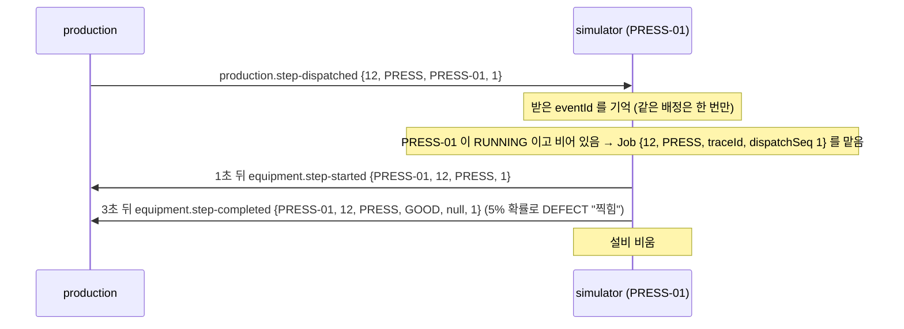

production 이 받는 보고 (`SimulatorEventListener`, 같은 메시지는 한 번만)

```text
step-started   {PRESS-01, 12, PRESS, 1}         → PRESS DISPATCHED → IN_PROGRESS (started_at)
step-completed {PRESS-01, 12, PRESS, GOOD, 1}   → 실적(GOOD, 작업자 NULL, PRESS-01) + 설비 비움 + PRESS DONE
                                                → 다음 바퀴에 BODY 가 비어 있는 용접 로봇에 배정 (dispatch_seq 1)
step-completed {…, DEFECT, "찍힘", 1}            → 실적 DEFECT + 설비 비움 + PRESS PENDING → 다음 바퀴에 다시 배정 (dispatch_seq 2)
완료가 시작보다 먼저 옴 (같은 설비·회차)          → 시작과 완료를 함께 반영 (시작 시각 = 지금). 늦은 시작은 무시
상태·설비·회차가 맞지 않는 보고, 닫힌·없는 작업지시의 보고 → 무시 (INFO 로그)
```

#### 7.8.2 사람 공정과 수동 개입: 작업자 API

밖 주소 `/api/production/...` (gateway 가 role PRODUCTION 인지 보고, `/api` 를 떼고, 직원 public_id 를 `X-User-Id` 로 넣음). 요청·응답 전체는 9장.

**할 일 찾기**

```text
GET /api/production/work-orders?status=IN_PROGRESS&lastId=0&size=20
  → { items: [ {workOrderId 12, productionId 101, orderId 10, productId 1, status IN_PROGRESS, currentProcess ASSEMBLY}, … ],
      count, last, nextCursor }
GET /api/production/work-orders/12            → 작업지시 + 공정 5개(라우팅 순서) + 공정별 실적
GET /api/production/equipments?process=ASSEMBLY → ASSEMBLY-01 RUNNING, ASSEMBLY-02 RUNNING
```

**공정 시작** `POST /api/production/work-orders/12/steps/ASSEMBLY/start { "equipmentCode": "ASSEMBLY-01" }` (`WorkOrderService.startStep` → `beginStep`)

| 확인 (이 순서로) | 실패 |
|---|---|
| 작업지시 있음 | 404 WORK_ORDER_NOT_FOUND |
| 취소되지 않음 | 409 WORK_ORDER_CLOSED |
| 이 공정이 PENDING (DISPATCHED·IN_PROGRESS·DONE 이면 안 됨) | 409 INVALID_STEP_STATUS |
| 앞 공정이 모두 DONE | 409 STEP_OUT_OF_ORDER |
| 설비 있음 | 404 EQUIPMENT_NOT_FOUND |
| 이 공정의 설비 | 409 EQUIPMENT_PROCESS_MISMATCH |
| 설비 RUNNING | 409 EQUIPMENT_NOT_RUNNING |
| 설비가 다른 공정을 맡고 있지 않음 | 409 EQUIPMENT_BUSY |
| (첫 시작이면) 생산 건이 READY | 409 WORK_ORDER_CLOSED |
| 저장 때 다른 요청이 먼저 바꾸지 않음 (작업지시·설비·생산 건 version) | 409 PRODUCTION_CONFLICT |

통과하면: 공정 IN_PROGRESS (설비, started_at, dispatched_at=NULL, dispatch_seq +1), 설비 점유, (첫 시작이면) 작업지시·생산 건 IN_PROGRESS + status-changed, 응답은 작업지시 상세

**공정 종료** `POST /api/production/work-orders/12/steps/ASSEMBLY/complete { "result": "GOOD" }` + `X-User-Id` (`WorkOrderService.completeStep` → `finishStep`)

- 작업지시 있음·열림, 진행 중(IN_PROGRESS)인 공정만 (아니면 409 INVALID_STEP_STATUS)
- 실적 1줄 (결과, 불량 사유(DEFECT 일 때만), 작업자 public_id, 설비, 시작·종료 시각)
- 설비를 비움
- GOOD → 공정 DONE. 마지막 공정(INSPECTION)이면 완료 처리 (7.9)
- DEFECT(사유 필수, 없으면 400) → 공정 PENDING(설비·시작 시각 지움). 같은 공정을 다시 시작 (이벤트 없음, 부품을 다시 받지 않음)

#### 7.8.3 전체 진행 예

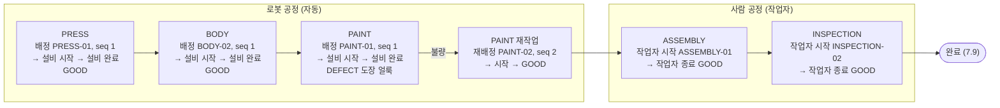

작업지시 #12 의 테이블 모습 (PAINT 재작업 진행 중)

```text
work_order #12          IN_PROGRESS, started_at 09:00:10, step_changed_at 09:01:02, version 9
work_order_step         PRESS DONE(PRESS-01) | BODY DONE(BODY-02) | PAINT IN_PROGRESS(PAINT-02, dispatch_seq 2) | ASSEMBLY PENDING | INSPECTION PENDING
production_result       PRESS GOOD(PRESS-01, worker NULL) | BODY GOOD(BODY-02) | PAINT DEFECT "도장 얼룩"(PAINT-01)
equipment               PAINT-01 occupied NULL | PAINT-02 occupied = PAINT 공정 id
production #101         IN_PROGRESS, started_at 09:00:10
order_vehicle(101)      IN_PRODUCTION
```

### 7.9 검사 양품 → VIN → 생산 완료 (production → inventory, order)

**production** (`finishStep` 의 검사 GOOD → `completeWorkOrder`, 같은 트랜잭션)

1. `Vin.fits(productId, workOrderId)`: 제품 id 5자리, 작업지시 id 6자리 안인가. 아니면 500 VIN_RANGE_EXCEEDED (롤백)
2. VIN 발행 `Vin.issue(1, 12, 2026)` = `KMH000013TU000012`

   | 자리 | 값 |
   |---|---|
   | 1~3 WMI | KMH |
   | 4~8 제품 id 5자리 | 00001 |
   | 9 체크 자리 (가중치 합 mod 11, 10 이면 X) | 3 |
   | 10 연식 (2026 → T, I·O·Q·U·Z·0 제외) | T |
   | 11 공장 | U |
   | 12~17 작업지시 id 6자리 | 000012 |

3. 작업지시 IN_PROGRESS → COMPLETED (vin, completed_at)
4. 생산 건 IN_PROGRESS → COMPLETED (completed_at)
5. production.completed {10, 101, 1, KMH000013TU000012}

**inventory** (`ProductionEventListener.onProductionCompleted` → `FinishedVehicleService.stock`)

1. 이 생산 건의 완성차가 이미 있으면 건너뜀
2. RESERVED 예약 줄을 읽음. 없으면 RESERVATION_NOT_FOUND → DLQ (완성된 차는 반드시 부품이 다 잡혀 있었다)
3. 부품과 남은 LOT(입고 시각, id 순)을 한 번에 읽음. 잡아 둔 부품이 삭제됐으면 PART_NOT_FOUND → DLQ
4. 줄마다: LOT 기록 → 부품 reserved −qty → 줄 CONSUMED → 이력 CONSUME
5. finished_vehicle {KMH000013TU000012, 101, 10, 1, IN_STOCK}. 이벤트는 보내지 않는다

LOT 기록 (`recordLots`): 차 101 의 부품은 모두 초기 재고 LOT(dev 시드처럼)에서 쓰므로 `part_lot_usage (vin, 101, 1001, LOT-INIT-1001 의 id, 1)`, `(vin, 101, 1011, LOT-INIT-1011 의 id, 4)`

차 103 (싼타페, 작업지시 #14, `KMH000164TU000014`) 이 완성될 때의 타이어 1012:

```text
실물 = available 0 + reserved 6 = 6 = LOT-INIT-1012 남은 3 + LOT-261017-000031 남은 3
→ part_lot_usage (KMH000164TU000014, 103, 1012, LOT-INIT-1012 의 id, 3)  입고 시각이 가장 앞인 초기 재고 LOT 먼저
→ part_lot_usage (KMH000164TU000014, 103, 1012, LOT 31 의 id, 3)        모자란 3 은 다음 LOT 에서, LOT remaining 3 → 0
```

LOT 이 모자라면 PART_LOT_SHORTAGE → 롤백, 재시도 후 DLQ

**order** (`ProductionEventListener.onProductionCompleted` → `OrderVehicleService.complete`)

- 차량 101 COMPLETED + vin. 품목 A: [COMPLETED, IN_PRODUCTION] → IN_PRODUCTION
- 102, 103 도 완료되면 품목·주문 모두 COMPLETED

### 7.10 출고 (inventory → order)

```text
GET  /api/inventory/finished-vehicles?status=IN_STOCK      → 최신 먼저 [ 103 의 VIN, 102, 101 … ]
POST /api/inventory/finished-vehicles/KMH000013TU000012/ship   (PRODUCTION 직원)
```

| 확인 | 실패 |
|---|---|
| VIN 형식 (17자, 영문 대문자·숫자, I·O·Q 없음) | 400 |
| 완성차 있음 (삭제되지 않음) | 404 FINISHED_VEHICLE_NOT_FOUND |
| IN_STOCK | 409 FINISHED_VEHICLE_ALREADY_SHIPPED |
| 다른 요청이 먼저 바꾸지 않음 (version) | 409 FINISHED_VEHICLE_CONFLICT |

- 통과: 완성차 SHIPPED + shipped_at, shipment.completed {10, 101, 1, KMH000013TU000012}, 응답 {vin, productId, status, shippedAt}
- order (`InventoryEventListener.onShipmentCompleted` → `OrderVehicleService.ship`): 차량 101 SHIPPED → 품목 A [SHIPPED, COMPLETED] → COMPLETED → 주문 COMPLETED. 세 대 모두 출고되면 주문 SHIPPED

### 7.11 이벤트 순서 전체 (이 예시)

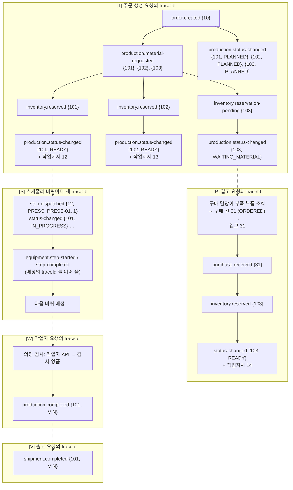

- [T] = 주문 생성 요청의 traceId. [P] = 입고 요청의 traceId. [S] = 스케줄러 바퀴마다 새 traceId. [W] = 작업자 요청의 traceId. [V] = 출고 요청의 traceId
- 메시지 처리 순서는 큐마다 다르다. 예를 들어 order 가 status-changed {101, READY} 를 {101, PLANNED} 보다 먼저 받으면 차량을 IN_PRODUCTION 으로 만들고, 늦게 온 PLANNED 는 RECEIVED 로 되돌린다 (13 S27 "알려진 빈틈")

### 7.12 다른 예: 취소 (주문 11, 싼타페 2대)

- 차 #201 은 프레스 배정이 끝나 생산 중, 차 #202 는 타이어를 기다리는 중 (WAITING_MATERIAL)

```text
POST /api/orders/{orderNo}/cancel   (SALES)
```

1. **order** (확인 순서: UUID 형식 400 → 주문 있음 404 → 차량을 다 앎(아니면 409 ORDER_NOT_READY) → 완료·출고 차량 없음(409 ORDER_CANNOT_BE_CANCELLED) → 이미 요청 중 아님(409 CANCEL_IN_PROGRESS) → 취소할 차량 있음(409 ORDER_ALREADY_CANCELLED) → 주문 version(409 ORDER_CONFLICT))
   - 차량 201, 202 → CANCEL_REQUESTED, 품목·주문 CANCEL_REQUESTED, cancel_requested_at = 지금, order.cancel-requested {11}, 응답 = 주문 상세
2. **production** (`OrderEventListener.onCancelRequested` → `ProductionService.cancelAll`): 주문 11 의 생산 건과 작업지시를 한 번에 읽고 차마다
   - #201 IN_PROGRESS → 그대로 + production.cancel-rejected {11, 201, ALREADY_STARTED, IN_PROGRESS}
   - #202 WAITING_MATERIAL → 생산 건 CANCELLED (작업지시가 있으면 함께) + production.cancelled {11, 202}
3. **inventory** (production.cancelled → `PartReservationService.release`)
   - #202 의 RESERVED 줄 → RELEASED (available +, reserved −, 이력 RELEASE), WAITING 줄 → RELEASED
   - 풀린 부품을 기다리던 다른 차의 줄에 먼저 온 순서로 넘김 (입고 때와 같은 규칙) → 다 찬 차는 inventory.reserved
4. **order**
   - cancel-rejected {201, IN_PROGRESS} → 차량 201 IN_PRODUCTION 으로 되돌림
   - cancelled {202} → 차량 202 CANCELLED + cancelled_at
   - CANCEL_REQUESTED 차량이 더 없음 → 회차 끝(cancel_requested_at NULL), 이번 회차에 취소된 202 가 있으므로 order.cancelled {11} 한 번
   - 품목: [IN_PRODUCTION, CANCELLED] → CANCELLED 빼고 IN_PRODUCTION → 주문 IN_PRODUCTION

### 7.13 순서도 (mermaid)

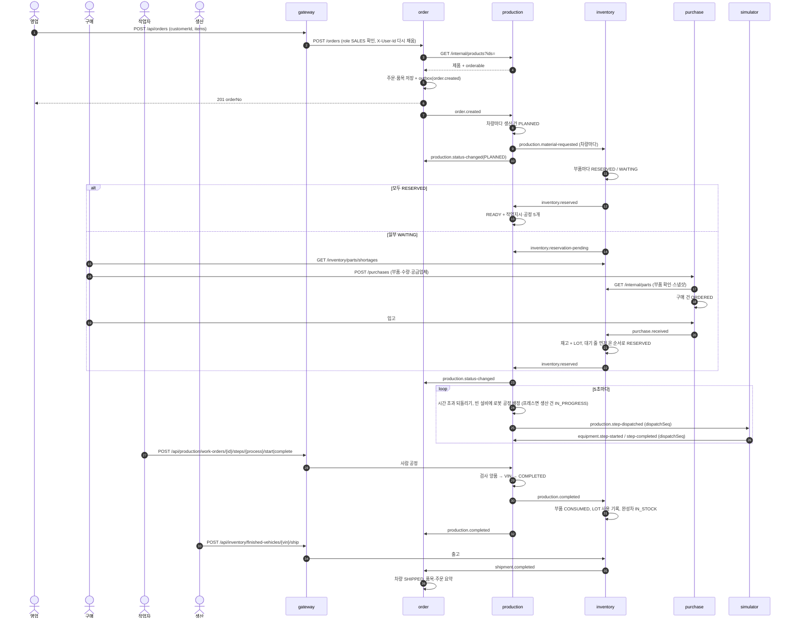

---

## 8. 로봇 공정 배정 알고리즘 자세히

코드: `scheduler/LineDispatchScheduler`, `scheduler/LineDispatcher`, `scheduler/DispatchOutcome`, `WorkOrderService.findFreeEquipmentCodes` / `findDispatchableWorkOrderIds` / `dispatch` / `withdrawStaleDispatch` / `withdrawStaleProgress`, `WorkOrderStepRepositoryImpl.findDispatchableWorkOrderIds`

### 8.1 한 바퀴의 구조

```text
dispatchAll():
  withdrawStaleDispatches()                     // 8.7 시간 초과 되돌리기 먼저 (같은 바퀴에서 바로 다시 배정됨)
  for process in [PRESS, BODY, PAINT]:          // 사람 공정은 건너뜀
      dispatch(process)

dispatch(process):
  free    = 비어 있는 설비 코드 목록 (RUNNING, occupied 없음, 코드 순서)   // 바퀴 시작 때 한 번
  skipped = {}                                                          // 이번 바퀴에 차 쪽 이유로 실패한 작업지시
  while free 가 남음:
      candidates = 배정 가능한 작업지시 id (skipped 제외, id 순서, free 개수만큼)
      if candidates 없음: 끝
      for 차 in candidates:
          if free 가 비었으면: 끝
          outcome = tryEquipments(free, 차)
          if outcome == CAR_FAILED: skipped 에 차를 넣음

tryEquipments(free, 차):                         // 차 하나를 빈 설비에 앞에서부터 시도
  while free 가 남음:
      outcome = attempt(차, free 의 맨 앞)       // WorkOrderService.dispatch, 차마다 따로 트랜잭션
      if CAR_FAILED:  return CAR_FAILED          // 설비는 그대로 다음 차에게
      free 맨 앞을 뺌                            // 썼거나(DISPATCHED) 못 쓰는 설비(EQUIPMENT_FAILED)
      if DISPATCHED:  return DISPATCHED
  return EQUIPMENT_FAILED                        // 설비가 다 빠짐. 차 잘못이 아님 (skipped 에 넣지 않음)
```

### 8.2 "배정 가능한 작업지시" 조건 (QueryDSL)

```sql
work_order_step.process = 이 공정
AND work_order_step.status = PENDING
AND work_order.status IN (RELEASED, IN_PROGRESS)
AND (공정 seq > 1 이면) 바로 앞 공정(seq − 1)이 DONE        -- 앞 공정은 그 앞이 모두 끝나야 시작되므로 바로 앞만 본다
AND work_order_step.work_order_id NOT IN (skipped)
ORDER BY work_order_id ASC   -- 먼저 발행된 차부터
LIMIT 빈 설비 수
```

필요한 개수만 읽는다 (전체 조회 금지). 취소된 작업지시(CANCELLED)는 조건에서 빠진다.

### 8.3 실패를 차 쪽 / 설비 쪽으로 나누기 (`DispatchOutcome`)

| 결과 | 언제 | 처리 |
|---|---|---|
| DISPATCHED | 배정 성공 | 그 설비를 쓴다 (free 에서 뺌) |
| EQUIPMENT_FAILED | EQUIPMENT_NOT_FOUND, EQUIPMENT_PROCESS_MISMATCH, EQUIPMENT_NOT_RUNNING, EQUIPMENT_BUSY (바퀴 시작 뒤 그 설비가 멈췄거나 다른 차·작업자가 먼저 잡음) | 그 설비만 이번 바퀴에서 빼고, **같은 차로** 다음 설비를 시도 → 먼저 발행된 차가 뒤의 차에 밀리지 않는다 |
| CAR_FAILED | 그 밖의 CustomException (WORK_ORDER_CLOSED, INVALID_STEP_STATUS, STEP_OUT_OF_ORDER, PRODUCTION_CONFLICT, WORK_ORDER_NOT_FOUND, PRODUCTION_NOT_FOUND …) 또는 OptimisticLockingFailureException | 그 차를 이번 바퀴에서 빼고(skipped), 설비는 남겨 다음 후보에게 → 계속 실패하는 차가 뒤의 차를 막지 않는다 |

실패할 때마다 INFO 로그 `배정 건너뜀, 다음 바퀴에 다시 봄: workOrderId=… process=… equipment=… reason=…`

### 8.4 반드시 끝나는 이유

시도 한 번마다 셋 중 하나가 일어난다: 설비가 쓰인다 / 설비가 빠진다 / 차가 빠진다. 설비 수와 후보 수는 유한하고 늘지 않으므로 바퀴가 끝난다. 또 후보 조회는 skipped 를 제외하므로 같은 차를 같은 바퀴에서 두 번 뽑지 않는다.

### 8.5 예시

**예 1: 계속 실패하는 차가 앞에 있음** (`LineDispatchTest.aCarThatKeepsFailingDoesNotBlockTheCarsBehindIt`)

- 프레스기 2대 [PRESS-01, PRESS-02], 작업지시 [W1(생산 건은 CANCELLED 인데 작업지시만 RELEASED), W2, W3]

```text
후보 [W1, W2]   W1 → PRESS-01 시도 → startProduction 이 WORK_ORDER_CLOSED → CAR_FAILED → skipped {W1}, PRESS-01 남음
                W2 → PRESS-01 배정 → free [PRESS-02]
후보 [W3]       (W1 제외, 남은 설비 1개)  W3 → PRESS-02 배정 → free []
결과: W1 PENDING 그대로(다음 바퀴에 다시 봄), W2·W3 DISPATCHED
```

고치기 전에는 후보를 한 번만 뽑아서 W1 이 PRESS-01 자리를 매 바퀴 비워 두고, W1 같은 차가 설비 수만큼 앞에 있으면 뒤의 차가 영영 배정되지 않았다 (#88).

**예 2: 바퀴 도중 설비가 멈춤** (`LineDispatcherTest.equipmentFailureRetriesTheSameCarOnTheNextEquipment`)

- 설비 [E1, E2], 차 [A, B]. 바퀴 시작 뒤 E1 이 멈춤

```text
A → E1 시도 → EQUIPMENT_NOT_RUNNING → EQUIPMENT_FAILED → E1 뺌 → A → E2 시도 → 배정
B → 남은 설비 없음 → 다음 바퀴
```

같은 차로 다음 설비를 시도하지 않으면 B 가 E2 를 받고 먼저 온 A 가 밀린다.

**예 3: 설비가 다 빠짐** (`runningOutOfEquipmentIsNotTheCarsFault`): A 가 E1, E2 모두 설비 쪽 이유로 실패 → EQUIPMENT_FAILED. A 는 skipped 에 들어가지 않는다 (차 잘못이 아님).

### 8.6 배정과 작업자 시작이 겹칠 때

- 같은 작업지시: 작업지시 version 충돌 → 늦은 쪽 실패. 작업자 쪽이 늦으면 409 PRODUCTION_CONFLICT, 배정 쪽이 늦으면 CAR_FAILED(다음 바퀴)
- 같은 설비: 설비 version 충돌 → 같은 결과
- 이미 배정된(DISPATCHED) 공정을 작업자가 시작 → 409 INVALID_STEP_STATUS

### 8.7 시간 초과 되돌리기 (#74, #111)

바퀴 맨 앞에서 두 가지를 정해진 개수(100개)씩, 공정마다 따로 트랜잭션으로 되돌린다. 되돌리면 공정 PENDING(설비 코드·시작 시각 지움), 설비 비움, 작업지시 변경 기록. 실적은 남기지 않는다. 같은 바퀴의 배정에서 바로 다시 배정되고 회차가 올라간다.

| 무엇 | 조건 | 기본값 | 왜 생기나 |
|---|---|---|---|
| 시작 보고 시간 초과 | DISPATCHED 이고 dispatched_at 이 start-report-timeout 보다 오래됨 | 1분 | simulator 재시작, 배정 메시지 유실, 설비가 배정을 무시(고장·작업 중) |
| 완료 보고 시간 초과 | IN_PROGRESS 이고 dispatched_at 이 있고(설비가 진행) started_at 이 completion-report-timeout 보다 오래됨 | 5분 | 시작 보고 뒤 simulator 재시작, 완료 보고 유실 |

- 작업자가 시작한 공정은 dispatched_at 이 없어 완료 보고 시간 초과 대상이 아니다 (사람 공정은 오래 걸릴 수 있다)
- 되돌리기 직전에 다시 확인한다 (`isDispatchedBefore`, `isEquipmentRunStartedBefore`). 그사이 보고가 와서 상태가 바뀌었으면 그대로 둔다. 충돌하면 다음 바퀴에 다시 본다
- 되돌린 뒤 늦게 온 지난 보고는 배정 회차가 달라 무시된다 (8.8)

### 8.8 배정 회차 (#104)

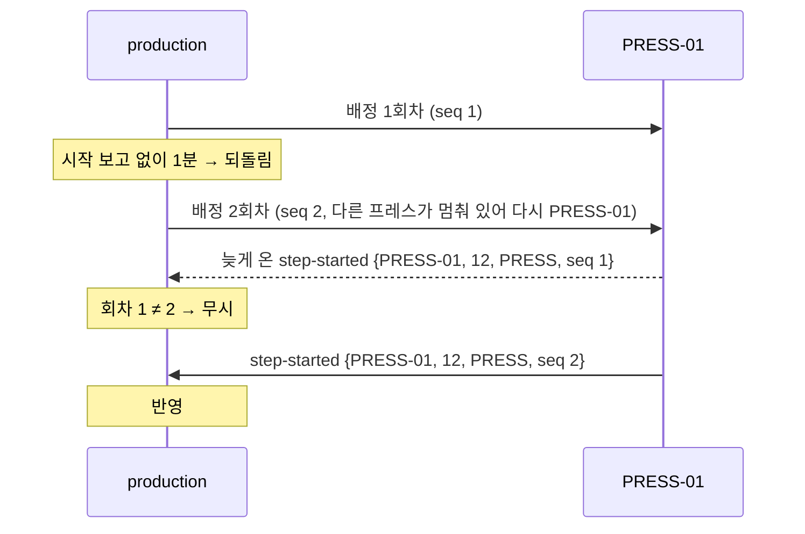

- 설비 코드만으로는 같은 설비에 다시 배정됐을 때 지난 보고와 이번 보고를 구분할 수 없어서 회차를 둔다
- 작업자 시작도 회차를 올린다. 시간 초과 뒤 작업자가 같은 설비로 손으로 시작했을 때 지난 배정의 완료 보고가 실적으로 들어가지 않게

### 8.9 설비 상태와 배정 (#93, #104)

- 배정은 RUNNING 이고 비어 있는 설비에만
- equipment.status-changed FAULT·STOPPED → 그 설비가 맡은 공정을 되돌림 (8.7 과 같은 처리) → 다음 바퀴에 같은 공정의 다른 RUNNING 설비로
- RUNNING 으로 돌아오면 상태·이력만 바뀌고, 다음 바퀴부터 배정 대상
- simulator 가 시작하면 모든 설비 상태(RUNNING)를 보낸다 → production 이 고장으로 알던 설비도 RUNNING 으로 맞춰진다 (설비가 기준)

---

## 9. API 목록

밖에서 부를 때는 gateway 주소에 `/api` 를 붙인다 (예: `/api/orders`). 아래 경로는 서비스 안의 경로다. 모든 응답은 3.2 의 모양이다. "권한" 은 2.4 의 표 (조회는 로그인한 직원 모두).

### 9.1 order

**주문 생성** `POST /orders` — SALES

요청

```json
{ "customerId": 7, "items": [ { "productId": 1, "qty": 2 }, { "productId": 16, "qty": 1 } ] }
```

| 필드 | 규칙 | 위반 메시지 |
|---|---|---|
| customerId | 필수, 1 이상 | "고객 번호가 필요합니다." / "고객 번호는 1 이상이어야 합니다." |
| items | 1개 이상, 같은 productId 두 번 안 됨 | "주문할 제품을 하나 이상 넣어야 합니다." / "같은 제품을 두 번 주문할 수 없습니다." |
| items[].productId | 필수 | "productId 가 필요합니다." |
| items[].qty | 필수, 1 이상 | "qty 가 필요합니다." / "qty 는 1 이상이어야 합니다." |

응답: 201 `{ "orderNo": "…" }` / 400 / 404 PRODUCT_NOT_FOUND, BOM_NOT_FOUND / 503 PRODUCTION_UNAVAILABLE

- 로그인 헤더 `X-User-Id`(직원)를 고객 번호로 쓰지 않는다

**주문 목록** `GET /orders?status=&lastOrderNo=&size=20`

```json
{ "items": [ { "orderNo": "…", "customerId": 7, "status": "IN_PRODUCTION", "createdAt": "2026-10-17T09:00:00" } ],
  "count": 1, "last": false, "nextOrderNo": "…" }
```

- 최신 먼저. status(주문 상태 값)로 거르기. 다음 페이지는 nextOrderNo 를 lastOrderNo 로
- 400: status 값, lastOrderNo UUID 형식, size 1~100 / 404: lastOrderNo 주문 없음 ORDER_NOT_FOUND

**주문 상세** `GET /orders/{orderNo}`

```json
{ "orderNo": "…", "customerId": 7, "status": "IN_PRODUCTION",
  "items": [ { "productId": 1, "productCode": "AVANTE", "productName": "아반떼", "qty": 2, "status": "IN_PRODUCTION",
    "vehicles": [ { "status": "IN_PRODUCTION", "vin": null }, { "status": "COMPLETED", "vin": "KMH000015TU000013" } ] } ] }
```

- 내부 id(주문 id, 생산 건 id) 없음. 차량은 품목 안에서 생산 건 id 순서. 아직 알려지지 않은 차량은 목록에 없다
- 400 orderNo 형식 / 404 ORDER_NOT_FOUND

**주문 취소 요청** `POST /orders/{orderNo}/cancel` — SALES

- 확인 순서와 409 는 7.12. 응답 200 = 주문 상세 (차량 CANCEL_REQUESTED)

### 9.2 production

**제품 목록** `GET /production/products`

- 응답 `[ { "productId": 1, "code": "AVANTE", "name": "아반떼" } ]`. 삭제되지 않고 BOM 이 있는 제품만, 코드 순. productId 를 주문 생성에 넣는다

**제품 확인 (내부)** `GET /internal/products?ids=1,16`

- order 만 부른다. gateway 에 노출 안 됨, api-docs 에 없음. ids 비었으면 400
- 응답: `[ { "id": 1, "code": "AVANTE", "name": "아반떼", "orderable": true } ]` — 삭제된 제품은 빠지고, 삭제되지 않은 BOM 이 없으면 orderable=false

**작업지시 목록** `GET /production/work-orders?status=RELEASED&lastId=0&size=20`

| 파라미터 | 규칙 |
|---|---|
| status | RELEASED 또는 IN_PROGRESS |
| lastId | 0 이상, 기본 0. 이 id 다음부터 |
| size | 1~100, 기본 20 |

- 응답 `CursorPage { items: [ { workOrderId, productionId, orderId, productId, status, currentProcess } ], count, last, nextCursor }`
- currentProcess = 라우팅 순서로 끝나지 않은 첫 공정 (모두 끝났으면 null)

**작업지시 상세** `GET /production/work-orders/{workOrderId}`

```jsonc
{ "workOrderId": 12, "productionId": 101, "orderId": 10, "productId": 1, "status": "COMPLETED", "vin": "KMH000013TU000012",
  "steps": [
    { "process": "PRESS", "seq": 1, "status": "DONE", "equipmentCode": "PRESS-01",
      "startedAt": "2026-10-17T09:00:11", "endedAt": "2026-10-17T09:00:14",
      "results": [ { "result": "GOOD", "defectReason": null, "workerId": null, "equipmentCode": "PRESS-01",
        "startedAt": "…", "endedAt": "…" } ] },
    … ] }
```

- 공정 5개는 라우팅 순서, 실적은 공정별로 묶어 한 번에 읽는다. workerId 는 작업자 public_id, 설비 보고면 null
- workOrderId 1 미만 400, 없으면 404 WORK_ORDER_NOT_FOUND

**공정 시작** `POST /production/work-orders/{workOrderId}/steps/{process}/start` — PRODUCTION

- 요청 `{ "equipmentCode": "ASSEMBLY-01" }` (필수, "설비를 지정해야 합니다."), process 는 다섯 공정 중 하나 (아니면 400)
- 응답 200 작업지시 상세 / 400 / 404 / 409 (7.8.2 의 확인 표)

**공정 종료** `POST /production/work-orders/{workOrderId}/steps/{process}/complete` — PRODUCTION

- 헤더 `X-User-Id` (필수, gateway 가 넣음) / 요청 `{ "result": "DEFECT", "defectReason": "도장 얼룩" }`

  | 필드 | 규칙 |
  |---|---|
  | result | 필수, GOOD 또는 DEFECT ("실적 결과를 넣어야 합니다.") |
  | defectReason | 255자 이하. DEFECT 이면 필수 (`@DefectReasonRequired`). GOOD 이면 보내도 저장하지 않음 |

- 응답 200 작업지시 상세 / 400 / 404 / 409 (WORK_ORDER_CLOSED, INVALID_STEP_STATUS, PRODUCTION_CONFLICT) / 500 VIN_RANGE_EXCEEDED (검사 양품인데 VIN 자리 초과)

**설비 목록** `GET /production/equipments?process=PRESS`

- 응답: `[ { "equipmentCode": "PRESS-01", "name": "프레스기 1호", "process": "PRESS", "status": "RUNNING" } ]` (코드 순서)
- process 가 없거나 모르는 값이면 400

### 9.3 inventory

**부족 부품** `GET /inventory/parts/shortages` (#114)

```json
[ { "partId": 1012, "code": "TIRE-18", "name": "타이어 18인치", "unit": "EA",
  "available": 3, "waitingQty": 6, "shortQty": 3, "waitingProductions": 1 } ]
```

- 기다리는(WAITING) 수량 합 > available 인 부품만, shortQty 큰 순 → 코드 순, 삭제 제외, 페이지 없음
- 부품별 합계는 QueryDSL 로 DB 에서 집계 (`PartReservationRepositoryImpl.sumWaitingByPart`)
- 이미 발주한 수량은 빼지 않는다

**부품 확인 (내부)** `GET /internal/parts?ids=1012`

- purchase 만 부른다. gateway 에 노출 안 됨, api-docs 에 없음. ids 비었으면 400
- 응답 `[ { "id": 1012, "code": "TIRE-18", "name": "타이어 18인치" } ]` (삭제된 부품은 빠짐)

**부품 재고 목록** `GET /inventory/parts`

- `[ { "partId": 1001, "code": "ENG-G16", "name": "가솔린 엔진 1.6", "unit": "EA", "available": 299, "reserved": 1 } ]` 삭제된 부품 빼고 코드 순

**부품 LOT 별 재고** `GET /inventory/parts/{partId}/lots`

```json
{ "partCode": "TIRE-18", "partName": "타이어 18인치", "onHand": 6,
  "lots": [ { "lotNo": "LOT-INIT-1012", "receivedQty": 3, "remainingQty": 3, "receivedAt": "2026-10-17T09:00:00" },
            { "lotNo": "LOT-261017-000031", "receivedQty": 3, "remainingQty": 3, "receivedAt": "2026-10-17T09:10:00" } ] }
```

- 남은 LOT 을 다음에 쓸 순서(입고 시각, id 순)로. 다 쓴 LOT 은 뺀다. onHand = available + reserved = LOT 남은 수량 합 (withoutLotQty 는 #116 에서 없앰)
- 400 partId 양수 아님 / 404 PART_NOT_FOUND

**완성차 목록** `GET /inventory/finished-vehicles?status=&lastVin=&size=20`

```json
{ "items": [ { "vin": "KMH000164TU000014", "productId": 16, "status": "IN_STOCK", "completedAt": "…", "shippedAt": null } ],
  "count": 1, "last": true, "nextVin": null }
```

- 최신 먼저, status(IN_STOCK, SHIPPED)로 거르기, 삭제된 것 빼기. 다음 페이지는 nextVin 을 lastVin 으로
- 400: status 값, lastVin VIN 형식, size 1~100 / 404: lastVin 완성차 없음 FINISHED_VEHICLE_NOT_FOUND

**완성차 출고** `POST /inventory/finished-vehicles/{vin}/ship` — PRODUCTION

- 확인과 응답은 7.10. 요청 본문 없음

**차에 쓰인 부품 LOT** `GET /inventory/finished-vehicles/{vin}/part-lots`

```json
[ { "partCode": "TIRE-18", "partName": "타이어 18인치", "lotNo": "LOT-INIT-1012", "qty": 3, "receivedAt": "…" },
  { "partCode": "TIRE-18", "partName": "타이어 18인치", "lotNo": "LOT-261017-000031", "qty": 3, "receivedAt": "…" } ]
```

- 부품 코드 순, 같은 부품은 LOT 입고 순(입고 시각, id). lotNo 는 항상 있다 (초기 재고는 `LOT-INIT-{부품 id}`). 내부 id 없음
- 400 VIN 형식 / 404 FINISHED_VEHICLE_NOT_FOUND / 이 기능 전에 완성된 차는 빈 목록

**LOT 이 쓰인 차** `GET /inventory/part-lots/{lotNo}/vehicles`

```json
[ { "vin": "KMH000164TU000014", "productId": 16, "status": "SHIPPED", "partCode": "TIRE-18", "qty": 3 } ]
```

- 사용 기록 순(먼저 완성된 차 먼저). status 로 창고에 있는지 출고됐는지 (리콜 대상 찾기)
- 400 lotNo 형식(`LOT-` + 숫자 6자리 + `-` + 숫자 6자리 이상, 또는 `LOT-INIT-` + 숫자) / 404 PART_LOT_NOT_FOUND / 쓰인 차가 없으면 빈 목록

### 9.4 purchase

| API | 권한 | 하는 일 |
|---|---|---|
| `GET /purchases?status=ORDERED&lastId=0&size=20` | 조회 | 상태별 구매 목록 (id 커서). status 필수: ORDERED, RECEIVED |
| `GET /purchases/suppliers` | 조회 | 공급업체 목록 |
| `POST /purchases { "partId": 1012, "qty": 3, "supplierId": 2 }` + `X-User-Id` | PURCHASE | 구매 건 만들기 = 발주 (ORDERED, MANUAL, 스냅샷, ordered_by). 201 |
| `POST /purchases/{purchaseId}/receive` | PURCHASE | 입고: ORDERED → RECEIVED (received_at) + purchase.received |

- 응답 구매 건: `{ purchaseId, partId, partCode, partName, qty, status, source, supplierId, orderedBy, orderedAt, receivedAt }`
- 400: X-User-Id 없음·빈 값·36자 초과, partId·qty·supplierId 없음·1 미만, purchaseId 양수 아님, status 값(REQUESTED 도 400), lastId 음수, size 범위 / 404 PART_NOT_FOUND, SUPPLIER_NOT_FOUND, PURCHASE_NOT_FOUND / 409 INVALID_PURCHASE_STATUS, PURCHASE_CONFLICT / 503 INVENTORY_UNAVAILABLE
- 발주 API(`POST /purchases/{id}/order`)는 #114 에서 없앴다

### 9.5 auth

| API | 권한 | 하는 일 |
|---|---|---|
| `POST /auth/admin/users { email, name, role }` | ADMIN | 계정 발급: Redis 에 대기 정보(24시간) + 활성화 메일. 201 |
| `POST /auth/activation { token, password }` | 공개 | 토큰(1회용)으로 계정 저장(ACTIVE). 204 |
| `POST /auth/login { email, password }` | 공개 | Access(본문) + Refresh(httpOnly 쿠키). 실패 횟수가 많으면 잠금(429) |
| `POST /auth/token/refresh` | 공개 | 쿠키의 Refresh 로 새 Access+Refresh (옛 Refresh 무효, 회전) |
| `POST /auth/logout` | 공개 | Refresh 삭제 + 쿠키 만료. 204 |
| `GET /internal/jwks` | 내부 | gateway 가 공개키를 받아 캐시 |

### 9.6 simulator (내부, 시연·테스트용, gateway 에 노출 안 됨)

| API | 하는 일 |
|---|---|
| `GET /internal/simulator/equipments` | 설비 상태와 지금 하는 작업 |
| `POST /internal/simulator/equipments/{code}/fault` | 고장 (FAULT) → equipment.status-changed, 하던 작업 버림 |
| `POST /internal/simulator/equipments/{code}/stop` | 정지 (STOPPED) → 같음 |
| `POST /internal/simulator/equipments/{code}/run` | 가동 (RUNNING) → equipment.status-changed |

- 설비 코드 형식(`{공정}-{두 자리}`)이 아니면 400, 없는 설비 404 EQUIPMENT_NOT_FOUND, 같은 상태로 바꾸면 그대로 (이벤트 없음)

---

## 10. 오류 코드 전체

### 10.1 order (`OrderErrorCode`)

| 코드 | HTTP | 어디서 | 뜻 |
|---|---|---|---|
| PRODUCT_NOT_FOUND | 404 | 주문 생성 | 주문한 제품이 없거나 삭제됨 |
| BOM_NOT_FOUND | 404 | 주문 생성 | BOM 이 없어 만들 수 없는 제품 |
| PRODUCTION_UNAVAILABLE | 503 | 주문 생성 | production 실패·3초 초과·비정상 응답 |
| ORDER_NOT_FOUND | 404 | 주문 상세·취소·목록(lastOrderNo), 이벤트 수신 | 주문 없음 (수신이면 DLQ) |
| ORDER_ITEM_NOT_FOUND | 404 | status-changed·completed·shipment 수신 | (orderId, productId) 품목 없음 → DLQ |
| ORDER_VEHICLE_NOT_FOUND | 404 | cancelled·cancel-rejected 수신 | 차량 없음 → DLQ |
| UNKNOWN_PRODUCTION_STATUS | 400 | status-changed·cancel-rejected 수신 | 모르는 생산 상태 → DLQ |
| ORDER_VEHICLE_OVERFLOW | 409 | 수신 | 품목 수량보다 많은 생산 건 → DLQ |
| ORDER_NOT_READY | 409 | 취소 요청 | 차량을 다 모름 (생산 계획 중) |
| ORDER_CANNOT_BE_CANCELLED | 409 | 취소 요청 | 완료·출고된 차량이 있음 |
| CANCEL_IN_PROGRESS | 409 | 취소 요청 | 이미 취소 요청 처리 중 |
| ORDER_ALREADY_CANCELLED | 409 | 취소 요청 | 모두 취소됨 |
| ORDER_CONFLICT | 409 | 취소 요청 | 다른 처리가 먼저 바꿈 (주문 version) |

### 10.2 production (`ProductionErrorCode`)

| 코드 | HTTP | 어디서 | 뜻 |
|---|---|---|---|
| PRODUCTION_NOT_FOUND | 404 | 이벤트 수신, 생산 시작·완료 | 생산 건 없음 (수신이면 DLQ). 취소 요청인데 그 주문의 생산 건이 하나도 없을 때도 |
| INVALID_ORDER_QTY | 400 | order.created 수신 | 수량 1 미만 → DLQ |
| WORK_ORDER_NOT_FOUND | 404 | 작업자 API, 배정 | 작업지시 없음 |
| STEP_NOT_FOUND | 404 | 설비 상태 수신 | 설비가 가리키는 공정이 없음 (데이터 꼬임) → DLQ |
| EQUIPMENT_NOT_FOUND | 404 | 작업자 API, 배정, 설비 상태 수신 | 설비 없음 |
| WORK_ORDER_CLOSED | 409 | 작업자 API, 배정 | 취소된 작업지시, 또는 생산 건이 READY/IN_PROGRESS 가 아니라 시작·완료 불가 |
| STEP_OUT_OF_ORDER | 409 | 공정 시작, 배정 | 앞 공정이 안 끝남 |
| INVALID_STEP_STATUS | 409 | 공정 시작·종료, 배정 | 지금 공정 상태로 할 수 없음 |
| EQUIPMENT_PROCESS_MISMATCH | 409 | 공정 시작, 배정 | 다른 공정의 설비 |
| EQUIPMENT_NOT_RUNNING | 409 | 공정 시작, 배정 | 설비 정지·고장 |
| EQUIPMENT_BUSY | 409 | 공정 시작, 배정 | 설비가 다른 차를 맡고 있음 |
| PRODUCTION_CONFLICT | 409 | 작업자 API, 배정 | 다른 요청이 먼저 바꿈 (낙관적 락) |
| VIN_RANGE_EXCEEDED | 500 | 검사 양품 | 제품 id 5자리·작업지시 id 6자리를 넘어 VIN 을 만들 수 없음 (설비 보고면 DLQ) |

### 10.3 inventory (`InventoryErrorCode`)

| 코드 | HTTP | 어디서 | 뜻 |
|---|---|---|---|
| PART_NOT_FOUND | 404 | 입고·완료 수신, LOT 별 재고 | 부품 없음 (수신이면 DLQ). 예약 요청에서는 오류가 아니라 reservation-failed |
| RESERVATION_NOT_FOUND | 404 | completed 수신 | 생산 건에 잡아 둔 부품이 없음 → DLQ |
| FINISHED_VEHICLE_NOT_FOUND | 404 | 출고, 완성차 목록(lastVin), 차의 LOT 조회 | 완성차 없음 |
| FINISHED_VEHICLE_ALREADY_SHIPPED | 409 | 출고 | 이미 출고됨 |
| FINISHED_VEHICLE_CONFLICT | 409 | 출고 | 같은 차를 동시에 출고 |
| PART_LOT_NOT_FOUND | 404 | LOT 이 쓰인 차 | LOT 없음 |

### 10.4 purchase (`PurchaseErrorCode`)

| 코드 | HTTP | 뜻 |
|---|---|---|
| PURCHASE_NOT_FOUND | 404 | 구매 건 없음 |
| PART_NOT_FOUND | 404 | 구매 건 만들기: inventory 에 없거나 삭제된 부품 |
| SUPPLIER_NOT_FOUND | 404 | 공급업체 없음 |
| INVALID_PURCHASE_STATUS | 409 | 입고는 ORDERED 에서만 |
| PURCHASE_CONFLICT | 409 | 같은 구매 건을 동시에 입고 |
| INVENTORY_UNAVAILABLE | 503 | 구매 건 만들기: inventory 실패·3초 초과·비정상 응답 |

### 10.5 simulator, auth, gateway

| 서비스 | 코드 |
|---|---|
| simulator | EQUIPMENT_NOT_FOUND 404 (내부 API) |
| auth | DUPLICATE_EMAIL 409, INVALID_EMAIL_DOMAIN 400, INVALID_ACTIVATION_TOKEN 400, LOGIN_FAILED 401, ACCOUNT_NOT_ACTIVE 403, ACCOUNT_LOCKED 429, INVALID_REFRESH_TOKEN 401, TOKEN_SIGNING_FAILED 500, MAIL_UNAVAILABLE 503 |
| gateway | UNAUTHORIZED 401 (토큰 없음·만료·서명 틀림), FORBIDDEN 403 (역할), NOT_FOUND 404 (라우트 없음), SERVICE_UNAVAILABLE 503 (뒤 서비스 연결 실패), GATEWAY_TIMEOUT 504 |

### 10.6 공통

| 경우 | 결과 |
|---|---|
| Bean Validation 위반, 경로·쿼리 값 형식 오류 | 400, 첫 위반 메시지 |
| 이벤트 처리 중 CustomException 포함 모든 예외 | 롤백 → 3번 재시도 → DLQ (HTTP 상태는 쓰이지 않음) |

---

## 11. 설정값

| 키 | 기본값 | 서비스 | 뜻 |
|---|---|---|---|
| `factoryflow.line.dispatch-enabled` | true | production | 배정 스케줄러를 돌릴지. 테스트는 build.gradle 의 systemProperty 로 끔 |
| `factoryflow.line.dispatch-interval` | 5s | production | 배정 주기 (앞 바퀴가 끝난 뒤 5초, fixedDelay) |
| `factoryflow.line.start-report-timeout` | 1m | production | 배정 뒤 시작 보고를 기다리는 시간 |
| `factoryflow.line.completion-report-timeout` | 5m | production | 설비가 시작한 뒤 완료 보고를 기다리는 시간 |
| `factoryflow.simulator.start-delay` | 1s | simulator | 배정을 받고 시작 보고까지 |
| `factoryflow.simulator.work-time.PRESS` / `.BODY` / `.PAINT` | 3s / 4s / 5s | simulator | 시작 보고부터 완료 보고까지 |
| `factoryflow.simulator.defect-rate` | 0.05 | simulator | 완료가 불량일 확률 |
| `factoryflow.simulator.fault-check-interval` | 30s | simulator | 자동 고장을 뽑는 주기 |
| `factoryflow.simulator.fault-rate` | 0 (끔) | simulator | 주기마다 가동 중 설비가 고장 날 확률. 시연할 때는 내부 API 로 고장을 낸다 |
| `factoryflow.simulator.repair-time` | 60s | simulator | 자동 고장에서 RUNNING 으로 돌아오기까지 |
| `factoryflow.simulator.resend-interval` | 1s | simulator | 확인 못 받은 메시지를 다시 보내는 주기 |
| `factoryflow.simulator.seen-event-limit` | 10000 | simulator | 중복 확인용으로 기억하는 eventId 개수 |
| `factoryflow.events.exchange` | factoryflow.events | 공통 | 이벤트 exchange |
| `factoryflow.events.relay-interval` | 1s | 공통 | OutboxRelay 주기 |
| `factoryflow.events.relay-batch-size` | 100 | 공통 | 한 번에 보내는 outbox 줄 수 |
| `factoryflow.events.confirm-timeout` | 5s | 공통 | 브로커 확인을 기다리는 시간 |
| `spring.rabbitmq.publisher-confirm-type` | correlated | 공통 | OutboxRelay·simulator 에 필수 |
| `spring.rabbitmq.listener.simple.retry.*` | 3번, 1s 시작, ×2, 최대 10s | 공통 | 수신 재시도 |
| `clients.production.url` / `timeout` | 환경별 / 3s | order | production 호출 주소와 시간 제한 |
| `clients.inventory.url` / `timeout` | local `http://localhost:8082`, dev `http://inventory.factoryflow.local:8080` / 3s | purchase | inventory 호출 주소와 시간 제한. application.yml 에는 없고 local·dev 프로필 파일(git 에 없음, dev 는 시크릿 `APP_DEV_YML_PURCHASE`)에만. 테스트는 `src/test/resources/application.properties` |
| `springdoc.paths-to-exclude` | `/internal/**` | 각 서비스 | 내부 API 를 api-docs 에서 뺌 |
| `app.cors.allowed-origins` | 비어 있음 (모두 거부) | gateway | 프론트 주소는 환경별 설정 (env `CORS_ALLOWED_ORIGINS`) |

---

## 12. 로그로 보는 흐름

| 로그 | 레벨 | 서비스 | 뜻 / 할 일 |
|---|---|---|---|
| `SAGA_REJECTED orderId=… productId=… reason=PRODUCT_NOT_FOUND\|BOM_NOT_FOUND` | ERROR | production | 주문 뒤 제품·BOM 이 지워져 그 제품의 차를 취소로 만듦. 품목이 "취소" 로 보임 → 고객 안내 (S8) |
| `SAGA_REJECTED productionId=… reason=PART_NOT_FOUND partIds=…` | ERROR | production | BOM 의 부품이 inventory 에 없어 차를 취소함 → 부품 등록을 고친 뒤 다시 주문 (S18) |
| `부품이 없어 예약할 수 없음: productionId=… partIds=…` | WARN | inventory | 위와 같은 일의 inventory 쪽 |
| `VIN_RANGE_EXCEEDED workOrderId=… productId=…` | ERROR | production | VIN 자리 초과로 완료 거절 (S47) |
| `EVENT_DEAD_LETTERED queue=… eventId=… reason=…` | ERROR | 수신하는 모든 서비스 | 3번 재시도해도 실패해 DLQ 로 감 → 원인 고친 뒤 다시 넣기 |
| 생산 건이 이미 있어 건너뜀 | INFO | production | order.created 재발행 |
| 끝난 생산 건에 예약이 늦게 와 취소를 다시 보냄 | INFO | production | 취소 뒤 예약 완료 |
| 허용되지 않은 상태라 inventory.reserved / reservation-pending 무시, PLANNED 가 아니라 inventory.reservation-failed 무시 | INFO | production | 중복·꼬인 예약 결과 |
| 작업지시가 이미 있어 건너뜀 | INFO | production | READY 재처리 |
| READY 가 아니라 생산을 시작할 수 없음 | INFO | production | 첫 시작 거절 (WORK_ORDER_CLOSED) |
| 다른 작업이 먼저 바꿔 거절 | INFO | production, order, inventory | 낙관적 락 충돌 → 409 |
| 작업지시가 없거나 끝나 설비 보고 무시 / 공정 상태·설비·회차가 맞지 않아 설비 보고 무시 | INFO | production | 늦거나 꼬인 설비 보고, 지난 회차 보고 |
| 배정 건너뜀, 다음 바퀴에 다시 봄 | INFO | production | 배정 실패 (8.3) |
| 시작 보고 없이 시간이 지나 배정을 되돌림 / 완료 보고 없이 시간이 지나 설비 공정을 되돌림 | INFO | production | 시간 초과 되돌리기 (8.7) |
| 공정 되돌리기 건너뜀, 다음 바퀴에 다시 봄 | INFO | production | 되돌리는 사이 보고가 와서 충돌 |
| 예약 줄이 이미 있어 건너뜀 / 이미 입고한 구매 건이라 건너뜀 / 완성차가 이미 있어 건너뜀 | INFO | inventory | 재발행 |
| 차량 상태를 바꾸지 않음 / 차량을 완료로 바꾸지 않음 / 차량을 출고로 바꾸지 않음 | INFO | order | 끝난 차량·같은 상태·취소 요청 중 |
| 취소된 차량에 출고가 옴 | WARN | order | 정상 흐름에서는 생기지 않음 |
| 이미 받은 배정이라 무시 / 배정을 받을 수 없어 무시 | INFO | simulator | 중복 배정, 설비가 고장·작업 중 |
| [Order] production 제품 조회 실패 / 응답에 data 가 없음 | WARN | order | 503 의 원인 |
| [Purchase] inventory 부품 조회 실패 / 응답에 data 가 없음 | WARN | purchase | 구매 건 만들기 503 의 원인 |
| outbox 발행 실패, 다음 주기에 재시도 / 브로커가 거부(nack) | WARN | 공통 | RabbitMQ 장애 |

모든 서비스 로그에 MDC traceId 가 있어 한 흐름을 묶어 볼 수 있다 (3.9). gateway 는 WebFlux 라 MDC 가 없어 traceId 를 메시지에 직접 넣는다.

---

## 13. 상황별 시나리오

각 상황마다 **무슨 일이 일어나는지 → 시스템이 어떻게 하는지 → 데이터가 어떻게 남는지 → 고객에게 어떻게 보이는지** 를 적었다. ✅ 는 지금 코드로 그렇게 동작하고 테스트로 확인한 것, ⚠️ 는 동작하지만 알려진 빈틈이 있는 것이다.

### 13.1 주문 접수 단계 (order, 동기)

#### S1. 정상 주문 ✅

- 상황: 영업 직원이 고객 7 의 아반떼 2대 + 싼타페 1대 입력. 둘 다 BOM 있음
- 시스템: production 에 제품 확인 → 통과 → 주문·품목 저장 + order.created
- 데이터: customer_order RECEIVED(customer_id 7, order_no UUID), order_item 2줄 (스냅샷 포함), outbox 1건
- 고객: 201 + 주문 번호, 상태 "접수"
- 테스트: `OrderCreateTest.savesOrderItemsAndOutboxTogether`

#### S2. 요청 형식이 틀림 ✅

| 상황 | 결과 |
|---|---|
| customerId 없음 / 0 이하 | 400 |
| 품목이 비었음 | 400 |
| productId 없음 | 400 |
| 수량 0 이하 | 400 |
| 같은 제품을 두 줄로 | 400 |

- 시스템: production 을 부르기 전에 거절 (Bean Validation). 데이터: 아무것도 안 생김
- 테스트: `missingCustomerIdIs400`, `nonPositiveCustomerIdIs400`, `emptyItemsIs400`, `missingProductIdIs400`, `nonPositiveQtyIs400`, `duplicateProductIs400`

#### S3. 직원의 로그인 정보가 고객 번호로 들어감 ✅ (막음)

- 상황: 요청 헤더에 로그인 직원 `X-User-Id` 가 있음
- 시스템: 헤더는 무시하고 본문의 customerId 만 쓴다 (#86)
- 테스트: `loggedInEmployeeHeaderIsNotTakenAsTheCustomer`

#### S4. 없는 제품 / BOM 없는 제품을 주문 ✅

- 시스템: production 응답에 없으면 404 PRODUCT_NOT_FOUND, BOM 이 없으면 404 BOM_NOT_FOUND. 주문·이벤트 안 생김. 한 품목이라도 안 되면 주문 전체를 받지 않는다
- 업무 이유: "만들 수 없는 차" 는 이벤트로 흘려보내지 않고 입구에서 막는다. 제품 목록에도 BOM 없는 제품은 안 나온다
- 테스트: `unknownProductIs404`, `productWithoutBomIs404`, `InternalProductControllerTest.deletedProductIsNotReturned`, `deletedBomDoesNotMakeProductOrderable`

#### S5. production 서비스가 응답하지 않음 ✅

- 상황: production 이 죽었거나 3초 넘게 응답이 없음, 5xx, 본문이나 data 가 없음
- 시스템: ProductClient 가 503 PRODUCTION_UNAVAILABLE 로 바꿈 (정상 응답의 빈 data 는 빈 목록 → 각 제품 404). 주문 안 생김
- 테스트: `productionUnavailableIs503`, `ProductClientTest` 6개

#### S6. SALES 가 아닌 직원이 주문 ✅

- 시스템: gateway 가 403 FORBIDDEN. order 까지 가지 않는다
- 테스트: `RolePermissionTest.otherRoleCannotWrite`

### 13.2 생산 계획 단계 (production ← order.created)

#### S7. 정상: 수량만큼 차량 생성 ✅

- 시스템: 아반떼 2대 → 생산 건 seq 1, 2 / 싼타페 1대 → seq 1. 차마다 부품 요청 + PLANNED 알림. 받은 traceId 를 이어 씀. 한 이벤트 안에 같은 제품이 두 줄이면 수량을 합친다
- order 쪽: status-changed(PLANNED) 를 받아 order_vehicle 3건(RECEIVED) 생성
- 테스트: `createsOnePlannedProductionPerVehicleWithMaterialRequestAndStatusChanged`, `materialRequestKeepsTheTraceIdOfOrderCreated`, `sameProductTwiceInOneEventMakesVehiclesForTheMergedQty`, order `plannedCreatesReceivedVehicle`

#### S8. 주문과 처리 사이에 제품이나 BOM 이 삭제됨 ✅ (#103)

- 상황: 주문 접수 직후 관리자가 싼타페를 삭제, 그 뒤 order.created 처리
- 시스템: 싼타페는 수량만큼 처음부터 CANCELLED 인 생산 건을 만들고 status-changed(CANCELLED) 를 보낸다. 부품은 요청하지 않는다. ERROR SAGA_REJECTED. 아반떼는 정상 생성
- order: 처음 보는 생산 건이라 품목에 차량을 만들어 CANCELLED → 싼타페 품목 CANCELLED, 주문은 아반떼로 요약
- 왜 전체를 실패시키지 않나: 다시 처리해도 계속 실패해서 DLQ 로 가고, 멀쩡한 아반떼까지 만들어지지 않기 때문
- 예전(#103 전): 건너뛰기만 해서 싼타페 품목이 계속 "접수" 로 멈춰 있었다
- 테스트: `productWithoutBomGetsCancelledVehiclesAndOthersAreCreated`, `deletedProductGetsCancelledVehiclesAndOthersAreCreated`, `rejectedProductIsCancelledOnceWhenOrderCreatedComesAgain`, order `rejectedProductMakesCancelledVehiclesAndCancelsTheItem`

#### S9. 같은 order.created 를 두 번 받음 ✅

- (a) 같은 eventId: ProcessedEventGuard 가 두 번째를 건너뜀
- (b) eventId 만 다른 재발행: 이미 생산 건이 있는 제품은 건너뜀. DB 고유키(order, product, seq)가 마지막 안전장치
- 테스트: `sameEventTwiceCreatesOnce`, `sameOrderAndProductWithAnotherEventIdCreatesOnce`

#### S10. 수량이 0 이하인 이벤트 / 깨진 JSON (정상 흐름에선 안 생김) ✅

- 시스템: 처리 오류 → 롤백 → 3번 재시도 → DLQ + EVENT_DEAD_LETTERED. 아무것도 안 생김
- 테스트: `failingMessageIsRetriedThenDeadLettered`, `brokenJsonIsDeadLettered`, `receivesOrderCreatedFromRabbitMq`

### 13.3 자재 확보 단계 (inventory ← production.material-requested)

#### S11. 재고 충분 ✅

- 시스템: 부품마다 RESERVED, available −, reserved +, 이력 RESERVE → inventory.reserved → production READY + 작업지시 (S21)
- 테스트: `enoughStockReservesAllParts`

#### S12. 재고 부족 ✅

- 상황: 싼타페에 타이어 1012 가 6개 필요한데 재고 3개
- 시스템: 엔진은 RESERVED, 타이어는 WAITING(재고 그대로) → 차 결과 inventory.reservation-pending. 부족 이벤트는 없다
- production: PLANNED → WAITING_MATERIAL. 작업지시 없음. 부족 부품 조회에 타이어 1012 가 shortQty 3 으로 나온다 → 구매 담당이 발주 (S56)
- 고객: 이 차는 "접수" (부품 대기는 따로 보이지 않음, #117). 같은 주문의 다른 차가 생산 중이면 주문은 "생산 중"
- 주의: 엔진은 이미 이 차 몫으로 잡혀 있다 (다른 차가 못 씀)
- 테스트: `shortPartWaitsAndPublishesPendingWithoutAShortageEvent`

#### S13. 재고가 있어도 줄을 선다 (먼저 온 차 우선) ✅

- 상황: 타이어를 20개 기다리는 차가 이미 있고, 재고 10개인데 새 차가 1개를 요청
- 시스템: 새 차도 WAITING. 부족 부품 조회: 기다리는 수량 21 − 재고 10 = shortQty 11, 기다리는 차 2대
- 테스트: `newRequestQueuesBehindWaitingLineEvenWithStock`

#### S14. 부족 수량은 기다리는 수량 − 재고 ✅

- available 3, 기다림 2 + 새 요청 2 → shortQty 1 / available 10, 기다림 2 + 새 요청 3 → 부족 부품이 아님 (WAITING 이긴 함, 앞에 기다리는 줄이 있어서)
- 이미 발주한 수량은 빼지 않는다 (inventory 는 구매를 모른다). 담당자는 발주 중 목록과 함께 본다
- 테스트: `shortQtyIsWhatTheWaitingLinesStillNeed`, `partIsNotShortWhenStockCoversTheWaitingLines`, `PartShortageTest` 4개

#### S15. 두 차가 같은 부품을 동시에 예약 ✅

- 시스템: 둘 다 부품 version 을 올리려 해서 늦은 쪽이 충돌 → 재시도 때 먼저 잡힌 결과를 보고 WAITING
- 테스트: `everyRequestedPartBumpsItsVersionSoConcurrentRequestsConflict`

#### S16. 한 요청 안에 같은 부품이 두 줄 ✅

- 시스템: 수량을 합쳐 예약 줄 1개로. 테스트: `samePartTwiceInOneEventIsMergedIntoOneLine`

#### S17. 같은 예약 요청을 두 번 받음 ✅

- 같은 eventId: Guard. 다른 eventId: 예약 줄이 이미 있으면 건너뜀
- 테스트: `sameEventTwiceChangesStockOnce`, `sameProductionWithAnotherEventIdChangesStockOnce`, `publishedEventsKeepTheReceivedTraceId`, `receivesMaterialRequestedFromRabbitMq`

#### S18. BOM 에 있는 부품이 inventory 에 없음 ✅ (#103)

- 상황: 부품이 삭제됐거나 잘못 등록됨
- inventory: 예약 줄을 하나도 만들지 않고 inventory.reservation-failed {productionId, PART_NOT_FOUND, 없는 partIds(id 순)}. DLQ 로 가지 않는다
- production: PLANNED 생산 건 → CANCELLED + production.cancelled → order 차량 CANCELLED, inventory 는 풀 줄이 없어 그대로
- 이미 취소됐거나 다른 상태면 그대로 (INFO). 같은 실패를 다시 받아도 한 번
- 부품이 나중에 등록돼도 취소된 차는 되살리지 않는다 (다시 주문)
- 예전(#103 전): DLQ 로 가서 차가 PLANNED 에 멈춰 있었다
- 테스트: inventory `missingPartsFailTheReservationWithoutSavingAnything`, `missingPartFromRabbitMqIsNotDeadLettered`, production `ReservationFailedTest` 4개

### 13.4 예약 결과 반영 단계 (production ← inventory.*)

#### S19. 부품 다 잡힘 → 작업지시 발행 ✅

- 시스템: PLANNED 또는 WAITING_MATERIAL → READY, 작업지시 1건 + 공정 5개, status-changed(READY) → order "생산 중"
- 테스트: `reservedMakesPlannedProductionReady`, `reservedReleasesOneWorkOrderWithFiveStepsInRoutingOrder`, `reservedMakesWaitingProductionReadyAfterReceipt`

#### S20. 일부 기다림 ✅

- 시스템: PLANNED → WAITING_MATERIAL. 작업지시 없음
- 테스트: `reservationPendingMakesPlannedProductionWaitForMaterial`, `reservationPendingDoesNotReleaseWorkOrder`

#### S21. 예약 결과가 두 번 오거나 순서가 꼬임 ✅

- READY·IN_PROGRESS 에 reserved·pending → 무시 (작업지시 그대로 1건), WAITING_MATERIAL 에 pending → 무시, 같은 메시지 두 번 → status-changed 도 한 번
- 테스트: `eventFromNotAllowedStateChangesNothing`, `reservedTwiceKeepsOneWorkOrder`, `sameEventTwiceSendsStatusChangedOnce`

#### S22. 취소된 차에 예약 완료가 늦게 옴 ✅

- 상황: 부품 대기 중 취소된 차가, 입고·다른 차 취소로 부품을 넘겨받아 inventory.reserved 가 늦게 옴 (또는 취소보다 예약이 늦게 처리됨)
- 시스템: 상태는 그대로, production.cancelled 를 다시 보냄 → inventory 가 그 예약을 다시 풀고 다음 차에 넘김
- 테스트: `reservedForCancelledProductionSendsCancelledAgain`

#### S23. 없는 생산 건의 결과 ✅

- 시스템: PRODUCTION_NOT_FOUND → 재시도 → DLQ
- 테스트: `unknownProductionIsDeadLettered`, `receivesBothResultsFromRabbitMq`, `publishedEventKeepsTheReceivedTraceId`

### 13.5 order 상태 반영 (order ← production.status-changed)

#### S24. 차량별로 진행이 다름 ✅

| 차량 상태들 | 품목/주문 표시 |
|---|---|
| A1 생산 중, A2 아직 모름 | A 품목 "생산 중" (모르는 차는 접수로 계산) |
| A1 완료, A2 모름 | A 품목 "생산 중" (모르는 차가 접수라 완료가 아님) |
| A1 부품 대기(생산 건), A2 모름 | A 품목 "접수" (#117) |
| A 품목 생산 중, B 품목 접수(부품 대기) | 주문 "생산 중" |
| B 의 유일한 차량 취소 | B 품목 "취소", 주문은 A 로 요약 |

- 테스트: `oneOfTwoVehiclesReadyMakesItemAndOrderInProduction`, `notYetKnownVehicleCountsAsReceived`, `itemsCanDifferAndOrderShowsInProduction`, `waitingForMaterialShowsAsReceived`, `OrderStatusTest`

#### S25. 끝난 차·취소 요청 중인 차에 늦은 상태가 옴 ✅

- 끝난 차(COMPLETED/SHIPPED/CANCELLED): 무시. 취소 요청 중: CANCELLED 만 받음
- FAILED 는 더 이상 생산 상태가 아니다 (오면 UNKNOWN_PRODUCTION_STATUS → DLQ)
- 테스트: `finishedVehicleIgnoresStatusChanged`, `cancelRequestedVehicleAcceptsOnlyCancelled`, `failedIsNoLongerAProductionStatus`

#### S26. 품목 수량보다 많은 차가 알려짐 / 없는 품목 (정상에선 안 생김) ✅

- 시스템: ORDER_VEHICLE_OVERFLOW / ORDER_ITEM_NOT_FOUND → DLQ
- 테스트: `moreVehiclesThanItemQtyIsAnError`, `unknownItemIsDeadLettered`, `sameEventTwiceIsAppliedOnce`, `receivesStatusChangedFromRabbitMq`

#### S27. 같은 차의 상태 변경이 순서가 바뀌어 도착 ⚠️ (알려진 빈틈)

- 상황: production 은 PLANNED → READY 순서로 보냈는데, order 가 READY 를 먼저 처리 (재시도 등으로 순서가 섞임)
- 시스템: READY → 차량 IN_PRODUCTION. 늦게 온 PLANNED → RECEIVED 로 되돌린다
- 결과: 다음 상태 변경이 올 때까지 고객에게 "접수" 로 보인다. 순서 번호로 거르는 것은 아직 없다
- 끝난 상태(COMPLETED, SHIPPED, CANCELLED)는 되돌리지 않으므로 완료·출고·취소 뒤에는 생기지 않는다

#### S28. 같은 주문의 차량들이 동시에 바뀜 ✅

- 상황: status-changed 큐와 completed 큐가 같은 품목을 동시에 바꿈
- 시스템: 품목·주문 version 으로 늦은 쪽이 충돌 → 재시도로 최신 상태를 보고 다시 요약
- 테스트: `itemChangedByAnotherTransactionMakesTheLaterSummaryFail`

### 13.6 로봇 공정 자동 배정

#### S29. 로봇 공정 자동 배정 ✅

- 상황: 작업지시 3건, 프레스기 2대 가동 중
- 시스템: 먼저 발행된 2대를 PRESS-01, PRESS-02 에 배정 (DISPATCHED + step-dispatched, 회차 1), 3번째는 다음 바퀴에. 프레스 배정된 2대는 생산 건 IN_PROGRESS → 취소 불가
- 테스트: `pressIsDispatchedToFreeEquipmentInReleaseOrder`, `pressDispatchStartsProductionAndClosesTheCancelWindow`, `LinePropertiesTest` 3개

#### S30. 프레스는 발행되자마자 배정된다 ✅ (#90)

- 작업지시가 방금 나온 차도 첫 배정 주기에 프레스에 배정된다 (예전 1분 대기를 없앰). 그래서 실제로 취소되는 것은 대개 부품을 기다리는 차다
- 테스트: `pressIsDispatchedAsSoonAsTheWorkOrderIsReleased`

#### S31. 설비가 정지·고장·작업 중 ✅

- 정지·고장 설비, 이미 다른 차를 맡은 설비에는 배정하지 않는다
- 테스트: `stoppedEquipmentGetsNothing`, `busyEquipmentGetsNoSecondCar`

#### S32. 계속 실패하는 차가 앞에 있음 ✅ (#88)

- 시스템: 그 차를 이번 바퀴에서 빼고 다음 후보로 빈 설비를 채운다
- 테스트: `aCarThatKeepsFailingDoesNotBlockTheCarsBehindIt`

#### S33. 바퀴 도중 설비가 멈추거나 다른 차가 먼저 잡음 ✅ (#88)

- 시스템: 그 설비만 빼고 같은 차로 다음 설비를 시도
- 테스트: `LineDispatcherTest` 3개

#### S34. 설비 보고로 공정이 넘어간다 ✅

- 시작 보고 → IN_PROGRESS, 완료 GOOD → 실적(작업자 없음) + 설비 비움 + DONE → 다음 바퀴에 다음 로봇 공정. 도장까지 끝나면 의장은 배정하지 않는다
- 테스트: `equipmentReportsMoveTheStepAndNextRobotStepIsDispatched`, `manualProcessIsNotDispatched`

#### S35. 로봇 공정 불량 → 자동 재작업 ✅

- 완료 보고 DEFECT → 실적 DEFECT + 설비 비움 + PENDING → 다음 바퀴에 다시 배정 (회차 +1). 생산 시작 알림은 다시 나가지 않는다
- 테스트: `defectReportSendsStepBackAndItIsDispatchedAgain`

#### S36. 꼬인 보고, 중복 보고 ✅

- 다른 설비의 보고, 배정되지 않은 공정의 보고, 끝난·없는 작업지시의 보고 → 무시 (INFO, DLQ 아님). 같은 보고 두 번 → 한 번
- 테스트: `mismatchedReportsAreIgnored`, `sameReportTwiceIsAppliedOnce`

#### S37. 완료 보고가 시작 보고보다 먼저 옴 ✅

- 상황: 시작·완료는 큐가 달라 순서가 바뀔 수 있다 (재전송, 밀린 메시지)
- 시스템: DISPATCHED 이고 같은 설비·회차면 시작과 완료를 함께 반영. 뒤늦은 시작 보고는 공정이 DONE 이라 무시
- 테스트: `completedBeforeStartedIsAppliedAndTheLateStartIsIgnored`

#### S38. 배정된 공정을 작업자가 건드림 ✅

- DISPATCHED 공정을 작업자가 시작 → 409 INVALID_STEP_STATUS. 배정과 작업자 시작이 동시면 한쪽만 반영
- 테스트: `workerCannotStartADispatchedStep`

#### S39. 취소된 작업지시 ✅

- 배정하지 않는다 (후보 조회에서 빠짐)
- 테스트: `closedWorkOrderIsNotDispatched`, `cancelledWorkOrderIsNotDispatched`

### 13.7 시간 초과와 배정 회차 (#74, #104, #111)

#### S40. 배정 뒤 시작 보고가 오지 않음 ✅

- 상황: simulator 재시작, 배정 메시지 유실, 설비가 고장·작업 중이라 무시
- 시스템: 1분 지나면 PENDING + 설비 비움 → 같은 바퀴에 다시 배정 (회차 +1). 실적 없음, 생산 시작 알림 다시 없음
- 1분이 안 된 배정은 그대로
- 테스트: `dispatchWithoutAStartReportIsWithdrawnAfterTheTimeoutAndDispatchedAgain`, `recentDispatchIsKept`

#### S41. 시작 보고 뒤 완료 보고가 오지 않음 ✅ (#111)

- 상황: 설비가 시작을 보고한 뒤 simulator 가 재시작하거나 완료 보고가 사라짐
- 시스템: 설비가 시작한 지 5분 지나면 PENDING + 설비 비움 → 다시 배정 (회차 +1). 사라졌던 설비의 늦은 완료 보고는 회차가 달라 무시 (실적 두 번 안 남음)
- 5분이 안 된 공정은 그대로
- 테스트: `equipmentStepWithoutACompletionReportIsWithdrawnAndDispatchedAgain`, `recentEquipmentProgressIsKept`

#### S42. 작업자가 하는 공정은 오래 걸려도 그대로 ✅ (#111)

- 상황: 시간 초과로 되돌린 로봇 공정을 작업자가 손으로 시작했고 10분째 진행 중
- 시스템: 작업자 시작은 dispatched_at 을 비우므로 완료 보고 시간 초과 대상이 아니다
- 테스트: `stepStartedByAWorkerIsNotWithdrawnEvenWhenItTakesLong`

#### S43. 같은 설비에 다시 배정됐는데 지난 배정의 보고가 옴 ✅ (#104)

- 상황: 시간 초과로 되돌린 뒤 다른 프레스가 멈춰 있어 같은 PRESS-01 에 다시 배정 (회차 2). 지난 배정(회차 1)의 시작·완료 보고가 늦게 옴
- 시스템: 회차가 달라 무시. 공정은 DISPATCHED 그대로. 회차 2 의 보고만 반영
- 작업자 시작도 회차를 올려 지난 배정의 완료 보고를 막는다
- 회차가 없는 보고(이 기능 전 메시지)는 설비 코드·상태로만 판단
- 테스트: `everyDispatchCarriesAGrowingDispatchSeq`, `reportsOfAnEarlierDispatchToTheSameEquipmentAreIgnored`, `workerStartRaisesTheSeqSoAnEarlierDispatchReportIsIgnored`, simulator `reportsCarryTheDispatchSeqOfTheDispatch`

### 13.8 작업자 API (사람 공정, 로봇 공정 수동 개입)

#### S44. 정상 진행 ✅

- 첫 프레스 시작 때: 작업지시·차 IN_PROGRESS, status-changed(IN_PROGRESS). 이후 취소 불가
- 실적은 공정마다 (작업자 public_id, 설비, 시각). 검사 양품이면 완료 (S46)
- 테스트: `pressStartMovesStepWorkOrderAndProductionToInProgress`, `goodResultFinishesStepAndRecordsWorker`, `allFiveStepsGoodLeavesEveryStepDone`

#### S45. 불량 → 재작업 ✅

- 실적 DEFECT 1줄, 설비 비움, 공정은 다시 "시작 전". 이벤트 없음, 부품을 다시 받지 않음. 재작업 이력이 남는다
- 테스트: `defectRecordsResultAndSendsStepBackForRework`

#### S46. 순서 건너뛰기·잘못된 상태·설비 문제 ✅

| 상황 | 결과 |
|---|---|
| 앞 공정이 안 끝남 | 409 STEP_OUT_OF_ORDER |
| 이미 진행 중인 공정을 또 시작 / 진행 중이 아닌 공정을 종료 | 409 INVALID_STEP_STATUS |
| 없는 설비 | 404 EQUIPMENT_NOT_FOUND |
| 다른 공정의 설비 | 409 EQUIPMENT_PROCESS_MISMATCH |
| 정지·고장 설비 | 409 EQUIPMENT_NOT_RUNNING |
| 다른 차를 작업 중인 설비 | 409 EQUIPMENT_BUSY |
| 두 작업자가 같은 공정·같은 설비를 동시에 | 한쪽만 성공, 다른 쪽 409 PRODUCTION_CONFLICT |
| 취소된 작업지시 | 409 WORK_ORDER_CLOSED |
| 불량 사유 없음, 결과 없음, 모르는 공정, 작업자 헤더 없음, 설비 코드 없음, id 1 미만 | 400 |
| 없는 작업지시 | 404 |
| PRODUCTION 이 아닌 역할 (ADMIN, 옛 WORKER 토큰 포함) | 403 (gateway) |

- 테스트: `stepCannotStartBeforePreviousIsDone`, `sameStepCannotStartTwice`, `completeOnlyInProgressStep`, `equipmentMustExistBelongToTheProcessAndRun`, `busyEquipmentCannotTakeAnotherCar`, `equipmentIsFreeAgainWhenTheStepEnds`, `concurrentChangeIsProductionConflict`, `twoCarsCannotTakeTheSameEquipmentAtOnce`, `closedWorkOrderRejectsSteps`, `badRequestsAre400`, `missingWorkOrderIs404`, `EquipmentControllerTest`

#### S47. 목록·상세 조회 ✅

- 테스트: `listsWorkOrdersByStatusWithCursor`, `detailShowsStepsInRoutingOrder`, `workOrderApiIsDocumented`

### 13.9 설비 상태 (production ← equipment.status-changed, #93)

#### S48. 설비 상태가 바뀜 ✅

- 시스템: 상태 저장 + 이력 1줄 (from, to, 이벤트 시각). 같은 상태면 이력 없음
- 테스트: `statusChangeIsSavedWithHistory`, `sameStatusChangesNothing`

#### S49. 작업 중인 설비가 고장·정지 ✅

- 상황: BODY-02 에 배정됐거나(DISPATCHED) 작업 중(IN_PROGRESS)인 공정이 있는데 FAULT
- 시스템: 그 공정 PENDING(설비·시작 시각 지움, 실적 없음), 설비 비움, 작업지시 변경 기록. 생산 건·주문은 그대로, 이벤트 없음 → 다음 바퀴에 BODY-01 로 배정 (사람 공정이면 작업자가 다른 설비로)
- 고장 전에 보낸 늦은 보고는 공정이 PENDING 이고 설비 코드가 지워져 무시
- 테스트: `faultSendsTheDispatchedStepBackAndFreesTheEquipment`, `stoppedSendsTheWorkerStepInProgressBack`, `stepSentBackIsDispatchedToAnotherEquipment`, `lateReportsFromBeforeTheFaultAreIgnored`

#### S50. 설비가 다시 가동 ✅

- 시스템: 상태·이력만. 되돌린 공정을 다시 가져오지 않는다 (배정 스케줄러가 알아서)
- 테스트: `runningAgainOnlyChangesStatus`

#### S51. 설비 점유 기록이 꼬임 (정상에선 안 생김) ✅

- 설비가 가리키는 공정이 이미 끝났거나 시작 전 → 공정은 그대로, 설비만 비움 (INFO)
- 가리키는 공정이 없음 → STEP_NOT_FOUND → DLQ / 없는 설비 → EQUIPMENT_NOT_FOUND → DLQ
- 테스트: `finishedStepIsNotSentBackEvenIfTheEquipmentStillPointsAtIt`, `equipmentHoldingAMissingStepIsStepNotFound`, `unknownEquipmentIsDeadLettered`, `sameEventTwiceIsAppliedOnce`, `receivesStatusChangedFromRabbitMq`

### 13.10 가상 설비 (simulator)

#### S52. 배정 → 시작 → 완료 ✅

- 시스템: 1초 뒤 step-started, 작업 시간 뒤 step-completed(GOOD). 배정의 traceId·회차를 이어 씀. 메시지 모양이 EventEnvelope 와 같다. 보낸 메시지는 브로커 확인까지 다시 보냄
- 테스트: `dispatchIsReportedStartedThenCompletedWithTheReceivedTraceId`, `PendingMessagesTest` 2개

#### S53. 불량 ✅

- 불량 확률로 DEFECT, 사유는 공정별 (프레스 "찍힘", 차체 "용접 불량", 도장 "도장 얼룩")
- 테스트: `DefectReportTest.defectRateOneReportsDefectWithTheProcessReason`

#### S54. 받을 수 없는 배정 ✅

- 같은 배정 두 번 → 한 번만. 정지·고장·작업 중·없는 설비, 사람 공정 설비에 온 배정 → 무시 (production 의 시간 초과가 되돌림)
- 테스트: `sameDispatchTwiceIsWorkedOnce`, `stoppedBusyOrUnknownEquipmentIgnoresTheDispatch`, `manualProcessEquipmentDoesNotTakeADispatch`, `SeenEventsTest`, `VirtualEquipmentTest` 2개

#### S55. 고장·정지·재시작 ✅

- 내부 API 로 고장 → status-changed(FAULT), 하던 작업은 보고하지 않음. run → RUNNING. 같은 상태는 이벤트 없음
- 자동 고장: fault-rate 확률로 FAULT, repair-time 뒤 RUNNING (그사이 손으로 바꿨으면 풀지 않음)
- 재시작: 설비가 모두 RUNNING 으로 시작하고 모든 설비 상태를 보낸다 → production 이 고장으로 알던 설비도 RUNNING 으로 맞춰짐 (#104). 하던 작업은 잊고 production 의 시간 초과가 되돌림
- 테스트: `faultDuringWorkDropsTheJob`, `internalApiShowsAndChangesEquipment`, `AutoFaultTest`, `announceSendsTheStatusOfEveryEquipment`
- 앱이 켜질 때 알림을 부르는 연결(ApplicationReadyEvent)은 테스트로 확인하지 못했다 (컨텍스트가 뜬 뒤에야 받을 큐를 만들 수 있음)

### 13.11 구매·입고 (#95, #114)

#### S56. 구매 담당이 부족을 보고 발주 ✅ (#114)

- 시스템: 부족 부품 조회로 부품·부족 수량을 보고 `POST /purchases {partId, qty, supplierId}` → inventory 에 부품 확인(스냅샷) → ORDERED·MANUAL, ordered_by. 이벤트 없음. 수량은 부족분보다 많아도 됨
- 자동 구매는 없다: inventory.shortage 를 보내지도 받지도 않는다. 예전에 발주되지 않은 자동 요청은 V4 에서 CANCELLED
- 테스트: `createdPurchaseIsOrderedRightAwayWithSnapshotAndWorker`, `ShortageIsNotConsumedTest`, purchase `MigrationTest.v4AddsOrderedByAndCancelsPendingAutoRequests`

#### S57. 구매 건을 만들 수 없음 ✅ (#114)

| 상황 | 결과 |
|---|---|
| X-User-Id 없음·빈 값·36자 초과, partId·qty·supplierId 없음·1 미만 | 400 (inventory 를 부르기 전) |
| inventory 에 없거나 삭제된 부품 | 404 PART_NOT_FOUND |
| 없는 공급업체 | 404 SUPPLIER_NOT_FOUND |
| inventory 가 응답 없음·3초 초과·비정상 응답 | 503 INVENTORY_UNAVAILABLE |
| PURCHASE 가 아님 | 403 (gateway) |

- 테스트: `createIsRejectedForUnknownPartSupplierOrUnavailableInventory`, `badCreateRequestsAre400BeforeAskingInventory`, `PartClientTest` 6개, `RolePermissionTest`

#### S57-1. 입고 ✅

- ORDERED → RECEIVED + purchase.received. 이미 입고·취소된 건 409, 없는 건 404, 동시 입고 409
- 테스트: `createThenReceivePublishesPurchaseReceived`, `receiveIsRejectedWhenItCannotBeReceived`, `concurrentReceiveIsPurchaseConflict`, `purchasesAreListedByStatusWithCursor`, `listRejectsBadParametersAndTheRemovedRequestedStatus`, `suppliersAreListed`, `purchaseApiIsDocumentedWithoutTheRemovedOrderApi`

#### S58. 입고 → 기다리던 차에 먼저 온 순서로 ✅

- 상황: 타이어 11개 입고, 기다리는 줄 100(4개) → 101(6개) → 102(1개)
- 시스템: 100 RESERVED(4), 101 RESERVED(6), 102 RESERVED(1). 줄이 다 찬 생산 건마다 inventory.reserved
- 테스트: `receiptFillsWaitingLinesInOrderAndAnnouncesCarsWithAllParts`

#### S59. 앞 줄이 안 차면 뒤 줄도 그대로 ✅

- 상황: 5개 입고, 줄 100(4) → 101(6) → 102(1)
- 시스템: 100 RESERVED, 101 은 6 > 1 이라 멈춤, 102 는 1개가 들어갈 수 있어도 그대로 (새치기 금지). 남은 1 은 available
- 테스트: `aLineThatDoesNotFitStopsTheLinesBehindIt`

#### S60. 다른 부품을 아직 기다리는 차 ✅

- 시스템: 이 부품 줄은 RESERVED 가 되지만 다른 부품 줄이 WAITING 이면 inventory.reserved 를 보내지 않는다
- 테스트: `carStillWaitingForAnotherPartIsNotAnnounced`, `receiptWithNoWaitingLineOnlyAddsStock`

#### S61. 같은 입고를 두 번 받음 / 없는 부품 ✅

- 같은 구매 건은 입고 이력으로 한 번만 (LOT 도 한 번). 없는 부품 → DLQ
- 테스트: `sameReceiptIsAppliedOnce`, `unknownPartIsDeadLettered`, `receivesFromRabbitMq`, `sameReceiptTwiceGetsOneLot`

### 13.12 생산 완료 (#73)

#### S62. 검사 양품 → VIN → 완료 ✅

- production: VIN 17자, 작업지시·생산 건 COMPLETED, production.completed. 설비 보고로 검사가 끝나도 같다
- 검사 불량, 검사가 아닌 공정의 양품 → 완료 없음
- 테스트: `inspectionGoodIssuesVinAndCompletesWorkOrderAndProduction`, `inspectionGoodReportedByEquipmentAlsoCompletes`, `inspectionDefectAndOtherStepsDoNotComplete`, `VinTest` 6개

#### S63. 생산 건이 IN_PROGRESS 가 아닌데 검사 양품 ✅

- 결과: 409 WORK_ORDER_CLOSED, 아무것도 안 바뀜
- 테스트: `productionThatIsNoLongerInProgressCannotComplete`

#### S64. VIN 자리 초과 ✅ (#103)

- 상황: 제품 id 가 99999, 작업지시 id 가 999999 를 넘음
- 결과: 작업자 API 500 VIN_RANGE_EXCEEDED, 공정 완료 롤백 (아무것도 안 바뀜). 설비 보고면 재시도 후 DLQ. ERROR 로그 VIN_RANGE_EXCEEDED
- 테스트: `vinThatDoesNotFitIsVinRangeExceededAndChangesNothing`, `fitsTellsWhetherProductAndWorkOrderIdsFitTheirPlaces`

#### S65. inventory 의 완료 처리 ✅

- RESERVED 줄 모두 CONSUMED, reserved −qty, available 그대로, 이력 CONSUME, 완성차 1줄(IN_STOCK). 같은 이벤트·다른 eventId 재발행은 한 번만
- RESERVED 줄이 없으면 RESERVATION_NOT_FOUND → DLQ / 잡아 둔 부품이 삭제됐으면 PART_NOT_FOUND, 아무것도 안 바뀜
- 테스트: inventory `ProductionCompletedTest` 6개

#### S66. order 의 완료 처리 ✅

- 차량 COMPLETED + VIN, 모든 차량 완료면 품목·주문 COMPLETED. 끝난 차량은 그대로. 처음 보는 차량은 만들어 완료. 없는 품목 DLQ
- 테스트: order `ProductionCompletedTest` 7개

### 13.13 부품 LOT ↔ VIN (#76)

#### S67. 입고에 LOT ✅

- 시스템: `LOT-{yyMMdd}-{purchaseId}` 1줄, received = remaining = 입고 수량. 구매 건 id 가 999999 를 넘으면 7자리 이상 (조회도 받음), Long 최대 자릿수까지 컬럼에 들어감
- 테스트: `receiptGetsOneLot`, `sameReceiptTwiceGetsOneLot`, `MigrationTest` V5 4개

#### S68. 완성 때 LOT 사용 기록 ✅

- 시스템: 초기 재고 LOT 부터 LOT 입고 순(입고 시각, id). 한 부품이 LOT 두 개에 걸칠 수 있다. LOT 남은 수량 합 = 실물 유지. LOT 이 모자라면 PART_LOT_SHORTAGE(아무것도 안 바뀜). 같은 완료 두 번 → 기록 한 번. 취소는 LOT 을 바꾸지 않음
- 테스트: `completedTakesLotsInReceiptOrderStartingWithInitialStock`, `initialLotMadeAfterAPurchaseLotIsStillTakenFirst`, `lotsShortOfReservedStockFailWithoutRecordingUsage`, `sameCompletedTwiceRecordsUsageOnce`, `cancelDoesNotChangeLots`

#### S68-1. 초기 재고 LOT (#116) ✅

- 상황: LOT 을 붙이기 전부터 있던 재고, 그 재고로 이미 만든 차
- 시스템: inventory V6 가 부품마다 `LOT-INIT-{부품 id}` 를 만들고(구매 건 없음), LOT 없던 사용 기록을 그 LOT 으로 옮기고, 사용 기록의 LOT 을 필수로 한다. 입고 시각은 가장 이른 LOT 보다 1초 앞이라 가장 먼저 쓴다. dev 시드도 시드 부품마다 만든다 (다시 돌려도 한 번)
- 테스트: `MigrationTest` `v6GivesStockWithoutLotAnInitialLot`, `v6UsageNeedsALotAndInitialLotHasNoPurchase`, `devSeedAddsPartsWithFixedIdsAndIsRepeatable`

#### S69. VIN 으로 LOT, LOT 으로 차 ✅

- 차의 LOT: 부품 코드 순, 같은 부품은 입고 시각 순, 내부 id 없음. 이 기능 전에 완성된 차는 빈 목록. 초기 재고 LOT(`LOT-INIT-…`)으로도 차를 찾는다
- LOT 의 차: 사용 순, 완성차 상태(창고·출고)로 리콜 대상 구분. 쓰인 차가 없으면 빈 목록
- 테스트: `PartLotTest`

### 13.14 고객 취소 (#75)

#### S70. 프레스 배정 전 차는 취소, 배정 후 차는 거절 ✅

- 시스템: 7.12 의 흐름. 일부만 취소될 수 있다. 답이 다 오면 이번 회차에 취소된 차가 있을 때 order.cancelled 한 번
- 테스트: `cancelRequestMarksEveryVehicleAndPublishesCancelRequested`, `answersFinishTheRoundAndOrderCancelledIsSentOnce`, production `carsBeforeThePressAreCancelledAndStartedCarsAreRejected`

#### S71. 취소 요청을 받을 수 없음 ✅

| 상황 | 결과 |
|---|---|
| orderNo 형식 | 400 |
| 없는 주문 | 404 ORDER_NOT_FOUND |
| 차량을 다 모름 (생산 계획 중) | 409 ORDER_NOT_READY ("잠시 후 다시") |
| 완료·출고된 차량 있음 | 409 ORDER_CANNOT_BE_CANCELLED |
| 이미 취소 요청 중 | 409 CANCEL_IN_PROGRESS |
| 모두 취소됨 | 409 ORDER_ALREADY_CANCELLED |
| 다른 처리가 먼저 바꿈 | 409 ORDER_CONFLICT |
| SALES 가 아님 | 403 (gateway) |

- 테스트: `cancelIsRejectedWhenItCannotBeRequested`, `concurrentChangeIsOrderConflict`

#### S72. 모두 거절 / 모두 취소 ✅

- 모두 거절: 차량은 원래 상태로, order.cancelled 없음. 모두 취소: 주문 CANCELLED
- 테스트: `allRejectedSendsNoOrderCancelled`, `allCancelledCancelsTheOrder`

#### S73. 취소로 풀린 부품을 다음 차에 넘김 ✅

- 시스템: RESERVED 줄 RELEASED(available +, reserved −, RELEASE 이력), WAITING 줄 RELEASED. 풀린 부품을 기다리던 줄에 먼저 온 순서로, 다 찬 차는 inventory.reserved. part.reserved = RESERVED 줄 합 유지
- 같은 취소 두 번 → 한 번, 예약 줄이 없으면(취소가 예약보다 먼저) 아무것도 안 함 → 나중에 예약되면 S22 로 다시 풀림
- 테스트: `cancelledProductionReleasesItsLinesAndTheFreedPartGoesToTheNextWaitingCar`, `sameCancelTwiceIsAppliedOnce`, `productionWithoutReservationLinesChangesNothing`, `receivesCancelledFromRabbitMq`

#### S74. 이미 취소된 생산 건, 생산 건이 없는 주문 ✅

- 이미 취소 → production.cancelled 재발행 (같은 메시지는 한 번). 생산 건이 하나도 없음 → PRODUCTION_NOT_FOUND → DLQ (order 가 차량을 다 알 때만 요청하므로 정상에선 안 생김)
- 테스트: `alreadyCancelledProductionSendsCancelledAgainAndTheSameMessageIsAppliedOnce`, `orderWithoutProductionsIsDeadLettered`, `receivesCancelRequestedFromRabbitMq`, order `receivesAnswersFromRabbitMq`

#### S75. 취소와 프레스 배정이 동시에 ✅

- 생산 건·작업지시 version 으로 한쪽만 반영. 리스너가 지면 재시도 때 최신 상태로 다시 판단 (배정이 이겼으면 거절)

### 13.15 출고 (#77)

#### S76. 정상 출고 ✅

- inventory: 완성차 SHIPPED + shipped_at, shipment.completed (traceId 이어 씀), 응답에 내부 id 없음
- order: 차량 SHIPPED, 모두 출고면 품목·주문 SHIPPED, 일부면 COMPLETED
- 테스트: `shipMarksTheVehicleShippedAndPublishesShipmentCompleted`, `shippedVehicleIsShippedAndOrderIsShippedWhenEveryVehicleIsShipped`

#### S77. 출고할 수 없음 ✅

- 400 VIN 형식, 404 없는·삭제된 완성차, 409 이미 출고됨, 동시 출고 409, PRODUCTION 이 아니면 403
- 테스트: `shipIsRejectedWhenItCannotBeShipped`, `concurrentShipIsFinishedVehicleConflict`, `shipApiIsDocumented`

#### S78. 생산 완료보다 출고가 먼저 order 에 도착 ✅

- 상황: production.completed(order 큐)가 밀려 있는데 출고가 먼저 처리됨
- 시스템: 차량 SHIPPED + VIN 기록. 늦게 온 completed 는 끝난 차량이라 무시
- 테스트: `vehicleNotYetCompletedIsShippedWithVinAndALateCompletedChangesNothing`

#### S79. 취소 요청 중인 차가 출고됨 ✅

- 상황: order 가 늦은 상태로 취소를 받았는데 그 차는 이미 완성·출고됨
- 시스템: SHIPPED. production 은 완성된 차의 취소를 반드시 거절하고, 늦게 온 거절은 요청 중이 아닌 차량이라 무시
- 테스트: `cancelRequestedVehicleIsShippedAndALateRejectionChangesNothing`

#### S80. 취소된 차에 출고, 같은 출고 두 번, 처음 보는 차 ✅

- 취소된 차량 → 그대로 (WARN). 같은 출고 두 번 → 한 번. 처음 보는 차량 → 만들어 출고 처리. 없는 품목 → DLQ
- 테스트: `cancelledVehicleIsNotChanged`, `sameShipmentTwiceIsAppliedOnce`, `notYetKnownVehicleIsAddedAndShipped`, `unknownItemIsDeadLettered`, `receivesShipmentFromRabbitMq`

### 13.16 조회 (#101)

#### S81. 주문 목록 ✅

- 최신 먼저, 상태로 거르기, lastOrderNo 로 다음 페이지. 다른 상태의 주문 번호로 이어 받아도 그보다 오래된 것 중에서 거름. 페이지를 넘기는 사이 새 주문이 생겨도 섞이지 않음
- 테스트: `OrderListTest` 5개

#### S82. 제품·부품·완성차·LOT 별 재고 ✅

- 제품: BOM 있는 것만 코드 순 / 부품: 삭제 제외 코드 순 / 완성차: 최신 먼저, 상태 거르기, lastVin, 삭제 제외 / LOT 별: 남은 LOT 입고 순(초기 재고 LOT 먼저) + 실물
- 테스트: `ProductControllerTest` 3개, `InventoryListTest` 7개

### 13.17 권한 (#107)

#### S83. 역할별 권한 ✅ (#107, #118)

- 표의 쓰기마다 허용 역할만 통과, 다른 역할과 ADMIN 은 403. 표에 없는 요청(POST·PUT·DELETE)은 모두 403. 조회는 SALES·PURCHASE·PRODUCTION 만 (ADMIN 403). ADMIN 은 계정 발급만. 옛 WORKER 토큰은 모두 403 (다시 로그인하면 PRODUCTION). 토큰 없으면 조회도 401
- auth: WORKER 로 발급하면 400, V3 가 WORKER 계정을 PRODUCTION 으로, 발급 대기의 WORKER 는 활성화 때 PRODUCTION
- 테스트: `RolePermissionTest`, `SecurityConfigTest`, auth `issueRejectsTheMergedWorkerRole`, `pendingWorkerIssueActivatesAsProduction`, `MigrationTest v3MergesWorkerIntoProduction`

#### S84. 위조·만료 토큰, 헤더 위조 ✅

- 클라이언트가 보낸 `X-User-*` 는 지우고 JWT sub 로 다시 채움. 만료 토큰은 401 (공개 경로는 토큰을 읽지 않아 통과). 클라이언트 traceId 는 버리고 새로 만듦
- 테스트: `UserHeaderFilterTest` 4개, `GatewayTraceIdTest` 7개, `CorsTest` 3개

### 13.18 인프라·운영

#### S85. RabbitMQ 가 잠시 죽음 ✅

- 보내는 쪽: 업무 저장과 outbox 기록은 커밋된다. OutboxRelay 가 1초마다 다시 시도하고, 확인받은 것만 발행 완료 → 살아나면 밀린 이벤트가 순서대로 나간다. simulator 는 메모리에서 다시 보냄
- 받는 쪽: 메시지가 큐에 남아 있다가(durable) 살아나면 처리
- API(주문 생성·출고·입고 등)는 RabbitMQ 와 상관없이 성공한다 (outbox 에만 쓰므로)

#### S86. 처리 중 계속 실패하는 메시지 ✅

- 1s·2s·4s 로 3번 재시도 → EVENT_DEAD_LETTERED → `{큐}.dlq`. 처리 기록·업무 데이터는 하나도 안 남는다
- 그 차는 직전 상태에 멈춘다. 사람이 DLQ 를 보고 원인을 고친 뒤 다시 넣어야 한다 (도구 없음, 14.2)

#### S87. 같은 흐름을 로그로 추적 ✅

- 주문 생성 요청의 traceId 가 이 주문의 예약·작업지시 발행까지 이어진다. 배정·작업자·입고·출고·취소 요청부터는 새 traceId (3.9). 이어 보려면 orderId·productionId·workOrderId·VIN 으로 찾는다

---

## 14. 아직 없는 것과 알려진 빈틈

### 14.1 닫아 둔 이슈 (지금은 필요 없어 not planned, 필요하면 다시 연다)

| 이슈 | 내용 |
|---|---|
| #105 | 구매·입고 보완: 공급업체 등록·수정, 구매 취소, 부분 입고(입고마다 LOT), 공급업체 LOT 번호 (수동 구매는 #114 에서 끝남) |
| #106 | 출고 보완: 출고 취소(완성차 IN_STOCK·차량 상태 복귀, 새 이벤트), 여러 대 한 번에 출고 |
| #108 | 목록 검색·거르기·전체 개수 (주문 기간·고객, 완성차 제품, 코드·이름 검색) |

열린 이슈는 없다 (2026-10-17).

### 14.2 알려진 빈틈

| 빈틈 | 결과 | 시나리오 |
|---|---|---|
| 같은 차의 상태 변경이 순서 바뀌어 도착 | 잠시 이전 상태로 보임 (끝난 상태는 안 되돌림) | S27 |
| DLQ 재처리 도구 없음 | 사람이 RabbitMQ 관리 화면에서 옮김. #103 으로 DLQ 로 가는 경우는 데이터 꼬임만 남음 | S86 |
| order.cancelled 를 받는 쪽 없음 | 버려짐 (고객 알림 기능의 자리) | 4.1 |
| 고객 알림 없음 | 취소·생산 완료·출고·취소로 끝난 품목(S8, S18)을 고객에게 따로 알리지 않음. 주문 상세로 봄 | — |
| LOT 은 완성 때 FIFO 로 정함 | 실제 창고에서 꺼낸 LOT 과 기록이 다를 수 있음 (#76 결정) | 6.8 |
| 초기 재고 LOT | 처음부터 있던 재고는 부품마다 LOT 하나(`LOT-INIT-…`)로 묶여, 실제 어느 납품분인지는 모름 | S68-1 |
| VIN 자리 | 제품 id 99999, 작업지시 id 999999 까지. 넘으면 완료 불가 (VIN 형식을 바꾸지 않음) | S64 |
| simulator 시작 알림의 연결 | 앱이 켜질 때 부르는지는 테스트로 확인하지 못함 (메서드는 확인) | S55 |
| 첫 관리자 계정 | DB 에 직접 넣는다 | 1.4 |
| 주문 취소는 주문 전체 단위 | 차량 하나만 골라 취소할 수 없음 (판단은 차량마다) | S70 |

---

## 15. 코드 읽는 순서, 관련 명세

이벤트를 받는 곳(listener) → 흐름(service) → 상태 규칙(domain) → 시나리오(test) 순서로 보면 빠르다.

| 흐름 | 받는 곳 | 흐름 | 상태 규칙 | 테스트 |
|---|---|---|---|---|
| 주문 생성·목록·상세·취소 | order `OrderController` | `OrderService`, `OrderWriter`, `client/production/ProductClient` | `CustomerOrder`, `OrderItem` | `OrderCreateTest`, `OrderListTest`, `OrderCancelTest`, `ProductClientTest` |
| 제품 목록·확인 | production `ProductController`, `InternalProductController` | `ProductService` | `Product`, `Bom` | `ProductControllerTest`, `InternalProductControllerTest` |
| 생산 건 | production `OrderEventListener` | `ProductionService.planAll`, `planVehicles`, `rejectVehicles`, `cancelAll` | `Production`, `ProductionStatus` | production `OrderEventListenerTest`, `OrderCancelRequestedTest` |
| 부품 예약·입고·해제 | inventory `ProductionEventListener`, `PurchaseEventListener` | `PartReservationService.reserve`, `receive`, `release` | `Part`, `PartReservation`, `StockHistory`, `PartLot` | inventory `ProductionEventListenerTest`, `PurchaseEventListenerTest`, `ProductionCancelledTest` |
| 예약 결과·작업지시 | production `InventoryEventListener` | `ProductionService.markReserved`, `markWaitingForMaterial`, `cancelForMissingParts`, `releaseWorkOrder` | `Production`, `WorkOrder`, `WorkOrderStep` | production `InventoryEventListenerTest`, `ReservationFailedTest` |
| 구매 | purchase `PurchaseController`, `SupplierController`, inventory `PartController.findShortages`, `InternalPartController` | `PurchaseService`, `PurchaseWriter`, `client/inventory/PartClient`, inventory `PartService.findShortages`, `PartReservationRepositoryImpl.sumWaitingByPart` | `Purchase` | `PurchaseControllerTest`, `PartClientTest`, `ShortageIsNotConsumedTest`, inventory `PartShortageTest` |
| order 상태 | order `ProductionEventListener`, `InventoryEventListener` | `OrderVehicleService.applyProductionStatus`, `complete`, `ship`, `applyCancelled`, `applyCancelRejected` | `OrderVehicle`, `OrderItem.refreshStatus`, `OrderStatus.summarize` | order `ProductionEventListenerTest`, `ProductionCompletedTest`, `ShipmentCompletedTest`, `OrderStatusTest` |
| 로봇 공정 배정 | production `LineDispatchScheduler`(스케줄), `SimulatorEventListener`(설비 보고·상태) | `LineDispatcher`, `WorkOrderService.dispatch`, `reportStepStarted`, `reportStepCompleted`, `withdrawStaleDispatch`, `withdrawStaleProgress`, `EquipmentService.changeStatus` | `DispatchOutcome`, `ProductionProcess.isAutomated`, `WorkOrderStep.dispatch`·`isCurrentDispatch`, `Equipment.occupy` | `LineDispatchTest`, `LineDispatcherTest`, `EquipmentStatusTest`, `LinePropertiesTest` |
| 작업자 공정·완료 | production `WorkOrderController`, `EquipmentController` | `WorkOrderService.startStep`·`completeStep` (공통 `beginStep`·`finishStep`·`completeWorkOrder`), `ProductionService.startProduction`·`completeProduction` | `WorkOrder`, `WorkOrderStep`, `ProductionResult`, `Equipment`, `Vin` | `WorkOrderControllerTest`, `ProductionCompletionTest`, `VinTest`, `EquipmentControllerTest` |
| 완성차·출고·LOT | inventory `ProductionEventListener`, `FinishedVehicleController`, `PartController`, `PartLotController` | `FinishedVehicleService.stock`·`ship`·`findFinishedVehicles`, `PartLotService`, `PartService` | `FinishedVehicle`, `PartLot`, `PartLotUsage` | inventory `ProductionCompletedTest`, `ShipmentTest`, `PartLotAllocationTest`, `PartLotTest`, `InventoryListTest` |
| 가상 설비 | simulator `ProductionEventListener`, `InternalEquipmentController`, `SimulatorScheduler` | `EquipmentService`, `EquipmentEventPublisher` | `VirtualEquipment`, `Job`, `SeenEvents`, `PendingMessages` | `EquipmentServiceTest`, `AutoFaultTest`, `DefectReportTest`, `VirtualEquipmentTest` |
| 권한·라우팅 | gateway `SecurityConfig`, `UserHeaderFilter`, `TraceIdFilter` | `authorizeByRole` | — | `RolePermissionTest`, `SecurityConfigTest`, `UserHeaderFilterTest`, `GatewayTraceIdTest` |
| 계정 | auth `AuthController` | `AuthService` 등 | `UserAccount` | `AuthAccountTest` |
| 공통 | — | common-event `EventPublisher`, `OutboxRelay`, `ProcessedEventGuard` / common-web `TraceIdFilter`, `GlobalExceptionHandler`, `CursorPage` | — | 각 서비스 `ArchitectureTest`, `MigrationTest` |

### 관련 명세 (`docs/specs/`)

- `saga-order-fulfillment.md` — 전체 SAGA, 상태 매핑, 요약 규칙, 보상
- `events.md` — 이벤트 계약 (사람만 수정)
- `order-create.md` — 주문 생성
- `production-order-created.md` — order.created → 차량별 생산 건
- `inventory-reservation.md` — 부품 예약, 대기 줄, 부족 계산
- `production-reservation-result.md` — 예약 결과 반영
- `order-production-status.md` — order 의 차량·품목·주문 상태
- `production-work-order.md` — 작업지시·공정·실적·설비, 로봇 공정 자동 진행(배정 규칙)
- `production-completion.md` — 검사 양품 → VIN → 생산 완료, 부품 사용·완성차 재고
- `equipment-status.md` — 설비 상태 수신, 고장·정지 시 재배정, FAILED 제거
- `purchase-receiving.md` — 입고 → 재예약 (1·2 의 자동 구매·발주는 #114 에서 바뀜)
- `purchase-manual.md` — 부족 부품 조회, 구매 담당이 직접 구매 (자동 구매 제거)
- `simulator.md` — 가상 설비, 시작 보고 시간 초과
- `order-cancel.md` — 주문 취소, 차량별 판단, 예약 해제, 주문 상세
- `shipment.md` — 출고
- `part-lot.md` — 부품 LOT ↔ VIN
- `list-apis.md` — 목록·조회 API
- `stalled-flows.md` — 흐름이 조용히 멈추던 경우 (제품 삭제, 부품 없음, VIN 자리 초과)
- `simulator-restart.md` — simulator 재시작 때 설비 상태, 배정 회차, 완료 보고 시간 초과
- `role-permissions.md` — 역할별 API 권한
- `auth-account.md` — 계정 발급·활성화·로그인·토큰
